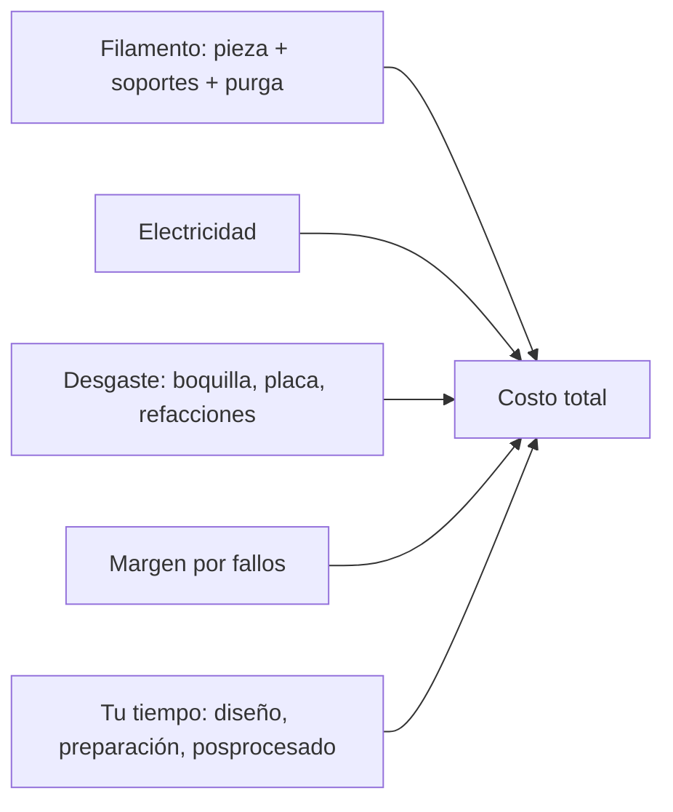

# Costeo de una impresión 3D

Parte de: [[36-Impresion-3D/07 Comunidad, licencias y costos/_Índice Comunidad, licencias y costos|Comunidad, licencias y costos]]

> [!info] Cómo avanzar
> `progreso`: **pendiente** → **viendo** (estudiando) → **visto** (contestaste la autoevaluación sin abrir las respuestas) → **dominado** (hiciste el laboratorio o lo aplicaste de verdad).

## Contenido

### Qué es
**Costear** una impresión es calcular cuánto te cuesta realmente producir una pieza: no solo el filamento, también la purga, la electricidad, el desgaste, los fallos y (si vendes) tu tiempo. Sirve para decidir si vale la pena imprimir algo, para comparar opciones (una pieza multicolor vs. pintarla) y para poner precio si algún día vendes.

### Cómo funciona


**1. Filamento.** El laminador te da los **gramos** estimados por filamento al laminar (y en multicolor, cuánto se va en purga y torre). Fórmula:
```text
costo filamento = gramos × (precio del carrete ÷ 1000 g)
(Ejemplo) 45 g de PLA a $400 por kg → 45 × 0.40 = $18.00
```
**Multicolor**: la purga cuenta igual que la pieza.
```text
(Ejemplo) 60 g de pieza + 35 g de purga a $450 por kg
total = 95 g × 0.45 = $42.75
desperdicio = 35 ÷ 95 ≈ 36.8 % del filamento usado
(la purga equivale al 58 % del peso de la pieza)
```

**2. Electricidad.**
```text
energía (kWh) = potencia promedio (kW) × horas
(Ejemplo) 150 W durante 5 h = 0.15 kW × 5 h = 0.75 kWh
a una tarifa de ejemplo de $1.50 por kWh → 0.75 × 1.50 ≈ $1.13
```
El consumo promedio real de tu impresora depende de la temperatura de la cama, del cuarto y del material (Pendiente de confirmar con un medidor de enchufe). Tu tarifa real está en tu recibo de luz; la de este ejemplo es solo ilustrativa.

**3. Tiempo de impresión aproximado.** Si conoces el volumen y el flujo medio real:
```text
(Ejemplo) 30 cm³ = 30,000 mm³ ÷ 10 mm³/s = 3,000 s = 50 min
```
En la práctica, el laminador da un estimado mejor porque incluye movimientos, aceleraciones y cambios de color.

**4. Desgaste y fallos.** Boquillas, placas y refacciones se gastan; algunas impresiones fallan. Una forma simple es agregar un **margen** (por ejemplo 10 %):
```text
(Ejemplo) filamento $18 + luz $1.13 = $19.13
con 10 % de margen por fallos → 19.13 × 1.10 ≈ $21.04
```

**5. Tu tiempo** (si vendes): diseño, laminado, retirar soportes, lijar, pintar, empacar. Suele ser el costo más grande.

### Ejemplo
Quieres hacer 10 llaveros de "Wee.Reporteria" para tu equipo. En lugar de calcular a mano cada vez, armas una hoja de cálculo en Excel (como en tus reportes) con columnas: gramos de pieza, gramos de purga, precio por kg, horas, watts, tarifa, margen. Comparas dos diseños: con el texto en las últimas capas (poca purga) y con el texto atravesando la pieza (mucha purga). El primero cuesta casi la mitad en filamento. Ver [[Impresión multicolor (pintar colores y torre de purga)]].

### Cómo medir mejor tus números
- **Gramos reales**: pesa la pieza (y la purga, si la juntas) en una báscula de cocina y compárala con el estimado del laminador; así sabes qué tan confiable es.
- **Consumo real**: un medidor de enchufe te dice cuántos kWh gastó una impresión completa, incluido el calentamiento inicial de la cama.
- **Precio por kg**: divide el precio del carrete entre su peso neto (algunos traen 1 kg, otros 750 g o 250 g).
- **Tasa de fallos**: lleva la cuenta en tu bitácora; si 1 de cada 10 impresiones falla, un margen del 10 % es razonable.

### Cuándo usar el costeo
- Antes de piezas grandes o multicolor.
- Al comparar materiales (PLA vs. PETG) o métodos (multicolor vs. pintar).
- Siempre que cobres o regales en volumen.

### Errores comunes
1. **Cobrar solo el filamento.** Olvidas electricidad, fallos y tu tiempo; en multicolor la purga puede pesar más que la pieza.
2. **Ignorar soportes y brim**: también son filamento.
3. **Usar el precio de oferta** de un carrete como si fuera el normal.
4. **No contar reimpresiones**: la primera versión casi nunca es la final.
5. **Inventar la tarifa eléctrica**: usa la de tu recibo.

### Para profundizar
- [OrcaSlicer wiki: torre de purga (reducir desperdicio)](https://www.orcaslicer.com/wiki/printer_settings/multimaterial/printer_multimaterial_wipe_tower)
- Práctica: [[Lab 5 - Pieza en 4 colores con CANVAS minimizando purga]]

## Ejercicios

Resuélvelos en papel o en la herramienta; la solución está plegada.

> [!question]- (Ejemplo) Pieza de 45 g de PLA a $400 por kg. ¿Costo del filamento?
> 45 / 1000 × 400 = **$18**. (Precio por kg de *ejemplo*; usa el de tu carrete.)

> [!question]- (Ejemplo) Una figura multicolor: 60 g de pieza + 35 g de purga, filamento a $450 por kg. ¿Costo y % de desperdicio?
> 95 g × 0.45 = **$42.75**. Desperdicio = 35/95 ≈ **36.8 %**.

> [!question]- (Ejemplo) Impresión de 5 h con consumo promedio de 150 W y tarifa de ejemplo de $1.50 por kWh. ¿Costo eléctrico?
> 0.150 kW × 5 h = 0.75 kWh × 1.50 = **$1.13**. (Consumo y tarifa de ejemplo; el consumo real de la Centauri 2 (Pendiente de confirmar).)

> [!question]- (Ejemplo) Pieza de 30 cm³ con flujo medio real de 10 mm³/s. ¿Tiempo aproximado?
> 30 cm³ = 30,000 mm³ / 10 = 3,000 s = **50 min** (sin contar calentamiento, viajes ni cambios de color).

> [!question]- (Ejemplo) Costo total: filamento $18, luz $1.13, 10 % de margen por fallos. ¿Total?
> (18 + 1.13) × 1.10 = **$21.04**.

## Autoevaluación

Contesta primero en voz alta o en papel; luego despliega la respuesta.

> [!question]- ¿Qué entra en el costo de una impresión?
> Filamento (pieza + soportes + purga), electricidad, desgaste (boquillas, placa), fallos/reimpresiones y, si vendes, tu tiempo de diseño y posprocesado.

> [!question]- ¿De dónde saco los gramos?
> El laminador muestra gramos y tiempo estimados por filamento después de laminar; en multicolor muestra también lo que se va en purga.

> [!question]- Error común: cobrar solo el filamento.
> Olvidas electricidad, fallos y tu tiempo; en multicolor la purga puede pesar más que la pieza.

## Práctica

- [[Lab 5 - Pieza en 4 colores con CANVAS minimizando purga]]

