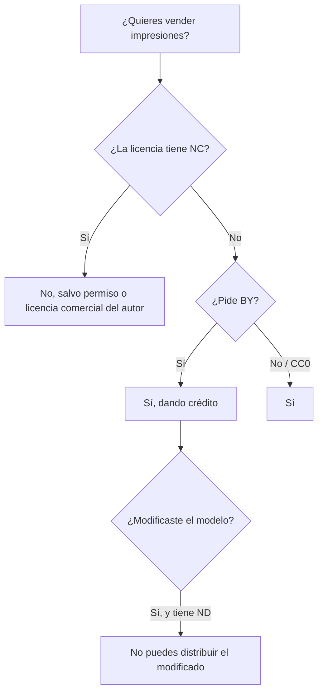

# Licencias de modelos 3D (Creative Commons y uso comercial)

Parte de: [[36-Impresion-3D/07 Comunidad, licencias y costos/_Índice Comunidad, licencias y costos|Comunidad, licencias y costos]]

> [!info] Cómo avanzar
> `progreso`: **pendiente** → **viendo** (estudiando) → **visto** (contestaste la autoevaluación sin abrir las respuestas) → **dominado** (hiciste el laboratorio o lo aplicaste de verdad).

## Contenido

### Qué es
Cuando descargas un modelo 3D, el archivo sigue siendo **obra de su autor**, protegida por derechos de autor. La **licencia** dice qué puedes hacer con él: imprimirlo, modificarlo, compartirlo o venderlo. En los repositorios, la mayoría usa licencias **Creative Commons (CC)**; otros usan licencias propias del sitio o del autor.

> Esta nota es orientación general, no asesoría legal. Para un negocio, consulta a un abogado de propiedad intelectual.

### Cómo funciona
Las licencias Creative Commons se arman combinando cuatro condiciones:

| Sigla | Nombre | Significa |
|---|---|---|
| **BY** | Atribución | Debes dar **crédito** al autor (nombre, enlace, licencia) |
| **NC** | No comercial | **No** puedes usarlo con fines comerciales |
| **SA** | Compartir igual | Si haces un derivado, debes compartirlo con la **misma licencia** |
| **ND** | Sin derivados | **No** puedes distribuir versiones modificadas |

Combinaciones comunes: **CC BY**, **CC BY-SA**, **CC BY-NC**, **CC BY-NC-SA**, **CC BY-ND**, **CC BY-NC-ND**. Además existe **CC0**, con la que el autor renuncia a sus derechos en la medida que la ley lo permite (casi dominio público).

**Puntos finos:**
- "Comercial" incluye vender impresiones, usarlas para promocionar un negocio o regalarlas como parte de un servicio pagado.
- Muchos autores venden **licencias comerciales** aparte (membresías o pagos por modelo) aunque el archivo sea gratuito con NC.
- Algunos sitios tienen licencias propias con reglas distintas a CC: lee la que aparece en la página del modelo.
- La licencia cubre el **modelo**, no lo que representa: un modelo CC de un personaje famoso no te da derechos sobre el personaje. Ver [[Personajes y marcas registradas en impresión 3D]].

### Ejemplo
Encuentras un organizador para cables con licencia **CC BY-NC-SA**. Puedes imprimirlo para ti, modificarlo y compartir tu versión (con crédito al autor original y con la misma licencia), pero **no** venderlo. Otro modelo de soporte para cámara tiene **CC BY**: puedes vender impresiones, siempre que des crédito (por ejemplo, en la descripción del producto o en una tarjeta).

Para tus propios diseños (por ejemplo, piezas para tu equipo de foto), puedes elegir tú la licencia al publicarlos: si quieres que otros los usen libremente pero no los vendan, CC BY-NC.

### Cuándo revisar la licencia
- **Siempre** antes de vender, regalar en volumen o publicar un remix.
- Al publicar tus modelos: elige una licencia a propósito, no la que el sitio ponga por defecto.

### Errores comunes
1. **"Es gratis descargarlo, entonces puedo venderlo."** Descarga gratuita no es permiso comercial.
2. **Olvidar el crédito** en licencias BY.
3. **Remezclar un modelo ND** y publicarlo.
4. **Cambiar la licencia** de un derivado SA.
5. **Asumir que todos los sitios usan CC**: lee la licencia de cada modelo.

### Para profundizar
- [Creative Commons — sobre las licencias](https://creativecommons.org/share-your-work/cclicenses/)
- [Creative Commons — licencias](https://creativecommons.org/licenses/)
- [INDAUTOR — Instituto Nacional del Derecho de Autor (México)](https://www.gob.mx/indautor)

## Autoevaluación

Contesta primero en voz alta o en papel; luego despliega la respuesta.

> [!question]- ¿Qué significan BY, NC, SA y ND en Creative Commons?
> **BY**: dar crédito al autor. **NC**: no comercial. **SA**: compartir derivados con la misma licencia. **ND**: no hacer derivados.

> [!question]- ¿Puedo vender impresiones de un modelo CC BY-NC?
> No, salvo permiso del autor (algunos venden licencias comerciales aparte).

> [!question]- Error común: «es gratis descargarlo, entonces puedo venderlo».
> Descarga gratuita no es permiso comercial; revisa la licencia de cada modelo.

