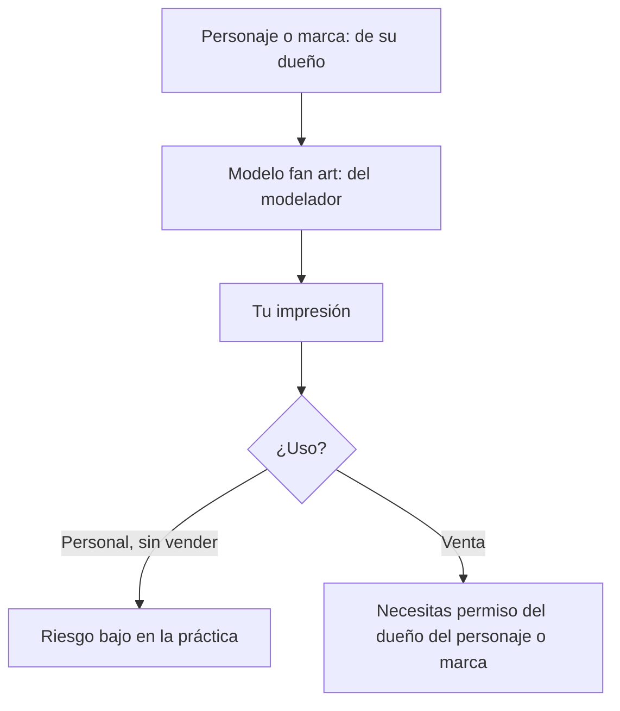

# Personajes y marcas registradas en impresión 3D

Parte de: [[36-Impresion-3D/07 Comunidad, licencias y costos/_Índice Comunidad, licencias y costos|Comunidad, licencias y costos]]

> [!info] Cómo avanzar
> `progreso`: **pendiente** → **viendo** (estudiando) → **visto** (contestaste la autoevaluación sin abrir las respuestas) → **dominado** (hiciste el laboratorio o lo aplicaste de verdad).

## Contenido

### Qué es
Muchos modelos populares son **fan art**: personajes de películas, videojuegos, anime o logotipos de marcas. Aunque el modelo lo haya hecho un aficionado, el **personaje** y la **marca** pertenecen a sus dueños. Esto importa sobre todo si quieres **vender** lo que imprimes.

> Orientación general, no asesoría legal. Las reglas varían por país; en México intervienen el derecho de autor (INDAUTOR) y la propiedad industrial (IMPI). Para un negocio, consulta a un abogado.

### Cómo funciona
Hay dos capas de protección distintas:

| Protección | Qué cubre | Ejemplo |
|---|---|---|
| **Derecho de autor** | Obras creativas: personajes, diseños, ilustraciones, esculturas | El diseño de un personaje de videojuego |
| **Marca registrada** | Nombres, logotipos y signos que identifican productos o servicios | El logo de una marca de autos o un equipo de futbol |

Y una tercera capa: el **modelo 3D** en sí también tiene derechos de su autor.

**Puntos clave:**
- El autor de un modelo fan art **no puede darte derechos** sobre un personaje que no es suyo. Aunque el modelo diga CC BY, eso solo cubre su trabajo de modelado, no el personaje.
- Vender figuras de personajes sin licencia es riesgoso: los dueños pueden pedir que retires productos de tiendas en línea, cerrar cuentas o reclamar legalmente.
- El uso personal (imprimir para tu escritorio) es otra situación; no implica que el modelo se vuelva tuyo.
- Algunas empresas tienen programas de licencia oficial o permiten ciertos usos de aficionados; revisa sus políticas oficiales.

### Ejemplo
Quieres vender figuras en una feria. Opciones:
1. **Personaje de anime descargado** → no lo vendas sin licencia, aunque el modelo sea CC.
2. **Diseñas tu propio personaje**, por ejemplo una mascota tipo ajolote inspirada en tus proyectos Xolotl → es tuyo; puedes venderlo y licenciarlo como quieras (cuida que no sea una copia de algo existente).
3. **Compras modelos con licencia comercial** a un autor que es dueño de su personaje original.
4. **Licencias oficiales**: algunas plataformas y marcas ofrecen modelos licenciados para imprimir; revisa los términos exactos.

Para tu uso personal, imprimir un personaje para tu escritorio y fotografiarlo con tu Sony a6700 está bien, siempre que no lo comercialices ni publiques el archivo como propio.

### Cuándo preocuparte
- Si vendes, aunque sea poco o "solo a amigos".
- Si publicas un modelo de un personaje o marca ajena con licencia que permita uso comercial.
- Si usas logotipos de marcas en productos.

### Errores comunes
1. **"El modelo es CC, entonces puedo vender el personaje."** La licencia del modelo no cubre el personaje.
2. **Cambiar un poco el personaje** y creer que ya es tuyo: las obras derivadas siguen dependiendo del original.
3. **Usar logotipos de marcas** en productos a la venta.
4. **Confiar en que "todos lo hacen"** en tiendas en línea: las cuentas se cierran por reclamos.
5. **No guardar evidencia** de licencias que sí compraste.

### Para profundizar
- [IMPI — Instituto Mexicano de la Propiedad Industrial](https://www.gob.mx/impi)
- [INDAUTOR — Instituto Nacional del Derecho de Autor](https://www.gob.mx/indautor)
- Relacionado: [[Licencias de modelos 3D (Creative Commons y uso comercial)]]

## Autoevaluación

Contesta primero en voz alta o en papel; luego despliega la respuesta.

> [!question]- ¿Puedo vender figuras de personajes famosos que imprimo?
> Generalmente no: los personajes y logotipos están protegidos por derechos de autor y marcas. Para uso personal es otra situación, pero venderlos sin licencia es riesgoso.

> [!question]- ¿Un modelo de fan art con licencia CC me da derecho a venderlo?
> No. El autor del modelo no puede darte derechos sobre un personaje que no es suyo.

> [!question]- ¿Qué hacer si quieres vender figuras?
> Diseña personajes propios, compra licencias oficiales o usa modelos cuyo autor sea dueño de la propiedad intelectual y permita venta.

