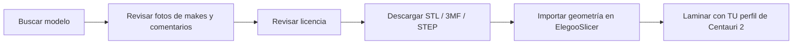

# Repositorios de modelos (Printables, MakerWorld y Thingiverse)

Parte de: [[36-Impresion-3D/07 Comunidad, licencias y costos/_Índice Comunidad, licencias y costos|Comunidad, licencias y costos]]

> [!info] Cómo avanzar
> `progreso`: **pendiente** → **viendo** (estudiando) → **visto** (contestaste la autoevaluación sin abrir las respuestas) → **dominado** (hiciste el laboratorio o lo aplicaste de verdad).

## Contenido

### Qué es
Los **repositorios de modelos** son sitios donde la comunidad publica modelos 3D listos para imprimir, casi siempre gratis (algunos de pago). Además de descargar, puedes ver fotos de impresiones reales de otros usuarios (*makes*), leer comentarios y, a veces, bajar proyectos 3MF con ajustes de impresión. Son la forma más rápida de empezar antes de diseñar tus propias piezas.

### Cómo funciona

| Sitio | De quién es | Características |
|---|---|---|
| **Printables** | Prusa Research | Comunidad grande, concursos, buena búsqueda, muchas piezas funcionales |
| **MakerWorld** | Bambu Lab | Muchos 3MF con perfiles listos (pensados para impresoras Bambu), modelos multicolor |
| **Thingiverse** | UltiMaker | El más antiguo; enorme catálogo, calidad variable |
| **Nexprint** | Elegoo | Plataforma de modelos de Elegoo; ElegooSlicer importa modelos desde ahí |

**Cómo elegir un buen modelo para empezar:**
1. **Makes con fotos**: si otras personas lo imprimieron con éxito, es buena señal. Evita modelos sin ninguna impresión reportada.
2. **Comentarios**: avisos de medidas mal, piezas que no encajan o ajustes recomendados.
3. **Instrucciones**: orientación sugerida, soportes, material y tornillería.
4. **Formatos**: STEP si quieres modificar medidas; 3MF si trae partes y colores. Ver [[Archivos para imprimir (STL, 3MF, OBJ y STEP)]].
5. **Licencia**: qué puedes hacer con él; ver [[Licencias de modelos 3D (Creative Commons y uso comercial)]].
6. **Autor**: perfiles con muchos modelos bien valorados suelen ser confiables.

### Ejemplo
Buscas un soporte de escritorio para tu DJI Osmo Pocket. En Printables encuentras tres opciones; eliges la que tiene 40 makes con fotos, comentarios que confirman que la medida es correcta y un STEP incluido. Descargas, importas en ElegooSlicer, revisas orientación y soportes y laminas con tu perfil de Centauri 2 y tu PLA calibrado. Al terminar, subes tu propio *make* con foto: ayudas a la comunidad y, en algunos sitios, ganas puntos o recompensas.

Para un modelo multicolor de MakerWorld, descargas el 3MF y reasignas cada color a una ranura de tu CANVAS antes de laminar.

### Cuándo usarlos y cuándo diseñar
- **Repositorio**: piezas comunes (organizadores, soportes genéricos, figuras, pruebas de calibración).
- **Diseñar**: piezas que dependen de medidas exactas de tus cosas o que no existen todavía.
- **Remix**: partir de un modelo con licencia que lo permita y ajustarlo.

### Errores comunes
1. **Descargar un 3MF de otra marca y mandarlo tal cual.** El perfil puede ser de otra impresora (por ejemplo una Bambu). Importa solo la geometría y lamina con el perfil de tu Centauri 2.
2. **Ignorar los comentarios** y descubrir después que la pieza no encaja.
3. **Imprimir modelos sin makes** cuando estás empezando.
4. **No revisar la licencia** si piensas vender o publicar remixes.
5. **Bajar archivos de sitios de dudosa procedencia** (ejecutables, "packs" raros): solo modelos de repositorios conocidos.

### Para profundizar
- [Printables](https://www.printables.com/)
- [MakerWorld](https://makerworld.com/)
- [Thingiverse](https://www.thingiverse.com/)
- [Elegoo lanza Nexprint (anuncio oficial)](https://www.elegoo.com/en-gb/blogs/news/elegoo-launches-nexprint-an-open-source-3d-model-platform-for-global-creators)

## Autoevaluación

Contesta primero en voz alta o en papel; luego despliega la respuesta.

> [!question]- ¿Qué son y para qué los uso?
> Sitios para descargar modelos gratis (y algunos de pago). Printables (Prusa), MakerWorld (Bambu Lab) y Thingiverse son de los más usados; Elegoo tiene Nexprint, integrado con ElegooSlicer.

> [!question]- ¿Cómo elegir un buen modelo para empezar?
> Revisa fotos de impresiones reales (*makes*), comentarios y que tenga instrucciones o 3MF con perfil. Evita modelos sin ninguna impresión reportada.

> [!question]- Error común: descargar un 3MF de otra marca y mandarlo tal cual.
> El perfil puede ser de otra impresora. Importa la geometría y lamina con el perfil de tu Centauri 2.

