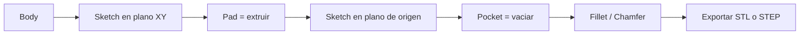

# FreeCAD

Parte de: [[37-Modelado-3D-Tecnico/01 Programas gratuitos/_Índice Programas gratuitos|Programas gratuitos]]

> [!info] Cómo avanzar
> `progreso`: **pendiente** → **viendo** (estudiando) → **visto** (contestaste la autoevaluación sin abrir las respuestas) → **dominado** (hiciste el laboratorio o lo aplicaste de verdad).

## Contenido

### Qué es
FreeCAD es un modelador 3D **paramétrico** de código abierto (licencia LGPL) para Windows, Mac y Linux. No pide cuenta, no tiene planes de pago ni límites de documentos y funciona sin internet: tus archivos `.FCStd` viven en tu disco y los puedes versionar en Git como cualquier otro artefacto. La serie actual es la **1.1** (salió en marzo de 2026 y la 1.1.2 en julio de 2026); desde la 1.0 trae ensambles integrados y mitigó buena parte del problema de nombres topológicos. Para ti es la opción "privada y sin letras chiquitas" frente a [[Onshape (plan gratuito)]] y [[Fusion (licencia personal)]].

### Cómo funciona
FreeCAD se organiza en **workbenches** (bancos de trabajo): cada uno es un juego de herramientas. Para piezas imprimibles usarás casi siempre tres:

- **Part Design**: modelado de sólidos por operaciones (*features*) dentro de un **Body**.
- **Sketcher**: bocetos 2D con restricciones (ver [[Bocetos, restricciones y cotas]]).
- **Spreadsheet**: una hoja de cálculo cuyas celdas, con **alias**, se usan como variables en cualquier cota.

El árbol del modelo es un historial: cada operación toma como entrada la anterior. Si cambias el boceto base, FreeCAD recalcula todo lo de arriba. Ese recalculado es la fuerza del paramétrico y también su punto débil: si una operación se apoyó en "la cara 6" y al recalcular esa cara ya es otra, la operación se rompe. Eso es el **problema de nombres topológicos**. La defensa es apoyar los bocetos en los **planos de origen** (XY, XZ, YZ) o en planos de referencia (*Datum Plane*) definidos con valores, no en caras generadas.

### Ejemplo
Placa para fijar un hub USB bajo el escritorio, pensada para la [[Elegoo Centauri 2 Combo]] (boquilla de 0.4 mm):

1. Workbench **Spreadsheet** → nueva hoja. En A1 escribe `largo`, en B1 `90` y dale alias `largo` (clic derecho → Propiedades → Alias). Igual con `ancho = 40`, `pared = 1.68` (4 líneas de 0.42) y `tornillo = 3.4`.
2. **Part Design** → *Create body* → *Create sketch* en XY. Dibuja un rectángulo, restríngelo simétrico al origen y en la cota del largo escribe `=Spreadsheet.largo`.
3. **Pad** de 4 mm. Nuevo boceto en XY con dos círculos de `=Spreadsheet.tornillo` y **Pocket** "Through all".
4. **Chamfer** de 0.5 mm en las aristas inferiores (compensa la pata de elefante).
5. Selecciona el Body → *File → Export* → STL, ábrelo en [[ElegooSlicer y OrcaSlicer]].

Cambia `largo` a 110 en la hoja y verás que todo se actualiza solo: así pruebas variantes sin redibujar.

### Práctica en tu Centauri 2
Haz la placa anterior, imprímela en PLA con 3 perímetros y 15 % de relleno y mide con el calibrador si los agujeros de Ø3.4 dejan pasar un tornillo M3. Anota la diferencia entre lo diseñado y lo medido: es tu primer dato de [[Tolerancias y holguras para piezas que encajan]].

### Cuándo usarlo y cuándo no
Úsalo cuando quieras archivos **locales y privados**, sin depender de una cuenta ni de que cambien las condiciones de una licencia gratuita, o cuando te guste automatizar: FreeCAD tiene consola de Python y macros. No es la mejor opción para empezar si quieres la curva de aprendizaje más suave: la interfaz es menos pulida que Onshape o Fusion y los tutoriales a veces corresponden a versiones viejas (0.19–0.21). Para una pieza de 10 minutos, [[Tinkercad]]; para piezas generadas por código, [[OpenSCAD]].

### Errores comunes
- **Apoyar bocetos en caras del sólido**. Funciona hasta que cambias algo abajo. Usa planos de origen o *Datum Plane* con desfase numérico.
- **Bocetos sin restringir por completo**. En Sketcher, el boceto se pone verde cuando ya no tiene grados de libertad; si sigue blanco, se deformará al recalcular.
- **Varios Bodies sueltos sin querer**. Cada pieza imprimible debe ser un Body con un solo sólido continuo; si un Pad no toca al anterior, FreeCAD marca error de "multiple solids".
- **Seguir un tutorial de 0.19**. Los nombres de menús y el flujo de ensambles cambiaron en 1.0; filtra tutoriales por versión.

### Para profundizar
- [Sitio oficial de FreeCAD](https://www.freecad.org/)
- [Workbench Part Design (wiki oficial)](https://wiki.freecad.org/PartDesign_Workbench)
- [Workbench Spreadsheet (wiki oficial)](https://wiki.freecad.org/Spreadsheet_Workbench)
- [Problema de nombres topológicos (wiki oficial)](https://wiki.freecad.org/Topological_naming_problem)

## Autoevaluación

Contesta primero en voz alta o en papel; luego despliega la respuesta.

> [!question]- ¿Qué es FreeCAD y cuál es su condición de uso?
> Es un modelador paramétrico 3D de **código abierto**, multiplataforma (Windows, Mac y Linux), sin registro ni licencias de pago ([freecad.org](https://www.freecad.org/)). Funciona sin internet y tus archivos son locales (`.FCStd`), ideal para lo que no quieras público en Onshape.

> [!question]- ¿Qué *workbench* usas para piezas imprimibles y cómo se arma una pieza?
> **Part Design**: creas un **Body**, un **Sketch** en un plano, lo restringes por completo en **Sketcher** y lo conviertes en sólido con **Pad** (extruir) o **Pocket** (vaciar). Los parámetros van en una hoja de **Spreadsheet** con alias (`=Spreadsheet.pared`).

> [!question]- Error común: cambias un boceto de abajo y las operaciones de arriba se rompen. ¿Por qué?
> Es el problema de **nombres topológicos**: una operación quedó referida a una cara o arista que cambió de identidad. Mitígalo apoyando bocetos en **planos de origen** o en geometría de referencia (*datum*), no en caras generadas; las versiones 1.x de FreeCAD lo atenuaron, pero conviene la costumbre.

