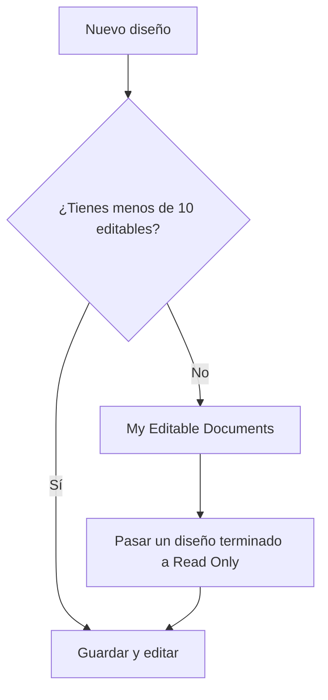

# Fusion (licencia personal)

Parte de: [[37-Modelado-3D-Tecnico/01 Programas gratuitos/_Índice Programas gratuitos|Programas gratuitos]]

> [!info] Cómo avanzar
> `progreso`: **pendiente** → **viendo** (estudiando) → **visto** (contestaste la autoevaluación sin abrir las respuestas) → **dominado** (hiciste el laboratorio o lo aplicaste de verdad).

## Contenido

### Qué es
Fusion (antes "Fusion 360") es el CAD paramétrico de Autodesk que combina diseño de sólidos, superficies, ensambles, dibujo, CAM y electrónica. Para hobbyistas existe la licencia **Fusion para uso personal**, gratuita, con condiciones que conviene conocer antes de invertir horas en ella. Es una app de escritorio para Windows y Mac que pide cuenta de Autodesk y guarda tus diseños en su nube; a diferencia de [[Onshape (plan gratuito)]], tus documentos **no son públicos**.

### Cómo funciona
**Condiciones de la licencia personal** (página oficial de Autodesk, revisada en noviembre de 2026):

- Solo para proyectos **personales, no comerciales y caseros**; no se permite en tu empleo principal, en empresas ni para capacitación comercial.
- Tus ingresos anuales relacionados deben ser **menores a 1,000 USD**; si los rebasas, toca pasar a una suscripción de pago.
- Es una **suscripción gratuita de 1 año**; la página no detalla cómo se renueva (Pendiente de confirmar).
- Funciones limitadas: CAM, dibujos 2D, electrónica, tipos de importación y exportación, administración de datos de un solo usuario y soporte solo en el foro.
- **Máximo 10 documentos editables** a la vez. Solo cuentan los diseños, dibujos y PCB de Fusion; los proyectos son ilimitados y las imágenes, PDF u hojas de cálculo no cuentan.

Cuando llegas a 10 de 10 puedes seguir trabajando en esos diez, pero no puedes guardar uno nuevo ni volver editable uno de solo lectura. Para liberar un lugar, en el panel de datos abres el filtro **My Editable Documents** y cambias un diseño terminado a **Read Only**. Queda en su proyecto y lo puedes abrir para verlo cuando quieras.

El flujo de modelado es el clásico: **Sketch** con restricciones → **Extrude / Revolve / Sweep / Loft** → **Fillet / Chamfer / Shell** → exportar. Los parámetros se definen en *Modify → Change Parameters* y se usan por nombre en cualquier cota (`largo - 2 * pared`).

### Ejemplo
Organiza tus documentos como organizas ramas en Azure DevOps: pocos activos, el resto archivados. Un esquema práctico:

| Estado | Ejemplos | Editable |
|---|---|---|
| En diseño | soporte del [[DJI Mic Mini 2]], caja de electrónica | Sí |
| Plantillas que reutilizas | caja paramétrica, galga de tolerancias | Sí |
| Terminados e impresos | adaptador de manguera v3 | Read Only |

Antes de pasar algo a solo lectura, exporta el **STEP** (para poder abrirlo en FreeCAD u Onshape) y el **STL/3MF** final. Así tu respaldo no depende de la licencia.

### Práctica en tu Centauri 2
Modela en Fusion una tapa con labio para una caja de 60 × 40 mm usando parámetros `pared = 1.68` y `holgura = 0.2`. Expórtala, imprímela con su caja y luego cambia el diseño a **Read Only**: comprueba que libera un lugar en el contador.

### Cuándo usarlo y cuándo no
Elige Fusion si quieres archivos privados, una app de escritorio con mucho material de aprendizaje en español e inglés, y te bastan 10 documentos activos. No lo elijas si piensas vender diseños o piezas por encima del tope, si quieres independencia total de una empresa (usa [[FreeCAD]]) o si prefieres no tener límites de documentos y no te importa que sean públicos (usa Onshape). Las condiciones de la licencia gratuita han cambiado varias veces desde 2020: revísalas cada año al renovar.

### Errores comunes
- **Llenar los 10 lugares con pruebas**. Haz bocetos rápidos en un solo documento de "pruebas" o en [[Tinkercad]].
- **No exportar STEP de lo terminado**. Si cambian las condiciones, te quedas con diseños que no puedes editar en otro programa.
- **Usarlo para un encargo pagado**. Rompe la licencia aunque sea "solo una pieza"; para eso existe la suscripción comercial.
- **Cotas con números fijos** en lugar de parámetros: pierdes la ventaja del paramétrico (ver [[Parámetros y diseño por variables]]).

### Para profundizar
- [Fusion para uso personal (Autodesk)](https://www.autodesk.com/products/fusion-360/personal)
- [El límite de 10 documentos explicado (blog de Autodesk)](https://www.autodesk.com/products/fusion-360/blog/the-10-document-limit-for-personal-use-explained-in-7-steps/)
- [Cambios a Fusion para uso personal (blog de Autodesk)](https://www.autodesk.com/products/fusion-360/blog/changes-to-fusion-360-for-personal-use/)

## Autoevaluación

Contesta primero en voz alta o en papel; luego despliega la respuesta.

> [!question]- ¿Qué límites tiene Fusion para uso personal?
> Según Autodesk: solo para proyectos **caseros y no comerciales**; máximo **10 documentos editables** a la vez (los demás quedan en solo lectura e ilimitados; [explicación](https://www.autodesk.com/products/fusion-360/blog/the-10-document-limit-for-personal-use-explained-in-7-steps/)); exportar **STL** y **STEP** sigue disponible ([blog](https://www.autodesk.com/products/fusion-360/blog/changes-to-fusion-360-for-personal-use/)); funciones de CAM y dibujos limitadas. La duración y forma de renovación de la licencia y el tope de ingresos actual: (Pendiente de confirmar). Es app de escritorio (Windows y Mac) y pide cuenta.

> [!question]- Llegaste a 10 documentos editables y quieres empezar otro. ¿Qué haces?
> Cambias un documento terminado a **Read Only** desde el filtro *My Editable Documents*; eso libera un lugar. Puedes seguir abriéndolo para verlo cuando quieras.

> [!question]- ¿Cuándo elegirías Fusion en lugar de Onshape gratis?
> Cuando quieres archivos **no públicos** y una app de escritorio con mucho material de aprendizaje, y te bastan 10 documentos activos. Si quieres algo sin límites y no te importa que sea público, Onshape; si quieres local y libre, FreeCAD.

