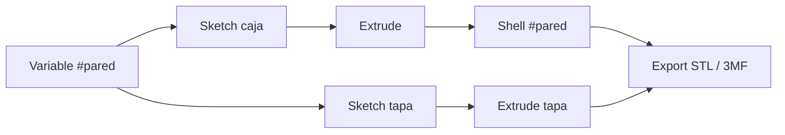

# Onshape (plan gratuito)

Parte de: [[37-Modelado-3D-Tecnico/01 Programas gratuitos/_Índice Programas gratuitos|Programas gratuitos]]

> [!info] Cómo avanzar
> `progreso`: **pendiente** → **viendo** (estudiando) → **visto** (contestaste la autoevaluación sin abrir las respuestas) → **dominado** (hiciste el laboratorio o lo aplicaste de verdad).

## Contenido

### Qué es
Onshape es un CAD paramétrico profesional que corre **completo en el navegador** (también hay app para iPhone y iPad). Su plan **Free** está pensado para hobbyistas y makers: tiene las mismas herramientas de modelado que el plan de pago, pero con dos condiciones clave: es solo para **uso no comercial** y **todo lo que creas es público**. Para soportes, cajas y repuestos personales que vas a imprimir en tu [[Elegoo Centauri 2 Combo]], es probablemente la mejor relación potencia/costo.

### Cómo funciona
**Condiciones del plan Free** (página oficial, revisada en noviembre de 2026):

- Uso **no comercial**: proyectos personales y de código abierto.
- **Documentos públicos**: cualquiera puede verlos y copiarlos (no editarlos).
- Sin *release management* (versiones formales con aprobación) ni render fotorrealista.
- La página no menciona límites de cantidad de documentos ni de almacenamiento.

Que sea público significa que no debes subir nada confidencial: piezas del trabajo, medidas de un producto ajeno o algo que pienses vender. A cambio, puedes copiar y estudiar miles de documentos públicos de otros.

Dentro de un **documento** hay pestañas. Las importantes:

- **Part Studio**: donde modelas. Puede contener varias piezas que comparten bocetos y variables, ideal para caja y tapa.
- **Feature list** (lista de operaciones): el historial a la izquierda. Se reejecuta de arriba a abajo cada vez que cambias algo, como un script.
- **Variables**: se crean con la operación *Variable* (`#pared = 1.68 mm`) y se usan en cualquier cota: `#largo - 2 * #pared`. También existe el *Variable Studio* para compartirlas entre Part Studios.
- **Assembly**: para unir piezas con *mates* y revisar que se muevan (ver [[Ensambles y uniones en CAD]]).

Exportas cada pieza con clic derecho → **Export** (STL, 3MF, STEP, entre otros). El historial completo queda en la nube con versiones automáticas: puedes regresar a cualquier punto como en Git.

### Ejemplo
Caja para el [[DJI Mic Mini 2]] con su receptor:

1. Crea variables: `#largo = 70 mm`, `#ancho = 45 mm`, `#alto = 25 mm`, `#pared = 1.68 mm`, `#holgura = 0.2 mm`.
2. Sketch en *Top*: rectángulo centrado en el origen con cotas `#largo` y `#ancho`. Extrude `#alto`.
3. **Shell** quitando la cara superior con grosor `#pared`.
4. Nuevo sketch para la tapa con cotas `#largo - 2 * #pared - 2 * #holgura`: el labio entra en la caja.
5. Exporta las dos piezas y lamínalas en [[ElegooSlicer y OrcaSlicer]].

Es exactamente el flujo del [[Lab 1 - Caja con tapa a presión en Onshape]].

### Práctica en tu Centauri 2
Antes de imprimir la caja completa, crea una **configuración** o duplica el Part Studio con `#alto = 6 mm` e imprime solo el anillo del encaje. Prueba holguras de 0.15, 0.2 y 0.25 cambiando una sola variable; registra cuál cierra bien.

### Cuándo usarlo y cuándo no
Úsalo si quieres CAD serio sin instalar nada, sin límites de documentos y te parece bien que tus diseños sean públicos; además funciona igual en cualquier PC con navegador. No lo uses para nada confidencial o comercial; para eso, [[FreeCAD]] (local y libre) o [[Fusion (licencia personal)]] (privado, con 10 documentos editables). Si te pasas a Free desde un plan de pago, los documentos privados que ya tenías quedan en solo lectura.

### Errores comunes
- **Subir medidas de algo del trabajo**. Público es público; revisa antes de crear el documento.
- **Una pieza por documento**. Pierdes el diseño en contexto: caja y tapa van en el mismo Part Studio.
- **Cotas con números fijos**. Usa variables; cambiar la holgura debe tomar segundos.
- **Esperar que funcione sin internet**. Todo vive en la nube; sin conexión no puedes modelar.

### Para profundizar
- [Plan Free de Onshape (oficial)](https://www.onshape.com/en/products/free)
- [Preguntas frecuentes de planes y suscripciones](https://cad.onshape.com/help/Content/Plans/subscriptions_and_payment_faqs.htm)
- [Onshape Learning Center (cursos gratuitos)](https://learn.onshape.com/)

## Autoevaluación

Contesta primero en voz alta o en papel; luego despliega la respuesta.

> [!question]- ¿Cuáles son las condiciones del plan gratuito de Onshape?
> Según Onshape ([plan Free](https://www.onshape.com/en/products/free)): es para la comunidad **hobbyista y maker**, para **uso no comercial**, y **todos los documentos son públicos** (cualquiera los puede ver y copiar, pero no editar; [FAQ](https://cad.onshape.com/help/Content/Plans/subscriptions_and_payment_faqs.htm)). Tiene las mismas funciones CAD que el plan Professional, pero sin gestión de versiones formales (*release management*) ni render fotográfico. Corre en el navegador.

> [!question]- ¿Qué implica que tus documentos sean públicos?
> Que no debes subir nada que no quieras compartir: piezas de tu trabajo, medidas de algo confidencial o un diseño que pienses vender. Para tus soportes, cajas y repuestos personales no es problema. Si ya tienes documentos privados y te pasas a Free, quedan en solo lectura.

> [!question]- ¿Qué son el *Part Studio*, la lista de operaciones y las variables en Onshape?
> El **Part Studio** es donde modelas piezas; la **lista de operaciones** (*Feature list*) es el historial que se recalcula si cambias algo; las **variables** (`#pared`, `#holgura`) se crean con la operación *Variable* y se usan en cualquier cota, p. ej. `#largo - 2 * #pared`. Para ti, es como un programa que se reejecuta.

## Práctica

- [[Lab 1 - Caja con tapa a presión en Onshape]]

