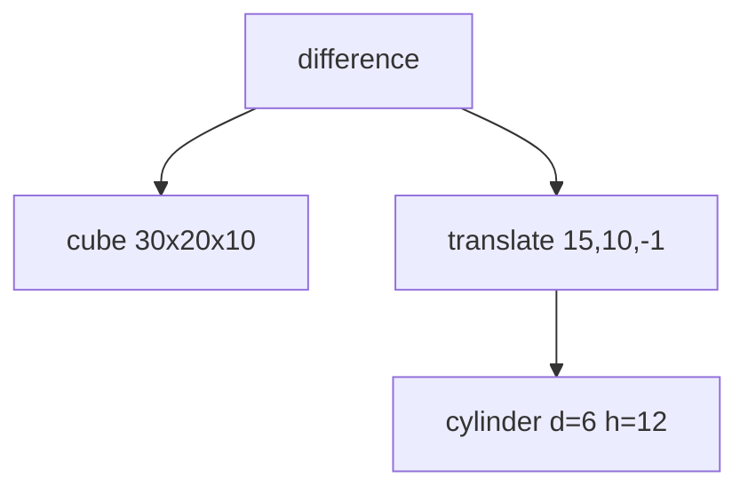

# OpenSCAD

Parte de: [[37-Modelado-3D-Tecnico/01 Programas gratuitos/_Índice Programas gratuitos|Programas gratuitos]]

> [!info] Cómo avanzar
> `progreso`: **pendiente** → **viendo** (estudiando) → **visto** (contestaste la autoevaluación sin abrir las respuestas) → **dominado** (hiciste el laboratorio o lo aplicaste de verdad).

## Contenido

### Qué es
OpenSCAD es un modelador 3D **por código**: escribes un script que describe sólidos primitivos (`cube`, `cylinder`, `sphere`, `polygon`), los transformas (`translate`, `rotate`, `scale`) y los combinas con operaciones booleanas (`union`, `difference`, `intersection`). Al compilar obtienes una malla que exportas a STL o 3MF. Es software libre para Windows, Mac y Linux. Como desarrollador te va a resultar natural: tus piezas son **funciones con parámetros**, se versionan en Git, se revisan en un *pull request* y no hay clics que repetir.

### Cómo funciona
El modelo se basa en **CSG** (*Constructive Solid Geometry*): todo es un árbol de sólidos y operaciones.



Puntos clave del lenguaje:

- **Es declarativo, no imperativo**. Las variables se resuelven al compilar; en un mismo ámbito vale la **última** asignación. `x = 1; x = x + 1;` no "suma": genera un aviso y no hace lo que esperas. Para acumular usa listas por comprensión (`[for (i = [0:3]) i * 10]`) o funciones recursivas.
- **Módulos** (`module`) generan geometría; **funciones** (`function`) devuelven valores. Es tu equivalente a métodos `void` y métodos con `return`.
- **Ángulos en grados**: `cos(30)`, no radianes.
- `$fn` controla cuántos lados tiene un círculo. `$fn = 6` da un hexágono **inscrito**: el diámetro que le pasas es entre vértices.
- **Customizer**: si declaras variables antes del primer `module` con un comentario de rango (`largo = 120; // [40:5:250]`), en *Ventana → Customizer* aparecen como deslizadores.
- `F5` hace una vista previa rápida; `F6` el render completo, necesario para exportar. Las versiones de desarrollo (*nightly*) traen el motor **Manifold**, que se activa en Preferencias y acelera muchísimo el render. La versión estable es antigua; para trabajar a diario conviene la *nightly* (verifica en la página de descargas).

### Ejemplo
Separador paramétrico para un cajón, listo para tu impresora:

```openscad
// Parámetros (salen en el Customizer)
largo = 120;     // [40:5:250]
ancho = 80;      // [30:5:200]
alto  = 30;      // [10:5:80]
n     = 3;       // [1:1:8]
pared = 1.68;    // 4 líneas de 0.42 mm
div   = 1.26;    // 3 líneas
chaflan = 0.5;   // contra la pata de elefante

function ancho_comp(total, pared, n, div) = (total - 2*pared - (n - 1)*div) / n;

module caja() {
  difference() {
    cube([largo, ancho, alto]);
    translate([pared, pared, pared]) cube([largo - 2*pared, ancho - 2*pared, alto]);
  }
}

module divisiones() {
  w = ancho_comp(largo, pared, n, div);
  for (k = [1 : n - 1])
    translate([pared + k*w + (k - 1)*div, 0, 0]) cube([div, ancho, alto - 2]);
}

caja();
if (n > 1) divisiones();
echo(str("Compartimento: ", ancho_comp(largo, pared, n, div), " mm"));
```

Con los valores por defecto la consola dice `Compartimento: 38.04 mm`. Cambia `n` a 4 en el Customizer y obtienes otra versión sin tocar el código.

### Práctica en tu Centauri 2
Exporta el separador con `alto = 10` (versión de prueba, rápida), imprímelo en PLA y verifica con calibrador el ancho de los compartimentos contra el `echo`. Después usa `hull()` o `minkowski()` para redondear las esquinas interiores y compara el tiempo de render con y sin Manifold.

### Cuándo usarlo y cuándo no
Ideal para piezas **geométricas y paramétricas**: organizadores, cajas, galgas, adaptadores, cualquier cosa que quieras generar en varias medidas o compartir para que otros la ajusten. No es bueno para formas orgánicas, redondeos complejos entre superficies o piezas donde necesitas "tocar" una arista concreta; ahí conviene un CAD con historial como [[Onshape (plan gratuito)]] o [[FreeCAD]], o [[Blender - interfaz, navegación y modos|Blender]] para lo artístico.

### Errores comunes
- **Caras coincidentes en un `difference`**: si el cilindro mide exactamente lo que la pieza, queda una piel o caras raras. Haz que el sustraendo sobresalga (`-0.01` abajo y `+0.02` de alto).
- **Pensar imperativo**: reasignar variables o querer un contador en un `for`.
- **`$fn` global muy alto**: renders lentos. Ponlo por objeto (`$fn = 64` en cilindros visibles) o usa `$fa`/`$fs`.
- **Hexágonos mal dimensionados**: olvidar que `d` es entre vértices; entre caras = `d * cos(30)`.

### Para profundizar
- [Sitio oficial de OpenSCAD](https://openscad.org/)
- [Documentación oficial](https://openscad.org/documentation.html)
- [Cheat sheet oficial](https://openscad.org/cheatsheet/)
- [Descargas (estable y nightly)](https://openscad.org/downloads.html)

## Ejercicios

Resuélvelos en papel o en la herramienta; la solución está plegada.

> [!question]- Escribe un módulo `hueco_tuerca(af, h, holgura)` que reste el alojamiento hexagonal de una tuerca dada su medida entre caras planas (`af`).
> Un cilindro con `$fn = 6` es un hexágono **inscrito** en el diámetro: el diámetro es entre **vértices**. Entre caras = `d·cos(30°)`, así que `d = af / cos(30)` (OpenSCAD usa grados).
> ```openscad
> module hueco_tuerca(af, h, holgura = 0.2) {
>   cylinder(d = (af + holgura) / cos(30), h = h, $fn = 6);
> }
> // Tuerca M3 (5.5 mm entre caras): d ≈ 6.58
> hueco_tuerca(5.5, 2.6);
> ```

> [!question]- Escribe un módulo `galga(d, holguras)` que imprima una placa con agujeros de `d + holgura` para cada valor de la lista y un perno de Ø`d`, con el valor grabado.
> ```openscad
> module galga(d = 8, holguras = [0.1, 0.2, 0.3, 0.4, 0.5], paso = 14, h = 5) {
>   n = len(holguras);
>   difference() {
>     cube([n * paso, paso + 6, h]);
>     for (k = [0 : n - 1]) {
>       translate([paso/2 + k*paso, paso/2, -0.01])
>         cylinder(d = d + holguras[k], h = h + 0.02, $fn = 64);
>       translate([paso/2 + k*paso, paso + 3, h - 0.6])
>         linear_extrude(1) text(str(holguras[k]), size = 3, halign = "center", valign = "center");
>     }
>   }
>   translate([paso/2, -paso/2, 0]) cylinder(d = d, h = h + 10, $fn = 64);  // perno de prueba
> }
> galga();
> ```
> Imprímela con el perfil que usarás de verdad y anota en qué agujero el perno entra justo, deslizante y flojo (complementa la [[Prueba de tolerancias]]).

> [!question]- Escribe una función que devuelva el ancho de cada compartimento: `ancho_comp(total, pared, n, div)`; ¿cuánto da para 120 mm, pared 1.6, 3 compartimentos y divisiones de 1.2?
> ```openscad
> function ancho_comp(total, pared, n, div) = (total - 2*pared - (n - 1)*div) / n;
> echo(ancho_comp(120, 1.6, 3, 1.2));  // ECHO: 38.1333
> ```
> (120 − 3.2 − 2.4) / 3 = **38.13 mm**.

## Autoevaluación

Contesta primero en voz alta o en papel; luego despliega la respuesta.

> [!question]- ¿Qué es OpenSCAD y por qué te va a gustar como programador?
> Es un modelador 3D **por código**: escribes un script que describe sólidos y operaciones booleanas (CSG) y lo compilas a una malla. Es software libre para Windows, Mac y Linux ([openscad.org](https://openscad.org/)). Diseño paramétrico puro: tus piezas son funciones con parámetros, versionables en Git.

> [!question]- ¿Qué hace este código?
```openscad
difference() {
  cube([30, 20, 10]);
  translate([15, 10, -1]) cylinder(d = 6, h = 12, $fn = 48);
}
```
> Un bloque de 30 × 20 × 10 mm con un agujero pasante de Ø6 mm en el centro. El cilindro empieza en `z = -1` y mide 12 para **sobresalir** por ambos lados: si coincidiera exacto con las caras, la resta deja una "piel" o caras dudosas.

> [!question]- Error común de programador: `x = 1; x = x + 1;`. ¿Qué pasa?
> OpenSCAD no es imperativo: las variables se resuelven al compilar y en un mismo ámbito vale **la última asignación** (con aviso). No hay acumuladores en un `for`; usa listas por comprensión (`[for (i=[0:3]) i*10]`), funciones recursivas o `sum` hecho a mano.

> [!question]- ¿Cómo haces que tus variables salgan como deslizadores?
> Declaras las variables **antes del primer `module`** con un comentario de rango: `largo = 120; // [40:5:250]` y abres **Ventana → Customizer**. Para exportar: `F6` (render completo) y luego *Archivo → Exportar* a STL o 3MF. Las versiones de desarrollo traen el motor **Manifold**, mucho más rápido ([descargas](https://openscad.org/downloads.html)).

## Práctica

- [[Lab 2 - Organizador paramétrico en OpenSCAD]]
- [[Lab 3 - Bisagra impresa en su lugar]]

