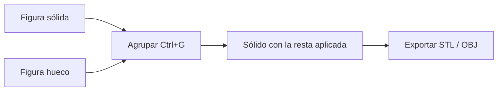

# Tinkercad

Parte de: [[37-Modelado-3D-Tecnico/01 Programas gratuitos/_Índice Programas gratuitos|Programas gratuitos]]

> [!info] Cómo avanzar
> `progreso`: **pendiente** → **viendo** (estudiando) → **visto** (contestaste la autoevaluación sin abrir las respuestas) → **dominado** (hiciste el laboratorio o lo aplicaste de verdad).

## Contenido

### Qué es
Tinkercad es una app web gratuita de Autodesk para diseño 3D por bloques: arrastras figuras básicas (cubos, cilindros, texto, conos), las conviertes en **sólidos** o **huecos** (*holes*), las agrupas y el hueco resta del sólido. No requiere instalar nada, corre en el navegador y pide una cuenta. Si ya sabes programar, no será tu herramienta principal, pero sirve para piezas rápidas de 10 minutos, para revisar una idea antes de pasarla a un CAD paramétrico o para enseñarle a alguien a diseñar.

### Cómo funciona
Todo es **CSG con el mouse**:

Herramientas clave:

- **Plano de trabajo** (*Workplane*): la cuadrícula en mm donde colocas figuras. Con la herramienta *Plano de trabajo* (`W`) lo pegas a cualquier cara para poner figuras encima.
- **Cotas**: al seleccionar una figura aparecen manijas; haz clic en el número para escribir la medida exacta.
- **Alinear** (`L`): centra o alinea varias figuras entre sí.
- **Regla**: mide distancias entre objetos y bordes.
- **Agrupar** (`Ctrl+G`) / **Desagrupar** (`Ctrl+Shift+G`): aplica las restas y uniones.
- **Duplicar y repetir** (`Ctrl+D`): duplica y repite la última transformación; es lo más parecido a un patrón.
- **Exportar**: STL, OBJ o glTF para impresión.

No hay historial paramétrico real: si quieres cambiar la pared de 2 a 1.6 mm, ajustas a mano cada figura. Por eso conviene para piezas que no vas a modificar mucho.

### Ejemplo
Caja de 60 × 40 × 30 mm con pared de 2 mm y piso de 2 mm:

1. Arrastra una **caja** y escribe 60 × 40 × 30.
2. Arrastra otra caja, cámbiala a **Hueco** y ponle 56 × 36 × 30 (60 − 2·2, 40 − 2·2).
3. Súbela **2 mm** en Z (la flecha negra de arriba) para que quede el piso.
4. Selecciona ambas, **Alinear** (`L`) y centra en X e Y.
5. `Ctrl+G`. Mide con la **Regla** que las paredes queden de 2 mm.
6. Agrega un texto en relieve de 0.6 mm en una cara lateral si quieres etiquetarla.
7. **Exportar → .STL** y abre en [[ElegooSlicer y OrcaSlicer]].

Nota de impresión: 2 mm con línea de 0.42 caben 4 perímetros (1.68) más un hueco pequeño; si quieres paredes perfectas, usa 1.68 (ver [[Grosor de pared y relleno según la carga]]).

### Práctica en tu Centauri 2
Diseña un llavero de 50 × 20 × 3 mm con tu nombre en relieve de 0.8 mm y un agujero de Ø4. Exporta la base y el texto como **dos STL** (agrupa cada uno por separado) y en el laminador asígnales colores distintos para probar el CANVAS: cambio de color solo en las capas del texto, con muy poca purga.

### Cuándo usarlo y cuándo no
**Sí**: llaveros, letreros, piezas simples de una sola vez, prototipos de forma, enseñar a niños o a alguien sin experiencia. **No**: piezas con encajes que vas a iterar (holguras), cosas que quieres en varias medidas, piezas con redondeos y chaflanes bien controlados o ensambles móviles. Ahí te conviene [[OpenSCAD]] (te va a gustar por ser código) o [[Onshape (plan gratuito)]].

### Errores comunes
- **Olvidar agrupar**: el hueco se ve transparente en pantalla, pero en el STL no resta nada; el laminador imprime el bloque macizo.
- **Huecos que no atraviesan**: si el hueco mide exactamente el alto de la pieza, puede quedar una piel; hazlo un poco más alto.
- **Medidas "a ojo" con las manijas**: escribe siempre el valor numérico.
- **Paredes delgadas en texto o detalles** menores a 0.8 mm: el laminador las omite. Revisa la vista previa por capas.

### Para profundizar
- [Qué es Tinkercad (centro de ayuda)](https://www.tinkercad.com/help-center/what-is-tinkercad)
- [Tutoriales oficiales de Tinkercad](https://www.tinkercad.com/learn)

## Autoevaluación

Contesta primero en voz alta o en papel; luego despliega la respuesta.

> [!question]- ¿Qué es Tinkercad y para qué te sirve si ya sabes programar?
> Es una app web de Autodesk para diseño 3D por bloques: juntas figuras **sólidas** y **huecos** (*holes*), las agrupas y el hueco resta. Autodesk la describe como "una app web gratuita" ([qué es Tinkercad](https://www.tinkercad.com/help-center/what-is-tinkercad)). Te sirve para una pieza rápida en 10 minutos o para enseñarle a alguien; para piezas que vas a modificar muchas veces, OpenSCAD u Onshape te dan parámetros reales.

> [!question]- ¿Cómo haces un agujero en Tinkercad?
> Pones un cilindro, lo cambias a **Hueco**, lo colocas sobre el sólido, seleccionas ambos y das **Agrupar** (`Ctrl+G`). Error común: olvidar agrupar; el hueco se ve transparente pero en el STL no resta nada.

> [!question]- Caso: quieres una caja de 60 × 40 mm con pared de 2 mm. ¿Cómo la armas?
> Caja sólida de 60 × 40 × alto; caja **hueco** de 56 × 36 × (alto) subida 2 mm (piso); usa **Alinear** (`L`) para centrarlas y agrupa. Revisa las medidas con la **Regla** de Tinkercad. Exporta en STL para [[ElegooSlicer y OrcaSlicer]].

