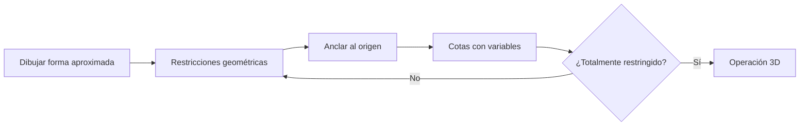

# Bocetos, restricciones y cotas

Parte de: [[37-Modelado-3D-Tecnico/02 Modelado paramétrico/_Índice Modelado paramétrico|Modelado paramétrico]]

> [!info] Cómo avanzar
> `progreso`: **pendiente** → **viendo** (estudiando) → **visto** (contestaste la autoevaluación sin abrir las respuestas) → **dominado** (hiciste el laboratorio o lo aplicaste de verdad).

## Contenido

### Qué es
Un **boceto** (*sketch*) es un dibujo 2D sobre un plano que después conviertes en sólido (extruir, revolucionar, vaciar). En CAD paramétrico, el boceto no es un dibujo "a mano alzada": cada línea, arco y punto queda definido por **restricciones** (relaciones geométricas sin número) y **cotas** (valores). Cuando ya no queda ningún grado de libertad, el boceto está **totalmente restringido** y se comporta de forma predecible al cambiar una medida. Es la base de todo lo demás en [[Onshape (plan gratuito)]], [[FreeCAD]] y [[Fusion (licencia personal)]].

### Cómo funciona
Piensa en el boceto como un sistema de ecuaciones: cada punto tiene 2 grados de libertad (x, y), cada línea 4, cada círculo 3. Cada restricción o cota quita uno o más. El *solver* del CAD resuelve el sistema cada vez que cambias algo.

**Restricciones** (sin número):

| Restricción | Uso típico |
|---|---|
| Horizontal / vertical | lados de un rectángulo |
| Coincidente | unir extremos, poner un punto sobre el origen |
| Paralela / perpendicular | ranuras, escuadras |
| Tangente | unir un arco con una línea sin quiebre |
| Igual | dos agujeros del mismo diámetro |
| Simétrica | centrar respecto a una línea o al origen |
| Punto medio | centrar un punto en una arista |

**Cotas** (con número o expresión): largo 60 mm, radio 3 mm, ángulo 45°, distancia entre centros `#largo - 10`.

El orden recomendado: primero **restricciones** (la forma), luego **anclaje** al origen (dónde vive) y al final **cotas** (cuánto mide). Cada programa colorea el estado: en Onshape las líneas pasan de azul a negro; en FreeCAD el boceto se pone verde y el panel dice "Fully constrained"; en Fusion las líneas quedan negras y aparece un candado en el navegador.

### Ejemplo
Perfil de una placa de 60 × 40 con dos agujeros para tornillo M3, centrada en el origen:

1. Rectángulo por el centro (*Center rectangle*): ya trae horizontales, verticales y simetría al origen.
2. Cotas: `60` y `40` (o mejor `#largo` y `#ancho`).
3. Dos círculos: restricción **Igual** entre ambos, **Horizontal** entre sus centros y **Simétrica** respecto al eje Y.
4. Cotas: diámetro `3.4`, distancia entre centros `#largo - 12`, distancia del centro al borde inferior `6`.
5. Verifica que todo esté negro/verde. Extruye 4 mm.

Si ahora cambias `#largo` a 80, la placa crece hacia ambos lados, sigue centrada y los agujeros se mantienen a 6 mm del borde.

### Práctica en tu Centauri 2
Dibuja este perfil totalmente restringido, extrúyelo 3 mm e imprímelo. Luego cambia `#largo` a 80, vuelve a imprimir y confirma con regla que ambos agujeros siguen a la misma distancia del borde. Si algo se movió distinto, te faltaba una restricción.

### Cuándo usarlo y cuándo no
Siempre que modeles en un CAD con historial, restringe por completo. La excepción razonable: un boceto de referencia para calcar una foto (ver [[Medir piezas e ingeniería inversa]]), que puede quedar suelto porque no genera geometría. Si no quieres lidiar con restricciones, la alternativa es [[OpenSCAD]], donde cada medida ya es una expresión, o [[Tinkercad]] para piezas sin cambios.

### Errores comunes
- **Rectángulo sin anclar**: al cambiar el largo, crece hacia un solo lado o "se escapa". Ánclalo al origen con simetría o punto medio.
- **Bocetos sobrecargados**: redondeos, chaflanes y patrones dibujados en el boceto. Deja el perfil simple y agrega esos detalles como operaciones 3D (ver [[Chaflanes, redondeos, vaciado y patrones]]); se editan mejor y fallan menos.
- **Sobre-restringir**: poner una cota que contradice otra. El CAD avisa en rojo; quita la redundante en vez de forzar.
- **Cotas en cadena**: medir cada agujero respecto al anterior acumula errores de diseño; acota respecto a una referencia común (el origen o un borde).

### Para profundizar
- [Sketcher Workbench (wiki de FreeCAD)](https://wiki.freecad.org/Sketcher_Workbench)
- [Onshape Learning Center: cursos de bocetos](https://learn.onshape.com/)

## Autoevaluación

Contesta primero en voz alta o en papel; luego despliega la respuesta.

> [!question]- ¿Qué es un boceto *totalmente restringido* y por qué importa?
> Uno donde cada línea y punto tiene posición definida por **restricciones** (horizontal, coincidente, tangente, igual, simétrico…) y **cotas**; ya no tiene grados de libertad. En FreeCAD y Onshape se ve en negro. Importa porque al cambiar una cota todo se mueve de forma predecible; si quedó suelto, se deforma al recalcular.

> [!question]- ¿Restricción o cota? Da un ejemplo de cada una.
> **Restricción**: relación geométrica sin número (dos líneas paralelas, un círculo tangente a una línea, un punto sobre el origen). **Cota**: un valor (largo 60 mm, radio 3 mm, ángulo 45°). Primero restricciones, luego cotas.

> [!question]- Caso: tu rectángulo de 60 × 40 se escapa del centro al cambiar el largo. ¿Qué le falta?
> Anclarlo: restricción de **simetría** de dos esquinas opuestas respecto al **origen** (o punto medio coincidente con el origen). Así crece hacia ambos lados y queda centrado.

> [!question]- Error común: bocetos con mucho detalle. ¿Qué conviene?
> Bocetos **simples** (un perfil por operación) y dejar redondeos, chaflanes y patrones como operaciones 3D. Son más fáciles de editar y fallan menos al recalcular.

## Práctica

- [[Lab 1 - Caja con tapa a presión en Onshape]]

