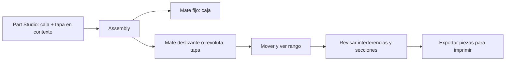

# Ensambles y uniones en CAD

Parte de: [[37-Modelado-3D-Tecnico/02 Modelado paramétrico/_Índice Modelado paramétrico|Modelado paramétrico]]

> [!info] Cómo avanzar
> `progreso`: **pendiente** → **viendo** (estudiando) → **visto** (contestaste la autoevaluación sin abrir las respuestas) → **dominado** (hiciste el laboratorio o lo aplicaste de verdad).

## Contenido

### Qué es
Un **ensamble** es un archivo donde colocas varias piezas y defines cómo se relacionan: cuáles están fijas, cuáles giran y cuáles se deslizan. Aunque imprimas las piezas por separado, el ensamble es tu **prueba virtual**: compruebas que encajan, que una bisagra abre lo que debe y que un tornillo pasa, antes de gastar filamento y horas de impresión.

### Cómo funciona
Cada programa llama distinto a las uniones, pero la idea es igual: una unión elimina grados de libertad entre dos piezas.

| Programa | Dónde | Nombre de la unión |
|---|---|---|
| [[Onshape (plan gratuito)]] | pestaña *Assembly* | *mates*: Fastened, Revolute, Slider, Cylindrical… |
| [[Fusion (licencia personal)]] | dentro del mismo diseño | *joints*: Rigid, Revolute, Slider… |
| [[FreeCAD]] 1.x | workbench *Assembly* | *joints*: Fixed, Revolute, Slider… |



Hay dos ideas que conviene separar:

1. **Diseño en contexto**: modelar piezas que dependen unas de otras en el **mismo Part Studio** (Onshape) o el mismo diseño (Fusion). La tapa toma sus medidas de la caja; si cambias la caja, la tapa se ajusta sola.
2. **Ensamble de verificación**: un documento aparte donde insertas las piezas y las unes con mates para moverlas.

Para piezas pequeñas de impresión, haz el modelado en contexto y usa el ensamble solo para revisar.

### Ejemplo
Caja con tapa abatible y bisagra de pasador de Ø3 mm:

1. En un Part Studio modela la caja y la tapa. Los nudillos de la bisagra de la tapa usan el mismo boceto que los de la caja, con un hueco de 0.3 mm (holgura de [[Holgura para piezas impresas en su lugar (print-in-place)|impresión en su lugar]]) o con agujero para un pasador de filamento de 1.75 mm.
2. En el *Assembly*: caja con **Fastened** al origen; tapa con **Revolute** sobre el eje del pasador.
3. Arrastra la tapa: debe abrir unos 100–110° sin chocar. Si choca antes, ajusta el chaflán del borde trasero.
4. Haz una **vista de sección** (*Section view*) por el centro de un nudillo y mide el hueco radial: debe ser igual a tu holgura en todo el contorno.
5. Revisa interferencias: en Fusion, *Inspect → Interference*; en Onshape, mide distancia mínima entre las piezas (herramienta *Measure*) o usa la sección.

### Práctica en tu Centauri 2
Modela una bisagra de dos hojas de 30 × 20 mm con 3 nudillos. Verifica en el ensamble que gire 180° sin interferencia y que la distancia mínima entre piezas sea ≥ 0.3 mm. Imprímela acostada en PLA y anota si gira suelta, justa o pegada; esa medida alimenta tu [[Prueba de tolerancias]].

### Cuándo usarlo y cuándo no
Úsalo cuando haya **movimiento** o **encajes entre varias piezas**: bisagras, cajones, tapas, engranes, soportes con articulación. Para una pieza única sin acoplamientos (un gancho, un separador) es trabajo de más. Si trabajas en [[OpenSCAD]], el equivalente es dibujar todas las piezas en su posición de uso con un parámetro `explotar = false` y verificar con `intersection()` que no se tocan.

```openscad
// Verificación rápida en OpenSCAD: si sale algo, hay interferencia
intersection() { caja(); tapa(); }
```

### Errores comunes
- **Piezas en documentos separados sin referencias**: cambias la caja y la tapa ya no encaja. Usa diseño en contexto.
- **Mates que dejan grados de libertad sueltos**: la pieza "flota" y crees que todo encaja. Revisa que cada pieza se mueva solo como debe.
- **Olvidar la holgura en el modelo**: el ensamble encaja perfecto porque diseñaste medidas exactas, pero impreso no entra. Holgura siempre en la geometría (ver [[Tolerancias y holguras para piezas que encajan]]).
- **Revisar solo en la posición cerrada**: algunos choques aparecen a mitad del recorrido; mueve la pieza en todo su rango.

### Para profundizar
- [Assembly Workbench (wiki de FreeCAD)](https://wiki.freecad.org/Assembly_Workbench)
- [Onshape Learning Center: ensambles](https://learn.onshape.com/)

## Autoevaluación

Contesta primero en voz alta o en papel; luego despliega la respuesta.

> [!question]- ¿Para qué haces un ensamble si vas a imprimir piezas sueltas?
> Para comprobar que las piezas **encajan** y se mueven antes de gastar filamento: interferencias, rango de giro de una bisagra, que un tornillo pase. En Onshape usa *Assembly* con **mates** (fijo, revoluta, deslizante); en Fusion, **joints**; en FreeCAD, el workbench **Assembly**.

> [!question]- Caso: diseñas caja y tapa. ¿Las modelas en el mismo Part Studio o en ensambles separados?
> En el **mismo Part Studio** (o mismo archivo) para que la tapa tome medidas de la caja (diseño en contexto) y cambien juntas. El ensamble lo usas después para verificar el cierre y detectar interferencias.

> [!question]- ¿Qué revisión de interferencia harías antes de imprimir?
> Medir la distancia mínima entre piezas que deben moverse (debe ser ≥ tu holgura) y usar la herramienta de interferencia o una sección (*section view*) para ver el hueco real.

## Práctica

- [[Lab 3 - Bisagra impresa en su lugar]]

