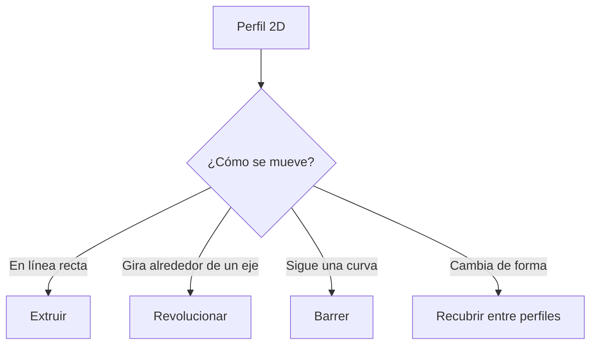

# Extruir, revolucionar, barrer y recubrir

Parte de: [[37-Modelado-3D-Tecnico/02 Modelado paramétrico/_Índice Modelado paramétrico|Modelado paramétrico]]

> [!info] Cómo avanzar
> `progreso`: **pendiente** → **viendo** (estudiando) → **visto** (contestaste la autoevaluación sin abrir las respuestas) → **dominado** (hiciste el laboratorio o lo aplicaste de verdad).

## Contenido

### Qué es
Son las cuatro operaciones que convierten un boceto 2D en un sólido 3D. Casi todas las piezas técnicas se arman combinándolas:

- **Extruir** (*extrude*, *Pad* en FreeCAD): empuja un perfil en línea recta. Placas, cajas, soportes.
- **Revolucionar** (*revolve*): gira un perfil alrededor de un eje. Perillas, tazas, ejes, adaptadores redondos.
- **Barrer** (*sweep*): mueve un perfil a lo largo de una trayectoria. Asas curvas, tubos doblados, roscas (con trayectoria helicoidal).
- **Recubrir** (*loft*): une dos o más perfiles distintos con una superficie suave. Transiciones de cuadrado a círculo, boquillas, embudos.

Cada una tiene su versión "de corte" (restar material) además de la de "agregar".

### Cómo funciona



- **Extruir** pide distancia (o "hasta una cara"), dirección y si es simétrico. Puedes agregar un ángulo de desmoldeo (*draft*), útil para paredes inclinadas.
- **Revolucionar** pide eje y ángulo (360° para una pieza completa). **Regla de oro**: el perfil debe quedar **todo de un lado del eje**; puede tocarlo, pero si lo cruza genera geometría inválida (el sólido se intersecta consigo mismo).
- **Barrer** pide perfil y trayectoria. El perfil debe ser más chico que el radio de curvatura de la trayectoria, si no, se pliega sobre sí mismo.
- **Recubrir** pide perfiles en planos distintos, en orden. Si los perfiles tienen distinto número de vértices, el CAD puede torcer la superficie; agrega puntos o usa guías.
- Para **roscas**, los CAD traen herramientas dedicadas (Thread en Fusion, Hole con rosca en FreeCAD y Onshape, o *features* de la comunidad en Onshape). Para tapas de frasco o roscas grandes es lo más práctico; ver [[Agujeros, roscas impresas, insertos y tuercas atrapadas]].

### Ejemplo
Adaptador de manguera de Ø20 a Ø12 mm (exterior), para imprimir en tu [[Elegoo Centauri 2 Combo]]:

- **Con revolución** de un perfil escalonado: la sección es un "medio adaptador" dibujado del lado derecho del eje, con paredes de 1.68 mm y una transición cónica a 45° (sin soportes si imprimes parado con el lado grande abajo).

En [[OpenSCAD]], `rotate_extrude()` es la revolución alrededor del eje Z; el `polygon` debe tener todas sus `x ≥ 0`:

```openscad
pared = 1.68;
// [x = radio, y = altura]; todo en x >= 0
perfil = [
  [10 - pared, 0], [10, 0], [10, 20],          // tramo Ø20
  [6, 24], [6, 44],                             // cono a 45° y tramo Ø12
  [6 - pared, 44], [6 - pared, 24 + 0.7],       // pared interior
  [10 - pared, 20 - 0.7]
];
rotate_extrude($fn = 128) polygon(perfil);
```

La transición baja 4 mm de radio en 4 mm de altura: 45° exactos.

### Práctica en tu Centauri 2
Imprime el adaptador parado (lado Ø20 en la cama), en [[PETG]] si va a llevar agua. Después modifica el perfil para que la transición sea un *loft* de 15 mm (más suave) y compara: la versión de 45° no necesita soportes; una de 30° respecto a la horizontal sí mostraría capas colgadas.

### Cuándo usarlo y cuándo no
- Pieza prismática → **extruir** (la mayoría de soportes y cajas).
- Simetría de revolución → **revolucionar**; es más estable y ligera que extruir círculos apilados.
- Trayectoria curva con sección constante → **barrer**.
- Sección que cambia de forma → **recubrir**; si solo cambia de tamaño (círculo a círculo), una revolución con cono es más sencilla.

### Errores comunes
- **Perfil que cruza el eje** al revolucionar: geometría inválida o error. Mueve el perfil para que quede de un solo lado.
- **Barrido con curva muy cerrada**: el perfil se autointersecta. Aumenta el radio de la trayectoria o achica el perfil.
- **Loft retorcido** por perfiles con distinto número de segmentos. Divide las curvas para que coincidan.
- **Bocetos abiertos**: extruir un perfil que no cierra da una superficie, no un sólido.

### Para profundizar
- [PartDesign Pad (wiki de FreeCAD)](https://wiki.freecad.org/PartDesign_Pad)
- [PartDesign Revolution (wiki de FreeCAD)](https://wiki.freecad.org/PartDesign_Revolution)
- [rotate_extrude en el manual de OpenSCAD](https://en.wikibooks.org/wiki/OpenSCAD_User_Manual/Using_the_2D_Subsystem)

## Autoevaluación

Contesta primero en voz alta o en papel; luego despliega la respuesta.

> [!question]- Explica en una línea cada operación.
> **Extruir**: empuja un perfil en línea recta (caja, placa). **Revolucionar**: gira un perfil alrededor de un eje (perilla, taza, eje). **Barrer** (*sweep*): mueve un perfil a lo largo de una trayectoria (asa curva, tubo). **Recubrir** (*loft*): une dos o más perfiles distintos (transición de cuadrado a círculo).

> [!question]- ¿Con cuál harías una tapa de frasco con rosca y con cuál un adaptador de manguera de Ø20 a Ø12?
> Rosca: **barrido helicoidal** (o la herramienta de rosca del programa). Adaptador: **revolución** de un perfil escalonado (o *loft* entre dos círculos si quieres transición cónica). En OpenSCAD: `rotate_extrude()` de un `polygon()`.

> [!question]- Error común al revolucionar. ¿Cuál?
> Que el perfil **cruce el eje** de giro: genera geometría inválida. El perfil debe estar todo de un lado del eje (puede tocarlo).

## Práctica

- [[Lab 1 - Caja con tapa a presión en Onshape]]

