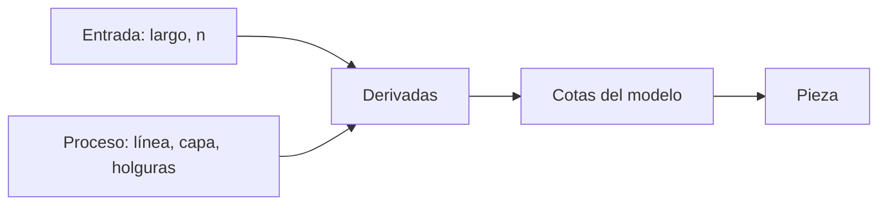

# Parámetros y diseño por variables

Parte de: [[37-Modelado-3D-Tecnico/02 Modelado paramétrico/_Índice Modelado paramétrico|Modelado paramétrico]]

> [!info] Cómo avanzar
> `progreso`: **pendiente** → **viendo** (estudiando) → **visto** (contestaste la autoevaluación sin abrir las respuestas) → **dominado** (hiciste el laboratorio o lo aplicaste de verdad).

## Contenido

### Qué es
**Diseñar por variables** es definir las medidas clave de una pieza (largo, ancho, pared, holgura, número de divisiones) como **variables con nombre** y hacer que todas las cotas dependan de ellas mediante expresiones. Es exactamente lo que haces en C# cuando evitas *números mágicos*: un cambio en un solo lugar se propaga a todo el modelo. Ganas iterar holguras en segundos, generar variantes (chico, mediano, grande) y reutilizar el diseño años después sin recordar "de dónde salió ese 37.4".

### Cómo funciona
Hay tres tipos de variables:

1. **De entrada**: lo que decide el usuario (`largo`, `n_compartimentos`).
2. **De proceso**: dependen de tu impresora y filamento (`linea = 0.42`, `capa = 0.2`, `holgura_desliza = 0.2`). Vienen de tu [[Prueba de tolerancias]].
3. **Derivadas**: se calculan (`interior = largo - 2 * pared`, `ancho_comp = ...`).



**Dónde se definen en cada programa**:

| Programa | Mecanismo |
|---|---|
| [[Onshape (plan gratuito)]] | operación *Variable* (`#pared`), *Variable Studio* para compartir y *Configurations* para variantes |
| [[FreeCAD]] | hoja **Spreadsheet** con alias: `=Spreadsheet.pared` |
| [[Fusion (licencia personal)]] | *Modify → Change Parameters* (parámetros de usuario) |
| [[OpenSCAD]] | variables del script; con comentario de rango salen en el Customizer |

### Ejemplo
Organizador de cajón en OpenSCAD con variables separadas por tipo:

```openscad
// --- Entrada (Customizer) ---
largo = 150;          // [60:5:300]
ancho = 90;           // [40:5:200]
alto  = 40;           // [15:5:100]
min_comp = 30;        // ancho mínimo de compartimento

// --- Proceso (de tu calibración en la Centauri 2) ---
linea = 0.42;
capa  = 0.2;
holgura_presion = 0.1;
holgura_desliza = 0.2;

// --- Derivadas ---
pared = 4 * linea;                                  // 1.68
div   = 3 * linea;                                  // 1.26
interior = largo - 2 * pared;                       // 146.64
n = floor((interior + div) / (min_comp + div));     // cuántos caben
w = (interior - (n - 1) * div) / n;                 // ancho real
fondo = max(5 * capa, 1.0);                         // nunca menos de 5 capas

echo(n = n, w = w);
```

Con los valores de arriba, la consola da `n = 4` y `w ≈ 35.71 mm`. Si cambias `largo` a 200, el organizador se recalcula: `n = 6`, `w ≈ 31.72 mm`. Fíjate en `max()`: es una **guarda** para que el fondo nunca sea más delgado de lo imprimible, aunque alguien ponga un valor absurdo.

En Onshape, el mismo diseño se ve así en las cotas: `#largo - 2 * #pared` para el interior y `(#interior - (#n - 1) * #div) / #n` para cada compartimento.

### Práctica en tu Centauri 2
Imprime el organizador con `alto = 10` (versión rápida para comprobar medidas). Mide un compartimento con calibrador y compáralo contra el `echo`. Luego crea tres variantes cambiando solo `largo` y anota cuánto tarda cada una en el laminador.

### Cuándo usarlo y cuándo no
Siempre que la pieza encaje con algo, vaya a existir en varias medidas o la vayas a compartir. Para una pieza única y decorativa, pocas variables bastan; no conviertas cada cota en parámetro: deja como variables las medidas que **realmente** cambiarías y las de proceso.

### Errores comunes
- **Una sola `holgura` para todo**: un ajuste a presión, uno deslizante y uno impreso en su lugar necesitan valores distintos, y un agujero horizontal sale diferente que uno vertical. Usa `holgura_presion`, `holgura_desliza`, `holgura_pip`.
- **Mezclar holgura por lado y diametral**: nómbralas explícitas (`holgura_lado`) y aplica `2 * holgura_lado` al diámetro.
- **Variables sin unidades** en Onshape o Fusion: escribe `2 mm`, no `2`, para evitar que tome otra unidad.
- **Valores de proceso copiados de internet**: punto de partida, no verdad; mídelos en tu impresora.

### Para profundizar
- [Spreadsheet Workbench (wiki de FreeCAD)](https://wiki.freecad.org/Spreadsheet_Workbench)
- [Customizer en el manual de OpenSCAD](https://en.wikibooks.org/wiki/OpenSCAD_User_Manual/Customizer)
- [Onshape Learning Center](https://learn.onshape.com/)

## Ejercicios

Resuélvelos en papel o en la herramienta; la solución está plegada.

> [!question]- En Onshape tienes `#largo = 100 mm`, `#pared = 2 mm`, `#holgura = 0.2 mm`. Escribe la expresión del largo exterior del labio de la tapa que entra en la caja.
> Interior de la caja: `#largo - 2 * #pared` = 96 mm. El labio debe ser más chico por la holgura de cada lado: `#largo - 2 * #pared - 2 * #holgura` = **95.6 mm**.

> [!question]- Un organizador de 150 mm de largo, pared 2 mm, divisiones de 1.2 mm. ¿Cuántos compartimentos de al menos 30 mm caben?
> n·30 + (n − 1)·1.2 ≤ 150 − 4 = 146 → 31.2n ≤ 147.2 → n ≤ 4.7 → **4 compartimentos** de (146 − 3.6)/4 = **35.6 mm**.

> [!question]- Escribe en OpenSCAD una variable derivada para que el alto de la tapa nunca sea menor a 3 capas de 0.2 mm aunque el usuario ponga menos.
> ```openscad
> capa = 0.2;
> tapa_pedida = 0.4; // [0.2:0.2:3]
> tapa = max(tapa_pedida, 3 * capa);  // 0.6
> ```

## Autoevaluación

Contesta primero en voz alta o en papel; luego despliega la respuesta.

> [!question]- ¿Qué es diseñar por variables y qué ganas?
> Definir las medidas clave (largo, pared, holgura) como **variables** y que todas las cotas dependan de ellas. Ganas poder ajustar una tolerancia o tamaño en segundos y reutilizar el diseño. Es lo mismo que no usar *números mágicos* en C#.

> [!question]- ¿Dónde se definen en cada programa?
> **Onshape**: operación *Variable* (`#pared`) o *Variable Studio*; también *Configurations* para variantes. **FreeCAD**: hoja de **Spreadsheet** con alias. **Fusion**: *Modificar → Cambiar parámetros*. **OpenSCAD**: variables del script + Customizer.

> [!question]- Error común: una sola variable `holgura` para todo. ¿Por qué falla?
> Cada tipo de ajuste necesita su holgura (a presión, deslizante, giratorio, impreso en su lugar), y los agujeros verticales y horizontales salen distinto. Crea variables separadas: `holgura_presion`, `holgura_desliza`, `holgura_pip`.

## Práctica

- [[Lab 2 - Organizador paramétrico en OpenSCAD]]

