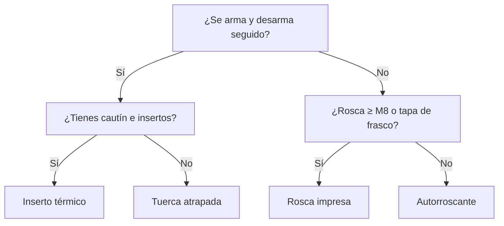

# Agujeros, roscas impresas, insertos y tuercas atrapadas

Parte de: [[37-Modelado-3D-Tecnico/03 Diseño para impresión 3D/_Índice Diseño para impresión 3D|Diseño para impresión 3D]]

> [!info] Cómo avanzar
> `progreso`: **pendiente** → **viendo** (estudiando) → **visto** (contestaste la autoevaluación sin abrir las respuestas) → **dominado** (hiciste el laboratorio o lo aplicaste de verdad).

## Contenido

### Qué es
Tarde o temprano una pieza impresa necesita un tornillo: para fijar una tapa, montar una placa o enroscarse en un tripié. El plástico impreso no retiene bien una rosca fina por sí solo, así que hay cuatro estrategias: **tornillo autorroscante** en un agujero un poco menor, **inserto térmico** de latón, **tuerca atrapada** en un alojamiento hexagonal y **rosca impresa** (solo para roscas grandes). Elegir bien define si la pieza aguanta armarse y desarmarse.

### Cómo funciona
**Por qué una rosca M3 impresa es mala idea**: el paso de una M3 es 0.5 mm, del orden del ancho de línea (0.42) y de la altura de capa (0.2). Los filetes salen deformados, con escalones y débiles. Las roscas impresas funcionan desde roscas grandes (alrededor de M8 en adelante) o en tapas de frasco con paso amplio.

| Opción | Cuándo | Diseño |
|---|---|---|
| Autorroscante | pocas veces de armado, cargas bajas | agujero algo menor que el tornillo (punto de partida a calibrar) y paredes gruesas alrededor |
| Inserto térmico | armar y desarmar muchas veces, sin acceso por detrás | hueco según la **ficha del fabricante del inserto**, con profundidad extra para el plástico desplazado |
| Tuerca atrapada | sin cautín ni insertos, tripiés 1/4"-20 | alojamiento hexagonal que impide que gire |
| Rosca impresa | ≥ M8 aprox., tapas de frasco | herramienta de rosca del CAD; holgura generosa |

**El hexágono en OpenSCAD**: `cylinder(d = ..., $fn = 6)` crea un hexágono **inscrito** en ese diámetro, así que `d` es la medida entre **vértices**. Las tuercas se especifican entre **caras planas** (*across flats*, `af`). La relación es `af = d · cos(30°)`, por lo tanto `d = (af + holgura) / cos(30)`.

**Orientación**: si el hexágono queda horizontal (eje del tornillo paralelo a la cama), un vértice abajo deja un techo plano colgado. Gíralo para que una **cara plana quede arriba**, o imprime con el eje vertical y usa una **pausa** en el laminador para meter la tuerca antes de que la capa siguiente la cubra.



### Ejemplo
Alojamiento para tuerca M8 (13 mm entre caras, 6.5 mm de alto) en una base para un rodillo:

```openscad
af = 13;          // M8: mide la tuya, varía por fabricante
h_tuerca = 6.5;
holgura = 0.2;

difference() {
  cylinder(d = 30, h = 12, $fn = 96);
  translate([0, 0, -1]) cylinder(d = 8.5, h = 14, $fn = 48);   // paso del tornillo
  translate([0, 0, 12 - h_tuerca - 0.2])
    cylinder(d = (af + holgura) / cos(30), h = h_tuerca + 1, $fn = 6);
}
echo(d_hex = (af + holgura) / cos(30));  // ≈ 15.24
```

El hexágono queda abierto por arriba (la tuerca entra desde la cara superior) y el eje es vertical, así que no hay techos colgados.

### Práctica en tu Centauri 2
Imprime una **galga de hexágonos** con `af` de tu tuerca y holguras de 0.1, 0.2 y 0.3 mm. Elige la que retiene la tuerca sin forzarla. Repite con el eje horizontal y cara plana arriba para ver la diferencia. Estos valores los usarás en el [[Lab 4 - Soporte de iPhone para tripié con tuerca atrapada]].

### Cuándo usarlo y cuándo no
- **Inserto térmico**: lo más profesional para cajas de electrónica y piezas que se abren seguido (ver [[Insertos térmicos, tornillería y pegado]]).
- **Tuerca atrapada**: barata, fuerte y perfecta para la rosca de tripié 1/4"-20 de tus accesorios de foto.
- **Autorroscante**: rápido, pero cada vez que lo quitas y pones el agujero se desgasta.
- **Rosca impresa**: tapas, frascos y roscas grandes; nunca para M3–M5.

### Errores comunes
- **Usar `af` como `d`**: el hexágono sale 15 % más chico y la tuerca no entra.
- **Tuerca horizontal con vértice abajo**: techo colgado, la tuerca no entra o el alojamiento se deforma.
- **Paredes delgadas alrededor de insertos o autorroscantes**: se agrietan entre capas. Deja al menos 2 veces el diámetro del tornillo de material alrededor y sube perímetros.
- **Copiar medidas de insertos de otra marca**: cada fabricante publica su agujero recomendado; úsalo.

### Para profundizar
- [Documentación oficial de OpenSCAD](https://openscad.org/documentation.html)
- [PartDesign Hole, con roscas y avellanados (wiki de FreeCAD)](https://wiki.freecad.org/PartDesign_Hole)

## Ejercicios

Resuélvelos en papel o en la herramienta; la solución está plegada.

> [!question]- Una tuerca 1/4"-20 mide 7/16" entre caras. ¿Cuánto es en mm y qué `d` pones en `cylinder(d=..., $fn=6)` con 0.2 de holgura?
> 7/16 · 25.4 = **11.11 mm**. `d = (11.11 + 0.2) / cos(30°)` = **13.06 mm**. (Mide tu tuerca: varía por fabricante.)

> [!question]- Escribe en OpenSCAD el alojamiento de una tuerca M3 (5.5 mm entre caras, 2.4 mm de alto) más el agujero del tornillo de Ø3.4 que atraviesa una placa de 6 mm.
> ```openscad
> difference() {
>   cube([20, 20, 6]);
>   translate([10, 10, -1]) cylinder(d = 3.4, h = 8, $fn = 32);
>   translate([10, 10, 6 - 2.6]) cylinder(d = (5.5 + 0.2) / cos(30), h = 3, $fn = 6);
> }
> ```
> La tuerca queda a ras de la cara superior (2.6 mm de alojamiento, 0.2 de margen).

> [!question]- ¿Por qué una rosca M3 impresa es mala idea y qué haces en su lugar?
> El paso (0.5 mm) es del orden del ancho de línea: la rosca sale deformada y débil. Usa agujero para autorroscante, inserto o tuerca atrapada.

## Autoevaluación

Contesta primero en voz alta o en papel; luego despliega la respuesta.

> [!question]- ¿Qué opciones tienes para atornillar en plástico impreso?
> 1) **Tornillo autorroscante** en un agujero un poco menor que el tornillo. 2) **Inserto térmico** de latón (ver [[Insertos térmicos, tornillería y pegado]]). 3) **Tuerca atrapada** en un alojamiento hexagonal. 4) **Rosca impresa**, solo para roscas grandes (≥ M8 aprox.) o tapas de frasco.

> [!question]- ¿Cuándo eliges inserto térmico y cuándo tuerca atrapada?
> Inserto: para armar y desarmar muchas veces con rosca fuerte en un lugar sin acceso por detrás. Tuerca atrapada: cuando no tienes cautín o insertos, o para roscas de tripié **1/4"-20**; el hexágono evita que gire.

> [!question]- ¿Cómo dimensionas el hueco para un inserto térmico?
> Con la **ficha del fabricante del inserto** (diámetro del agujero y profundidad recomendados); en general es menor que el diámetro exterior del inserto para que el plástico fundido lo agarre. Deja profundidad extra para el plástico que desplaza.

> [!question]- Error común con la tuerca atrapada horizontal. ¿Cuál?
> Que el hexágono quede con un vértice abajo y la parte de arriba sea un techo plano colgado. Orienta el hexágono con **cara plana arriba** (o pausa la impresión para meter la tuerca y que la capa siguiente la cubra).

## Práctica

- [[Lab 4 - Soporte de iPhone para tripié con tuerca atrapada]]

