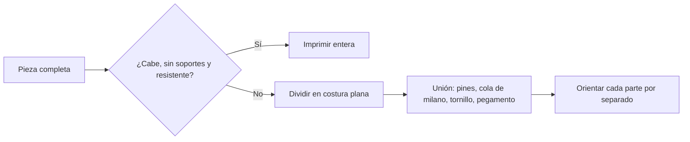

# Clips, bisagras impresas y piezas en varias partes

Parte de: [[37-Modelado-3D-Tecnico/03 Diseño para impresión 3D/_Índice Diseño para impresión 3D|Diseño para impresión 3D]]

> [!info] Cómo avanzar
> `progreso`: **pendiente** → **viendo** (estudiando) → **visto** (contestaste la autoevaluación sin abrir las respuestas) → **dominado** (hiciste el laboratorio o lo aplicaste de verdad).

## Contenido

### Qué es
Son las formas de **unir o articular** piezas impresas sin depender de tornillos:

- **Clip** (*snap-fit*): un brazo flexible con un gancho que se dobla al entrar y regresa para trabar.
- **Bisagra impresa**: dos piezas que giran sobre un eje, ya sea impresas juntas (ver [[Holgura para piezas impresas en su lugar (print-in-place)]]) o armadas con un pasador.
- **Piezas en varias partes**: dividir un diseño en piezas que se unen después con pines, cola de milano, tornillos o pegamento.

Bien diseñadas, hacen piezas más fuertes, más fáciles de imprimir y que se pueden armar y desarmar.

### Cómo funciona
**Clips en voladizo**: el brazo trabaja como una viga que se flexiona. La deformación se concentra en la **raíz**, así que ahí va un redondeo generoso. Para que no se rompa:

- El brazo debe flexionarse **a lo largo de las capas** (pieza acostada en la cama). Si el brazo es vertical, la flexión abre la unión entre capas y se quiebra al primer uso (ver [[Orientación de la pieza y resistencia por capas]]).
- **Largo y delgado** se dobla más sin romperse que corto y grueso. Como punto de partida, un brazo de 15–20 mm de largo con 1.5–2 mm de grosor en PLA; calíbralo.
- El gancho con rampa de entrada (30–45°) y cara de retención más vertical si no quieres que se suelte.
- **Material**: [[PLA]] es rígido y se fatiga rápido; para un clip que se abre muchas veces, [[PETG]] es más tenaz; para algo que se dobla mucho, [[TPU (filamento flexible)]].

**Bisagras**: la opción con pasador (filamento de 1.75 mm, clavo, tornillo M3) da más control que la impresa en su lugar. Los nudillos se imprimen con el eje horizontal; usa agujeros en forma de gota para que no se cuelguen.

**Dividir una pieza** cuando:
1. No cabe en la cama (la de tu [[Elegoo Centauri 2 Combo]] es de 256 × 256 × 256 mm).
2. Una sola orientación obliga a muchos soportes.
3. Cada zona necesita una orientación distinta para resistir su carga.
4. Quieres colores o materiales distintos por parte.



### Ejemplo
Clip de tapa para una caja de 60 × 40 mm, en OpenSCAD:

```openscad
largo_brazo = 18;  // flexión
grosor = 1.8;      // ~4 líneas de 0.42 + margen
ancho = 8;
gancho = 1.0;      // cuánto traba

module clip() {
  // brazo acostado: flexiona en el plano XY
  cube([largo_brazo, grosor, ancho]);
  // gancho con rampa de entrada
  translate([largo_brazo, 0, 0])
    linear_extrude(ancho) polygon([[0, 0], [0, grosor + gancho], [-2.5, grosor]]);
  // redondeo en la raíz para repartir esfuerzo
  translate([0, grosor, 0]) difference() {
    cube([1.5, 1.5, ancho]);
    translate([1.5, 1.5, -1]) cylinder(r = 1.5, h = ancho + 2, $fn = 32);
  }
}
clip();
```

El clip se imprime **acostado** (ancho en Z): la flexión ocurre en XY, a lo largo de las líneas.

### Práctica en tu Centauri 2
Imprime tres clips iguales en PLA: uno acostado, uno parado y uno en PETG acostado. Ábrelos y ciérralos 20 veces cada uno y anota cuál se rompe primero. Es la forma más rápida de entender la anisotropía y el efecto del material.

### Cuándo usarlo y cuándo no
Clips para tapas y uniones que se abren de vez en cuando; tornillos o insertos si se abren todos los días o cargan peso. Bisagras con pasador para uso rudo; impresas en su lugar para piezas ligeras o de demostración. Divide piezas solo cuando ganas algo (tamaño, orientación, color): cada unión es un punto débil y un paso de armado más.

### Errores comunes
- **Clip vertical**: se quiebra en la unión de capas.
- **Raíz con esquina viva**: concentra esfuerzo; siempre redondeo.
- **Brazo corto y grueso en PLA**: no flexiona, se rompe.
- **Dividir en una zona curva o con carga**: corta en planos y lejos de donde se dobla la pieza.

### Para profundizar
- [Wiki de OrcaSlicer, base de ElegooSlicer (calibraciones y ajustes)](https://github.com/SoftFever/OrcaSlicer/wiki)
- [Documentación oficial de OpenSCAD](https://openscad.org/documentation.html)

## Autoevaluación

Contesta primero en voz alta o en papel; luego despliega la respuesta.

> [!question]- ¿Cómo debe estar orientado un clip flexible para no romperse?
> Con el brazo que se flexiona **a lo largo de las capas** (acostado en la cama), largo y delgado, con un redondeo en la raíz para repartir esfuerzo. Si el brazo es vertical, se quiebra en la unión entre capas.

> [!question]- ¿Cuándo divides una pieza en varias partes?
> Cuando no cabe en la cama, cuando una orientación sola obliga a muchos soportes, o cuando cada zona necesita una orientación distinta para resistencia. Unes con pines, cola de milano, tornillos o pegamento.

> [!question]- ¿PLA, PETG o TPU para un clip que se abre muchas veces?
> **PETG** (más tenaz, se fatiga menos que el [[PLA]]); para algo que se dobla mucho, [[TPU (filamento flexible)]]. Ver [[PETG]].

## Práctica

- [[Lab 3 - Bisagra impresa en su lugar]]

