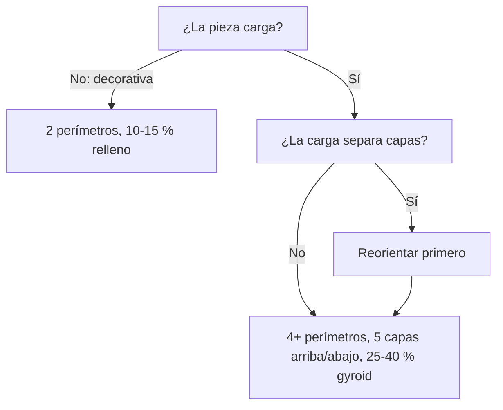

# Grosor de pared y relleno según la carga

Parte de: [[37-Modelado-3D-Tecnico/03 Diseño para impresión 3D/_Índice Diseño para impresión 3D|Diseño para impresión 3D]]

> [!info] Cómo avanzar
> `progreso`: **pendiente** → **viendo** (estudiando) → **visto** (contestaste la autoevaluación sin abrir las respuestas) → **dominado** (hiciste el laboratorio o lo aplicaste de verdad).

## Contenido

### Qué es
Una pieza FDM no es un bloque macizo: el laminador la convierte en **perímetros** (las líneas que dibujan el contorno de cada capa), **capas superiores e inferiores** sólidas y un **relleno** interior con un patrón y un porcentaje. El grosor de pared que diseñas en el CAD y la configuración que eliges en el laminador deciden juntos cuánto aguanta la pieza, cuánto pesa y cuánto tarda. Diseñar sabiendo cómo se va a laminar te ahorra piezas rotas y paredes con huecos.

### Cómo funciona
**Ancho de línea**: con la boquilla de 0.4 mm de tu [[Elegoo Centauri 2 Combo]] (diámetro de fábrica: Pendiente de confirmar), el laminador suele usar líneas de unos 0.42–0.45 mm (revisa tu perfil en [[ElegooSlicer y OrcaSlicer]]). Si una pared mide un múltiplo de ese ancho, cabe un número entero de líneas y sale sólida y limpia:

| Líneas | Con 0.42 mm |
|---|---|
| 2 | 0.84 mm |
| 3 | 1.26 mm |
| 4 | 1.68 mm |
| 5 | 2.10 mm |
| 6 | 2.52 mm |

**Los perímetros se ponen desde ambas caras de una pared**. Una pared de 2 mm con "3 perímetros" no tiene espacio para 3 por lado (2.52 mm); caben 2 por lado (1.68) y sobran 0.32 mm que el laminador deja vacíos o llena con una línea delgada (*gap fill*). Si diseñas 1.68 o 2.52, no hay sobrante.

**De dónde sale la resistencia**: en flexión y en la mayoría de cargas, el esfuerzo viaja por la **piel** de la pieza. Por eso, subir perímetros (de 2 a 4) y capas superiores e inferiores aporta mucho más que subir el relleno de 15 % a 50 %, que gasta mucho plástico para poca ganancia. El relleno sirve sobre todo para sostener las capas superiores y dar rigidez a compresión.

Patrones de relleno comunes: **rejilla** o **rectilíneo** (rápido), **gyroid** (resistencia similar en todas direcciones, bueno para cargas mixtas), **panal** (rígido pero lento). El 100 % casi nunca hace falta; con 6–8 perímetros una pieza pequeña ya es prácticamente maciza.

### Ejemplo
Soporte de pared para una repisa ligera:

- **Diseño**: brazo con espesor de 6 mm, radio de 3 mm en la esquina interior (donde se concentra el esfuerzo), cartela a 45° debajo del brazo y agujeros avellanados para los taquetes.
- **Orientación**: acostado, para que la carga flexione a lo largo de las capas.
- **Laminador**: [[PETG]], 4 perímetros, 5 capas arriba y abajo, 30 % gyroid.
- **Validación**: cuelga el doble del peso que esperas durante un día antes de confiar.

### Práctica en tu Centauri 2
Imprime cuatro barras de 80 × 10 × 4 mm en PLA: (a) 2 perímetros 15 %, (b) 2 perímetros 50 %, (c) 4 perímetros 15 %, (d) 4 perímetros 50 %. Anota el tiempo y el peso que da el laminador, apóyalas en dos libros y cuelga peso al centro hasta romperlas. Normalmente (c) gana a (b) gastando menos: compruébalo tú.

### Cuándo usarlo y cuándo no
Diseña en múltiplos de línea en todo lo que tenga paredes finas o encajes (cajas, organizadores, tapas). En piezas macizas y gruesas importa menos: el laminador rellena y nadie ve el interior. No subas el relleno como primera solución a una pieza débil: revisa antes la orientación y las esquinas.

### Errores comunes
- **Paredes de 1.0 o 1.5 mm**: dejan huecos o líneas delgadas raras; usa 0.84, 1.26, 1.68.
- **Arreglar todo con relleno**: más peso y tiempo, poca resistencia extra. Sube perímetros.
- **Ignorar las capas superiores**: con pocas, el relleno se transparenta y la cara de arriba queda débil (*pillowing*). Usa al menos 4–5 con capa de 0.2.
- **Gancho roto en la esquina**: falta radio interior y probablemente la orientación separa capas (ver [[Orientación de la pieza y resistencia por capas]]).

### Para profundizar
- [Wiki de OrcaSlicer, base de ElegooSlicer (perímetros, relleno y patrones)](https://github.com/SoftFever/OrcaSlicer/wiki)
- [Página oficial de la Centauri 2 Combo (Elegoo)](https://us.elegoo.com/products/centauri-2-combo)
- En tu bóveda: [[Perímetros y relleno]]

## Ejercicios

Resuélvelos en papel o en la herramienta; la solución está plegada.

> [!question]- Con línea de 0.42 mm, ¿qué grosores de pared diseñarías para 2, 3 y 4 líneas?
> 0.84, 1.26 y **1.68 mm** (en la práctica 0.8, 1.2/1.3 y 1.6/1.7 también funcionan; revisa la vista previa del laminador).

> [!question]- Una pared de 2 mm con 3 perímetros de 0.42: ¿cuánto queda para relleno y qué hace el laminador?
> Los perímetros se ponen desde **ambas** caras: 3 por lado serían 2.52 mm y no caben. Caben 2 por lado (4 · 0.42 = 1.68 mm) y sobran 0.32 mm en el centro, que el laminador deja vacío o rellena con una línea delgada (*gap fill*). Diseña 1.68 o 2.52 mm para que salga limpia.

> [!question]- Tienes un gancho que se rompe. ¿Qué cambias primero en el laminador y qué en el diseño?
> Laminador: más perímetros (de 2 a 4). Diseño: orientarlo acostado y agregar radio en la esquina interior (concentra esfuerzos).

## Autoevaluación

Contesta primero en voz alta o en papel; luego despliega la respuesta.

> [!question]- ¿Qué aporta más resistencia: más relleno o más paredes?
> Casi siempre **más paredes (perímetros)** y más capas superiores/inferiores: la carga viaja por la piel. Subir el relleno de 15 % a 50 % ayuda mucho menos por el plástico que gasta. Ver [[Perímetros y relleno]].

> [!question]- ¿Por qué diseñar paredes en múltiplos del ancho de línea?
> Si diseñas 1.0 mm con línea de 0.42, el laminador mete 2 líneas y un hueco o una línea delgada rara. 0.84, 1.26, 1.68 (2, 3, 4 líneas) salen sólidas y limpias.

> [!question]- Caso: un soporte de pared para una repisa ligera. ¿Qué configuración inicial usas?
> PETG, 4 perímetros, 5 capas arriba/abajo, relleno 25–40 % *gyroid* o rejilla, orientado para que la carga no separe capas. Pruébalo con el doble del peso antes de confiar.

