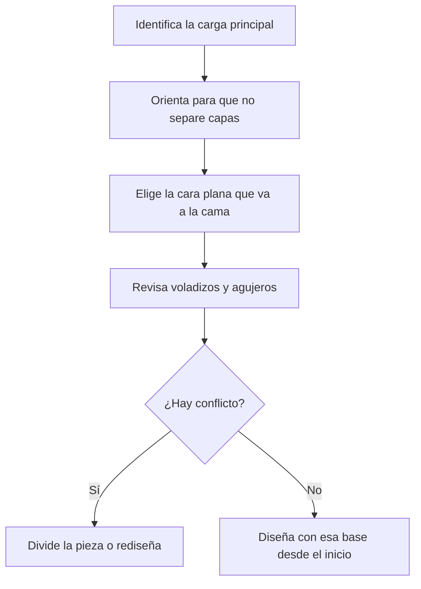

# Orientación de la pieza y resistencia por capas

Parte de: [[37-Modelado-3D-Tecnico/03 Diseño para impresión 3D/_Índice Diseño para impresión 3D|Diseño para impresión 3D]]

> [!info] Cómo avanzar
> `progreso`: **pendiente** → **viendo** (estudiando) → **visto** (contestaste la autoevaluación sin abrir las respuestas) → **dominado** (hiciste el laboratorio o lo aplicaste de verdad).

## Contenido

### Qué es
En FDM, la pieza se construye capa por capa y cada capa se une a la de abajo por **fusión parcial**. Por eso una pieza impresa es **anisotrópica**: resiste mucho más a lo largo de las líneas de una capa (X e Y) que entre capas (Z). Elegir en qué posición se imprime, qué cara va a la cama, es una decisión de diseño tan importante como las medidas, porque cambia la resistencia, el acabado y la necesidad de soportes.

### Cómo funciona
Dentro de cada capa, el filamento es continuo: tirar de una línea es tirar del plástico completo. Entre capas, solo hay la zona donde el plástico caliente "soldó" con la capa de abajo, ya más fría. Una fuerza que **separa capas** (tracción en Z o flexión de una pieza alta) la rompe con mucha menos carga.

Al orientar compiten tres cosas:

| Objetivo | Qué buscas |
|---|---|
| **Resistencia** | que la carga corra a lo largo de las capas, no que las despegue |
| **Superficie** | la cara visible arriba o en paredes verticales; la cara de la cama queda lisa pero con pata de elefante |
| **Soportes** | voladizos ≤ 45° y agujeros importantes verticales (salen redondos) |

Factores que mejoran la unión entre capas: temperatura de boquilla adecuada (en la parte alta del rango del filamento), ventilador moderado en piezas funcionales, capas no muy altas y un entorno sin corrientes de aire. Tu [[Elegoo Centauri 2 Combo]] es de **marco abierto** (sin gabinete): aléjala de ventiladores, ventanas y del aire acondicionado, sobre todo al imprimir [[PETG]] o piezas altas.

### Ejemplo
**Gancho en L para colgar audífonos** bajo el escritorio:

- **Parado** (la L vertical): el peso de los audífonos dobla el brazo horizontal y la esquina trabaja separando capas. Se rompe justo en la esquina.
- **Acostado** (la L en el plano XY): el peso dobla el gancho a lo largo de las líneas. Mucho más fuerte, sin soportes, y la cara de la cama queda lisa contra el escritorio.

Mejoras de diseño que acompañan la orientación: radio de 3–5 mm en la esquina interior, espesor de 6 mm y un labio al final para que la diadema no resbale.

### Práctica en tu Centauri 2
Imprime dos ganchos iguales en PLA, uno parado y otro acostado, con el mismo perfil (2 perímetros, 15 %). Cuélgales peso creciente (botellas de agua) hasta que fallen y observa la fractura: el parado se abrirá entre capas con una superficie lisa; el acostado se doblará o romperá a través de las líneas.

### Cuándo usarlo y cuándo no
Decide la orientación **antes de diseñar** en cualquier pieza funcional: soportes, ganchos, clips, bisagras, ejes. En piezas decorativas sin carga, prioriza la superficie visible y minimizar soportes. Si una pieza necesita dos orientaciones incompatibles (un clip resistente y un agujero redondo en otra dirección), divídela (ver [[Clips, bisagras impresas y piezas en varias partes]]).

### Errores comunes
- **Diseñar primero, orientar al final**: terminas con soportes por todos lados o una pieza débil. Elige la base al empezar y diseña con chaflanes abajo y voladizos ≤ 45°.
- **Pines y ejes verticales pequeños**: se rompen en una capa. Imprímelos acostados (con un lado plano) o hazlos más gruesos.
- **Orientar solo por estética** en una pieza con carga.
- **Ignorar los agujeros**: los horizontales salen ovalados; si deben ser precisos, verticales o en forma de gota (ver [[Voladizos y puentes]]).

### Para profundizar
- [Wiki de OrcaSlicer, base de ElegooSlicer](https://github.com/SoftFever/OrcaSlicer/wiki)
- [Página oficial de la Centauri 2 Combo (Elegoo)](https://us.elegoo.com/products/centauri-2-combo)

## Autoevaluación

Contesta primero en voz alta o en papel; luego despliega la respuesta.

> [!question]- ¿Por qué una pieza FDM es más débil en Z?
> Porque las capas se unen por fusión parcial entre sí; esa unión resiste menos que el filamento continuo dentro de cada capa. Una fuerza que **separa capas** (tirar en Z o doblar una pieza alta) la rompe más fácil.

> [!question]- Caso: un gancho en L para colgar audífonos. ¿Cómo lo orientas?
> **Acostado** (la L en el plano XY), así el peso dobla el gancho a lo largo de las líneas y no despega capas. Parado, se rompe en la esquina por la unión entre capas.

> [!question]- ¿Qué tres cosas compiten al orientar una pieza?
> **Resistencia** (cargas a lo largo de las capas), **calidad de superficie** (la cara visible arriba o en paredes verticales) y **soportes** (minimizar voladizos). Agujeros que deben ser redondos: verticales.

> [!question]- Error común: diseñar primero y pensar la orientación al final. ¿Qué haces mejor?
> Decidir la cara que va en la cama **al empezar** y diseñar con esa base: base plana, chaflanes abajo, voladizos ≤ 45°. Así no necesitas soportes ni cortes.

## Práctica

- [[Lab 4 - Soporte de iPhone para tripié con tuerca atrapada]]

