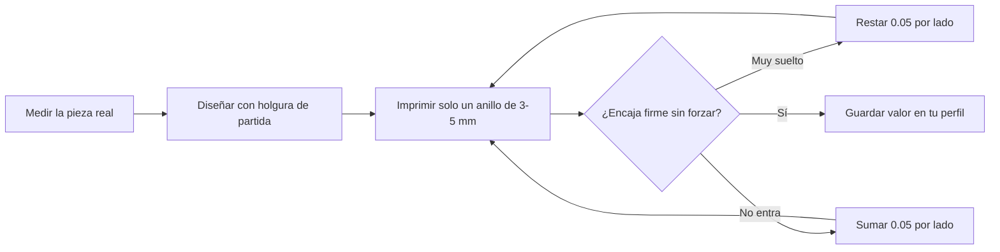

# Ajuste a presión en piezas impresas

Parte de: [[Tolerancias y holguras para piezas que encajan]]

> [!info] Cómo avanzar
> `progreso`: **pendiente** → **viendo** (estudiando) → **visto** (contestaste la autoevaluación sin abrir las respuestas) → **dominado** (hiciste el laboratorio o lo aplicaste de verdad).

## Contenido

### Qué es
Un **ajuste a presión** (*press fit*) es un encaje con muy poca holgura, o incluso con interferencia, en el que una pieza se queda en su lugar **por fricción**: el plástico se deforma un poco al entrar y aprieta. Lo usas cuando algo no debe soltarse solo: una tapa que no se caiga al voltear la caja, un rodamiento en su alojamiento, un imán de neodimio en su hueco, un pin en una figura. Es el más sensible de los tres ajustes de [[Tolerancias y holguras para piezas que encajan]]: una diferencia de 0.05 mm cambia el resultado.

### Cómo funciona
Punto de partida para PLA con boquilla de 0.4 mm: **0.05–0.15 mm por lado**, a calibrar con tu [[Prueba de tolerancias]]. El valor exacto depende de:

- **La impresora y el perfil**: flujo, ancho de línea, compensación de contorno en el laminador.
- **El material**: [[PLA]] es rígido y no perdona; [[PETG]] es más tenaz y tolera un poco más de interferencia sin agrietarse.
- **La orientación del agujero**: los verticales salen redondos y un poco más chicos; los horizontales, ovalados.
- **La pata de elefante**: los primeros 0.2–0.4 mm de un agujero que toca la cama salen más cerrados.



**El PLA no es elástico como un plástico inyectado**. Si fuerzas un ajuste muy apretado, la pieza se agrieta **entre capas** al meterla o, con los días, cede por **fluencia** (*creep*) y se afloja. Por eso, en vez de interferencia grande, conviene un ajuste justo más un pequeño retén: una costilla de 0.2 mm, un "crush rib" (nervaduras finas que se aplastan) o un chaflán de entrada que guíe la pieza.

### Ejemplo
Alojamiento para un rodamiento 608 (Ø exterior 22 mm, 7 mm de ancho) en un portacarrete:

```openscad
d_rod = 22;           // mide tu rodamiento
holgura_presion = 0.05;
alto = 7;

difference() {
  cylinder(d = 32, h = alto + 2, $fn = 128);
  translate([0, 0, 2]) cylinder(d = d_rod + 2 * holgura_presion, h = alto + 1, $fn = 128);
  translate([0, 0, -1]) cylinder(d = 12, h = 4, $fn = 64);   // paso del eje
  // chaflán de entrada de 0.5 mm
  translate([0, 0, alto + 2 - 0.5]) cylinder(d1 = d_rod, d2 = d_rod + 1.2, h = 0.51, $fn = 128);
}
```

El alojamiento queda de Ø22.1 mm, vertical (bien redondo) y con un chaflán que ayuda a centrar el rodamiento al presionarlo.

### Práctica en tu Centauri 2
Imprime **solo un anillo** de 3 mm de alto con alojamientos de Ø22.0, 22.1, 22.2 y 22.3 para el rodamiento (o para lo que tengas a mano: un imán, una pila AA). Anota cuál retiene sin forzar y cuál se agrieta. Repite en PETG para ver la diferencia de material.

### Cuándo usarlo y cuándo no
**Sí**: rodamientos, imanes, tapas que no deben caerse, pines de figuras, insertos sin calor. **No**: piezas que se arman y desarman seguido (se desgasta y afloja), cargas grandes o vibración (mejor tornillo o pegamento) y piezas de PLA que van a estar al sol o en calor (el creep aumenta).

### Errores comunes
- **Forzar con martillo una interferencia grande en PLA**: grietas entre capas.
- **Probar con la pieza completa**: horas de impresión por cada intento. Corta en el CAD solo la zona de encaje.
- **Olvidar la pata de elefante**: el encaje aprieta solo abajo. Chaflán de 0.4–0.6 mm en la base del agujero.
- **Usar el valor de otra impresora o filamento**: recalibra si cambias de marca o color.

### Para profundizar
- [[Tolerancias y holguras para piezas que encajan]] (nota padre)
- [Calibraciones en la wiki de OrcaSlicer, base de ElegooSlicer](https://github.com/SoftFever/OrcaSlicer/wiki)

## Autoevaluación

Contesta primero en voz alta o en papel; luego despliega la respuesta.

> [!question]- ¿Qué es un ajuste a presión y cuándo lo usas?
> Encaje con muy poca holgura (o interferencia) que se queda puesto por fricción: tapas que no se deben caer, un rodamiento en su alojamiento, un imán en su hueco. Holgura de partida: 0.05–0.15 mm por lado, a calibrar.

> [!question]- ¿Cómo pruebas un ajuste a presión sin imprimir la pieza completa?
> Corta en el CAD solo la zona de encaje (un anillo o una placa de 3–5 mm de alto) e imprime eso. Ajusta en pasos de 0.05 mm.

> [!question]- Error común: forzar un ajuste muy apretado en PLA. ¿Qué pasa?
> El PLA es rígido: se agrieta entre capas o se deforma con el tiempo (*creep*). Mejor un ajuste justo + un retén pequeño, o PETG que es más tenaz.

## Práctica

- [[Lab 1 - Caja con tapa a presión en Onshape]]

