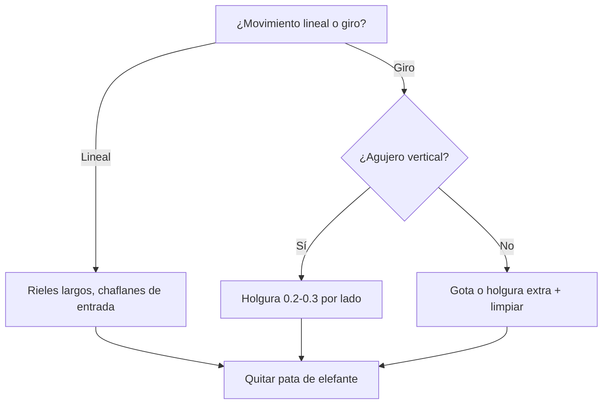

# Ajuste deslizante y giratorio en piezas impresas

Parte de: [[Tolerancias y holguras para piezas que encajan]]

> [!info] Cómo avanzar
> `progreso`: **pendiente** → **viendo** (estudiando) → **visto** (contestaste la autoevaluación sin abrir las respuestas) → **dominado** (hiciste el laboratorio o lo aplicaste de verdad).

## Contenido

### Qué es
Son los ajustes con **holgura suficiente para que haya movimiento**:

- **Deslizante**: una pieza corre en línea recta dentro de otra. Cajones, tapas corredizas, rieles, un porta-microSD que se abre.
- **Giratorio**: un eje gira dentro de un agujero. Ruedas, perillas, bisagras con pasador, carretes.

Ambos parten de una holgura de **0.2–0.3 mm por lado** en PLA con boquilla de 0.4 mm, a calibrar con tu [[Prueba de tolerancias]]. La diferencia práctica es que el giratorio necesita agujeros **bien redondos**, y eso depende de la orientación.

### Cómo funciona
**Agujeros verticales vs. horizontales**:

- **Vertical** (eje perpendicular a la cama): cada capa dibuja un círculo completo. Sale redondo, quizá un poco más chico de lo diseñado. Ideal para ejes.
- **Horizontal** (eje paralelo a la cama): el agujero se construye de abajo hacia arriba; la parte superior es un **voladizo** que se cuelga y lo vuelve ovalado. Por eso un eje horizontal se traba aunque uses la misma holgura.

Soluciones para el horizontal: forma de **gota** (techo en punta a 45°, ver [[Voladizos y puentes]]), subir la holgura solo en ese agujero, o reorientar para que quede vertical.



**Qué más ayuda a que corra suave**:

- **Chaflanes de entrada** para que la pieza se centre sola al entrar.
- **Superficies largas y planas** impresas en la misma orientación (las capas coinciden y no se "atoran").
- **Poca área de contacto**: dos rieles delgados en vez de una cara completa.
- **Quitar la pata de elefante** con un chaflán en la base; es la causa número uno de cajones trabados abajo.
- **Juego axial**: en ejes, deja también holgura en la dirección del eje (0.3 mm o más), no solo radial.

### Ejemplo
Tapa corrediza para una caja de puntas de destornillador:

- Ranuras en "cola de milano" a 45° en las paredes de la caja (se imprimen sin soporte).
- Tapa de 1.68 mm de grosor (4 líneas) con los bordes a 45° que corren en las ranuras.
- Holgura de 0.25 por lado en todo el perfil.
- Un pequeño tope de 0.3 mm al final para que no se salga sola.

En [[OpenSCAD]]:

```openscad
holgura = 0.25;
g = 1.68;          // grosor de la tapa
largo = 80; ancho = 40;

// perfil de la tapa (sección), extruido a lo largo
module tapa() {
  rotate([90, 0, 90]) linear_extrude(largo)
    polygon([[0, 0], [ancho, 0], [ancho - g, g], [g, g]]);
}
// la ranura de la caja es el mismo perfil crecido 'holgura' por lado
module ranura() {
  rotate([90, 0, 90]) translate([0, 0, -1]) linear_extrude(largo + 2)
    offset(delta = holgura) polygon([[0, 0], [ancho, 0], [ancho - g, g], [g, g]]);
}
tapa();
```

`offset(delta = ...)` crece el perfil exactamente la holgura en cada lado: así la ranura y la tapa salen del mismo polígono.

### Práctica en tu Centauri 2
Imprime un eje de Ø8 y tres placas con agujeros de 8.4, 8.5 y 8.6: una con los agujeros verticales y otra con los agujeros horizontales. Comprueba en cuál gira libre el eje en cada orientación: verás que el horizontal necesita más holgura o la forma de gota.

### Cuándo usarlo y cuándo no
Deslizante para todo lo que se abre o corre; giratorio para mecanismos simples de baja velocidad. Para giros con carga o rápidos, mete un **rodamiento** a presión o un buje de latón: el plástico contra plástico se desgasta.

### Errores comunes
- **Eje horizontal sin gota**: se traba.
- **Solo holgura radial**: el eje roza en las caras laterales; agrega juego axial.
- **Superficies con distinta orientación**: las capas se atoran como dientes.
- **Ignorar la pata de elefante**: el cajón corre arriba y se traba abajo.

### Para profundizar
- [[Tolerancias y holguras para piezas que encajan]] (nota padre)
- [offset() en el manual de OpenSCAD](https://en.wikibooks.org/wiki/OpenSCAD_User_Manual/2D_Primitives)

## Autoevaluación

Contesta primero en voz alta o en papel; luego despliega la respuesta.

> [!question]- ¿Qué diferencia hay entre ajuste deslizante y giratorio?
> Deslizante: una pieza corre en línea (cajón, tapa corrediza). Giratorio: un eje gira dentro de un agujero (rueda, perilla). Ambos usan holgura de partida de 0.2–0.3 mm por lado; el giratorio necesita agujeros bien redondos (verticales).

> [!question]- Un eje horizontal gira trabado aunque usaste 0.25 por lado. ¿Por qué?
> Los agujeros horizontales salen ovalados y con la parte de arriba caída (es un voladizo). Usa forma de gota, imprime el agujero vertical o súbele holgura solo a ese agujero.

> [!question]- ¿Qué ayuda a que un deslizante corra suave además de la holgura?
> Chaflanes de entrada, superficies largas y planas impresas en la misma orientación, poca área de contacto (rieles), y quitar la pata de elefante.

## Práctica

- [[Lab 3 - Bisagra impresa en su lugar]]

