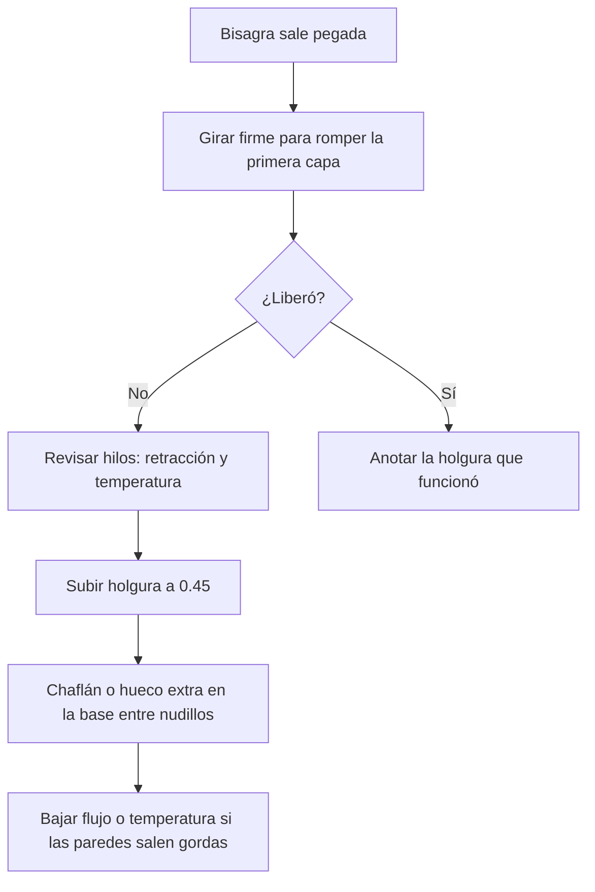

# Holgura para piezas impresas en su lugar (print-in-place)

Parte de: [[Tolerancias y holguras para piezas que encajan]]

> [!info] Cómo avanzar
> `progreso`: **pendiente** → **viendo** (estudiando) → **visto** (contestaste la autoevaluación sin abrir las respuestas) → **dominado** (hiciste el laboratorio o lo aplicaste de verdad).

## Contenido

### Qué es
Una pieza **impresa en su lugar** (*print-in-place*, PIP) es un mecanismo que sale de la impresora **ya armado**: bisagras, cadenas, articulaciones de figuras, engranes en su eje, juguetes articulados. Las piezas se imprimen juntas, separadas por un hueco que nunca se toca durante la impresión. Al terminar, giras o flexionas con firmeza para "liberar" el mecanismo. Es el ajuste que pide **más holgura**, porque no puedes lijar ni ajustar después.

### Cómo funciona
Punto de partida: **0.3–0.5 mm por lado**, tanto **radial** (alrededor del eje) como **axial** (entre las caras de los nudillos), a calibrar con tu [[Prueba de tolerancias]]. Las zonas donde suele fallar:

1. **Primera capa**: por la pata de elefante, la primera capa sale más ancha y puede fusionar las dos piezas en la base. Es la falla más común.
2. **Techos de huecos horizontales**: el hueco alrededor de un eje horizontal tiene un techo que se cuelga y toca al eje.
3. **Hilos** (*stringing*): filamento que cruza el hueco por mala retracción y "cose" las piezas.
4. **Paredes gordas**: con flujo alto, la holgura real es menor que la diseñada.



**Trucos de diseño**:

- Eje **cónico** en lugar de cilíndrico (pivote tipo "pin y cono"): se autosoporta a 45° y no necesita techo colgado.
- **Hueco extra en la base** entre piezas (0.2–0.4 mm adicionales en las primeras capas) para que la pata de elefante no las una.
- Formas de **gota** en huecos horizontales.
- Holgura **axial** igual o mayor que la radial.

### Ejemplo
Bisagra de tres nudillos impresa en su lugar, en OpenSCAD:

```openscad
h = 0.4;            // holgura PIP por lado (radial y axial)
d_eje = 4;          // eje cónico en los extremos
largo_n = 10;       // largo de cada nudillo
d_n = 8;            // diámetro del nudillo

module nudillo(z) translate([0, 0, z]) cylinder(d = d_n, h = largo_n, $fn = 64);

// hoja A: nudillos 1 y 3 con conos que entran al nudillo 2
module hoja_a() {
  nudillo(0);
  nudillo(2 * (largo_n + h));
  translate([0, 0, largo_n]) cylinder(d1 = d_eje, d2 = 0.8, h = d_eje / 2, $fn = 32);
  translate([0, 0, 2 * (largo_n + h)]) mirror([0, 0, 1]) cylinder(d1 = d_eje, d2 = 0.8, h = d_eje / 2, $fn = 32);
}
// hoja B: nudillo central con alojamientos cónicos crecidos 'h'
module hoja_b() {
  difference() {
    nudillo(largo_n + h);
    translate([0, 0, largo_n + h - 0.01]) cylinder(d1 = d_eje + 2*h, d2 = 0.8 + 2*h, h = d_eje / 2 + h, $fn = 32);
    translate([0, 0, 2*largo_n + h + 0.01]) mirror([0, 0, 1]) cylinder(d1 = d_eje + 2*h, d2 = 0.8 + 2*h, h = d_eje / 2 + h, $fn = 32);
  }
}
hoja_a(); hoja_b();
```

El eje de la bisagra va **vertical**, así que los conos se imprimen sin soporte. Faltaría agregar las hojas planas; el flujo completo está en el [[Lab 3 - Bisagra impresa en su lugar]].

### Práctica en tu Centauri 2
Imprime la misma bisagra con `h = 0.3`, `0.4` y `0.5`. Anota cuál se libera con un giro y cuál queda floja. Haz una con el eje horizontal para comparar: probablemente necesites más holgura o forma de gota.

### Cuándo usarlo y cuándo no
**Sí**: juguetes articulados, cajitas con bisagra, demos, llaveros con partes móviles, piezas que nunca vas a desarmar. **No**: mecanismos con carga o precisión (el juego de 0.4 mm se nota) y piezas que necesitarías reparar. Ahí, piezas separadas con pasador (ver [[Ajuste deslizante y giratorio en piezas impresas]]).

### Errores comunes
- **Holgura solo radial**: las caras de los nudillos se fusionan.
- **No liberar con firmeza**: el mecanismo "parece" pegado y solo tenía la primera capa unida.
- **Retracción mal ajustada**: hilos que cosen el hueco.
- **Usar la holgura de un modelo descargado**: cada impresora y filamento es distinto.

### Para profundizar
- [[Tolerancias y holguras para piezas que encajan]] (nota padre)
- [Calibraciones de retracción y flujo (wiki de OrcaSlicer)](https://github.com/SoftFever/OrcaSlicer/wiki)

## Autoevaluación

Contesta primero en voz alta o en papel; luego despliega la respuesta.

> [!question]- ¿Qué es una pieza impresa en su lugar (print-in-place)?
> Un mecanismo que sale de la impresora ya armado (bisagra, cadena, articulación): las piezas se imprimen juntas separadas por un hueco que nunca se toca.

> [!question]- ¿Qué holgura usas y dónde falla más?
> Punto de partida: **0.3–0.5 mm** por lado (radial y axial), a calibrar. Falla más en la **primera capa** (se fusiona por la pata de elefante) y en techos de huecos horizontales que se cuelgan.

> [!question]- Caso: la bisagra sale pegada. ¿Qué pruebas en orden?
> 1) Girar firme para romper la unión de primera capa. 2) Revisar que no haya "hilos" (retracción). 3) Subir holgura a 0.45. 4) Agregar un chaflán o hueco extra en la base entre nudillos. 5) Bajar flujo/temperatura si las paredes salen gordas.

## Práctica

- [[Lab 3 - Bisagra impresa en su lugar]]

