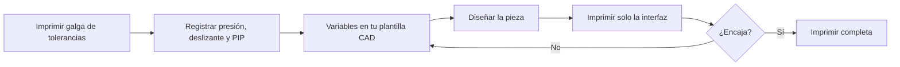

# Tolerancias y holguras para piezas que encajan

Parte de: [[37-Modelado-3D-Tecnico/03 Diseño para impresión 3D/_Índice Diseño para impresión 3D|Diseño para impresión 3D]]

> [!info] Cómo avanzar
> `progreso`: **pendiente** → **viendo** (estudiando) → **visto** (contestaste la autoevaluación sin abrir las respuestas) → **dominado** (hiciste el laboratorio o lo aplicaste de verdad).

## Contenido

### Qué es
La **holgura** es el espacio que dejas a propósito entre dos piezas que deben encajar; la **tolerancia** es cuánto se desvía la pieza real de lo que diseñaste. En FDM las desviaciones son predecibles: las paredes salen un poco más gordas, los agujeros un poco más chicos, la primera capa se aplasta y los agujeros horizontales se ovalan. Si diseñas un eje de 8 mm para un agujero de 8 mm, no entra. La solución no es "adivinar": es **medir cómo imprime tu impresora** y diseñar con variables de holgura.

### Cómo funciona
Hay tres familias de ajuste, cada una con su subtema:

| Ajuste | Para qué | Holgura de partida por lado (PLA, boquilla 0.4) | Nota |
|---|---|---|---|
| A presión | que no se suelte | 0.05–0.15 mm | [[Ajuste a presión en piezas impresas]] |
| Deslizante / giratorio | que se mueva | 0.2–0.3 mm | [[Ajuste deslizante y giratorio en piezas impresas]] |
| Impreso en su lugar | que salga armado | 0.3–0.5 mm | [[Holgura para piezas impresas en su lugar (print-in-place)]] |

Son **puntos de partida**: calíbralos con la [[Prueba de tolerancias]] en tu [[Elegoo Centauri 2 Combo]] y con cada filamento.

**Por lado o diametral**: la holgura **por lado** (radial) es el espacio en cada pared; la **diametral** es el total. 0.2 por lado = 0.4 en el diámetro. Para no confundirte, nombra la variable explícitamente y aplica la fórmula siempre igual:

```openscad
holgura_lado = 0.2;
eje = 8;
d_agujero = eje + 2 * holgura_lado;   // 8.4
// para una pieza que entra en un hueco: exterior = interior - 2 * holgura_lado
```



**De dónde vienen las desviaciones** y qué hacer:

- **Pata de elefante**: la primera capa sale más ancha → chaflán de 0.4–0.6 mm en bordes inferiores o compensación de primera capa en el laminador.
- **Agujeros horizontales ovalados** → forma de gota o más holgura (ver [[Voladizos y puentes]]).
- **Flujo alto** → paredes gordas; calibra flujo antes que holguras.
- **Contracción y material**: [[PETG]] y [[PLA]] se comportan distinto; anota el valor por filamento.

### Ejemplo
Tu galga dice: perno de 10 mm entra justo en el agujero de 10.3 y gira libre en el de 10.5. Registras `holgura_presion = 0.15` y `holgura_giro = 0.25`. Para la tapa de una caja de 80 mm interior con ajuste deslizante, el labio exterior mide 80 − 2·0.2 = 79.6 mm. Si después la tapa entra apretada solo abajo, no es la holgura: es la pata de elefante.

### Práctica en tu Centauri 2
1. Imprime una galga con pernos de Ø10 y agujeros de 10.1 a 10.6 en pasos de 0.1, con los agujeros verticales.
2. Imprime la misma galga con agujeros horizontales.
3. Crea una nota de perfil por filamento con tus tres valores (presión, deslizante, PIP) para vertical y horizontal.
4. Pásalos a variables de tu plantilla de [[Parámetros y diseño por variables]].

### Cuándo usarlo y cuándo no
Siempre que dos piezas se toquen: tapas, ejes, tuercas, pines, cajones, accesorios para tu equipo de foto. Para piezas sueltas sin acoplamiento no hace falta. No compenses holguras "corrigiendo" la escala en el laminador: la escala cambia toda la pieza, la holgura solo la interfaz.

### Errores comunes
- **Diseñar medidas exactas** y esperar que encaje.
- **Confundir por lado y diametral**: el encaje queda el doble de flojo o de apretado.
- **Copiar valores de internet** sin calibrar.
- **Una sola variable de holgura** para todos los tipos de ajuste.

### Para profundizar
- [Calibraciones en la wiki de OrcaSlicer (base de ElegooSlicer)](https://github.com/SoftFever/OrcaSlicer/wiki)
- [Documentación oficial de OpenSCAD](https://openscad.org/documentation.html)

## Subtemas

- [[Ajuste a presión en piezas impresas]]
- [[Ajuste deslizante y giratorio en piezas impresas]]
- [[Holgura para piezas impresas en su lugar (print-in-place)]]

## Ejercicios

Resuélvelos en papel o en la herramienta; la solución está plegada.

> [!question]- Un eje de Ø5 mm (medido) debe girar libre en un agujero impreso vertical. Con holgura deslizante de 0.25 por lado, ¿qué diámetro diseñas?
> 5 + 2·0.25 = **5.5 mm**. Si tu galga mostró que tus agujeros salen 0.1 mm más chicos de lo diseñado, compensa: 5.6 mm.

> [!question]- Un rodamiento 608 tiene diámetro exterior de 22 mm. Quieres que entre a presión. Propón el diámetro del alojamiento.
> A presión con 0.05 por lado: 22 + 0.1 = **22.1 mm** como punto de partida; imprime solo un anillo de 3 mm de alto para probar y ajusta en pasos de 0.05.

> [!question]- Tu prueba de tolerancias dice: perno de 10 mm entra justo en agujero de 10.3 y gira libre en 10.5. ¿Qué valores de `holgura_lado` registras para presión y giro?
> Presión: (10.3 − 10)/2 = **0.15**. Giro: (10.5 − 10)/2 = **0.25**. Anótalos en tu nota de perfil para ese filamento.

> [!question]- Diseñas una caja de 80 mm interior y una tapa con labio. Si la pared de la caja mide 1.6 y quieres ajuste deslizante (0.2 por lado), ¿cuánto mide el labio exterior?
> Labio = interior − 2·holgura = 80 − 0.4 = **79.6 mm**.

## Autoevaluación

Contesta primero en voz alta o en papel; luego despliega la respuesta.

> [!question]- ¿Qué es la holgura y por qué no basta con diseñar las medidas exactas?
> Es el espacio que dejas entre dos piezas que deben encajar. En FDM las paredes salen un poco más gordas, los agujeros más chicos y la primera capa se aplasta; si diseñas un eje de 8 en un agujero de 8, no entra.

> [!question]- ¿Holgura por lado o diametral? ¿Cómo no confundirte?
> **Por lado** (radial) es el espacio en cada pared; **diametral** es el total. Holgura 0.2 por lado = 0.4 en diámetro. Pon el nombre en la variable: `holgura_lado = 0.2`, y en el agujero `d = eje + 2*holgura_lado`.

> [!question]- ¿Qué valores usas como punto de partida? (a calibrar)
> Referencias comunes para PLA con boquilla de 0.4 (**punto de partida, calíbralo con la [[Prueba de tolerancias]] en tu impresora y filamento**):
>
> | Ajuste | Holgura por lado |
> |---|---|
> | A presión (no se suelta) | 0.05–0.15 mm |
> | Deslizante / giratorio | 0.2–0.3 mm |
> | Impreso en su lugar | 0.3–0.5 mm |

> [!question]- Caso: la tapa entra apretada solo en la parte de abajo. ¿Qué pasó?
> **Pata de elefante**: la primera capa sale más ancha. Agrega un chaflán de 0.4–0.6 mm en el borde que toca la cama o usa la compensación de primera capa del laminador.

## Práctica

- [[Lab 1 - Caja con tapa a presión en Onshape]]
- [[Lab 3 - Bisagra impresa en su lugar]]

## Progreso de los subtemas

```base
filters:
  and:
    - file.inFolder("37-Modelado-3D-Tecnico/03 Diseño para impresión 3D/Tolerancias y holguras para piezas que encajan")
    - file.name != "Tolerancias y holguras para piezas que encajan"
views:
  - type: table
    name: Progreso
    order:
      - file.name
      - progreso
      - nivel
```
