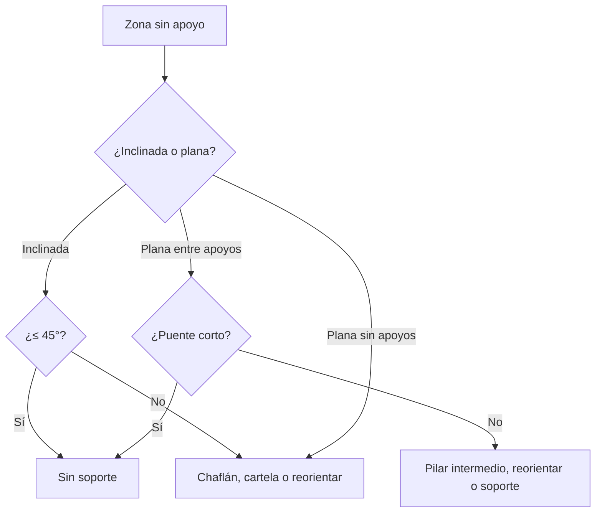

# Voladizos y puentes

Parte de: [[37-Modelado-3D-Tecnico/03 Diseño para impresión 3D/_Índice Diseño para impresión 3D|Diseño para impresión 3D]]

> [!info] Cómo avanzar
> `progreso`: **pendiente** → **viendo** (estudiando) → **visto** (contestaste la autoevaluación sin abrir las respuestas) → **dominado** (hiciste el laboratorio o lo aplicaste de verdad).

## Contenido

### Qué es
Un **voladizo** (*overhang*) es una parte de la pieza que sale hacia afuera sobre el vacío: cada capa sobresale un poco respecto a la anterior. Un **puente** (*bridge*) es un tramo horizontal tendido entre dos apoyos. La impresora FDM no puede depositar plástico en el aire, así que ambos tienen límites. Diseñar respetándolos evita **soportes**, que gastan material, dejan marcas y a veces son imposibles de quitar (dentro de un agujero, por ejemplo).

### Cómo funciona
**Geometría del voladizo**: en una pared inclinada un ángulo θ respecto a la vertical, cada capa se desplaza `capa · tan(θ)` hacia afuera.

| Ángulo desde la vertical | Desplazamiento con capa de 0.2 mm | Apoyo sobre la línea de abajo (0.42 mm) |
|---|---|---|
| 30° | 0.12 mm | mucho |
| 45° | 0.20 mm | la mitad, aprox. |
| 60° | 0.35 mm | muy poco |
| 70° | 0.55 mm | nada: la línea cae al vacío |

De ahí la **regla de 45°**: hasta unos 45° respecto a la vertical, cada capa se apoya en buena parte de la anterior y sale sin soporte. Es un punto de partida; con buen enfriamiento se logra más. La forma de saberlo en tu [[Elegoo Centauri 2 Combo]] es imprimir una **prueba de voladizos** (rampa de 30° a 70°).

**Puentes**: el extrusor tiende la línea entre dos apoyos y el ventilador la enfría mientras cuelga. Puentes cortos (unos 10–20 mm) suelen salir bien en PLA con buen ventilador; los largos se cuelgan. Los laminadores tienen ajustes específicos de puente (velocidad, flujo, ventilador); revísalos en [[ElegooSlicer y OrcaSlicer]].



**Agujeros horizontales**: la mitad superior de un círculo empieza casi horizontal, es un voladizo. Soluciones:

- **Gota** (*teardrop*): reemplaza la parte superior por dos rectas a 45° que terminan en punta.
- **Techo plano corto** que funcione como puente.

### Ejemplo
Agujero horizontal en forma de gota en OpenSCAD:

```openscad
module gota(d, largo) {
  // eje del agujero a lo largo de Y; la punta apunta hacia +Z
  rotate([90, 0, 0]) linear_extrude(largo, center = true)
    union() {
      circle(d = d, $fn = 64);
      rotate(45) square(d / 2);   // esquina a 45° hacia arriba
    }
}
difference() {
  cube([30, 10, 20], center = true);
  gota(8.4, 12);
}
```

El cuadrado girado 45° agrega la punta tangente al círculo: la parte superior del agujero queda formada por dos rectas a 45°, imprimible sin soporte.

### Práctica en tu Centauri 2
Imprime una prueba de voladizos de 30° a 70° y otra de puentes de 10, 20, 30 y 40 mm en PLA. Anota el último ángulo y el último largo que salen aceptables: esos son **tus** límites, no los de un foro. Repite en [[PETG]], que suele necesitar menos ventilador y se comporta distinto.

### Cuándo usarlo y cuándo no
Aplica estas reglas al diseñar cualquier pieza funcional. Usa soportes solo cuando rediseñar sea peor: figuras artísticas con brazos extendidos, por ejemplo (ver el área de modelado artístico). Para textos en la cara de abajo, voltea la pieza o haz el texto grabado en lugar de en relieve.

### Errores comunes
- **Redondeos en el borde inferior**: empiezan horizontales; usa chaflanes.
- **Brazos horizontales saliendo de una pared vertical**: acuesta la pieza o agrega una cartela a 45° (además la hace más fuerte).
- **Confiar en la regla de 45° sin probar**: tu ventilador, material y velocidad cambian el límite.
- **Puentes largos sin ajustes de puente**: se cuelgan; acorta con pilares o reorienta.

### Para profundizar
- [Wiki de OrcaSlicer (ajustes de puentes y voladizos)](https://github.com/SoftFever/OrcaSlicer/wiki)
- [Documentación oficial de OpenSCAD](https://openscad.org/documentation.html)

## Ejercicios

Resuélvelos en papel o en la herramienta; la solución está plegada.

> [!question]- Con capas de 0.2 mm, ¿cuánto se desplaza cada capa en una pared a 45° y a 60° de la vertical? ¿Cuál es más riesgosa con línea de 0.42 mm?
> Desplazamiento = capa · tan(ángulo). 45°: 0.2 · 1 = **0.20 mm**. 60°: 0.2 · 1.73 = **0.35 mm**, casi todo el ancho de línea (0.42), así que queda poco apoyo: más riesgosa.

> [!question]- Tienes un texto en relieve en la cara de abajo de una tapa. ¿Cómo lo resuelves sin soportes?
> Voltea la tapa (texto hacia arriba), o cambia el texto a **grabado** (hundido) en la cara de la cama. Otra opción: texto en la cara superior.

> [!question]- Un soporte de pared tiene un brazo horizontal de 40 mm saliendo de una pared vertical. Propón dos cambios para imprimirlo sin soportes.
> 1) Acostar la pieza para que el brazo quede en el plano de la cama. 2) Agregar un **refuerzo a 45°** (cartela) debajo del brazo. Bonus: más resistente.

## Autoevaluación

Contesta primero en voz alta o en papel; luego despliega la respuesta.

> [!question]- ¿Qué es la regla de 45°?
> Una pared inclinada hasta ~45° respecto a la vertical se imprime sin soporte porque cada capa se apoya en buena parte de la anterior. Es un **punto de partida**: con buen enfriamiento se logra más; calíbralo con una prueba de voladizos en tu impresora.

> [!question]- ¿Qué es un puente y qué largo es razonable?
> Un tramo horizontal entre dos apoyos que el extrusor tiende en el aire. Puentes cortos (unos 10–20 mm) suelen salir bien en PLA con buen ventilador; largos se cuelgan. Es una referencia para probar en tu [[Elegoo Centauri 2 Combo]], no un dato fijo.

> [!question]- ¿Cómo evitas soportes en un agujero horizontal?
> Con forma de **gota** (*teardrop*): la parte superior en punta a 45°, o un techo plano corto que funcione como puente. Así no hay que limpiar soporte dentro del agujero.

