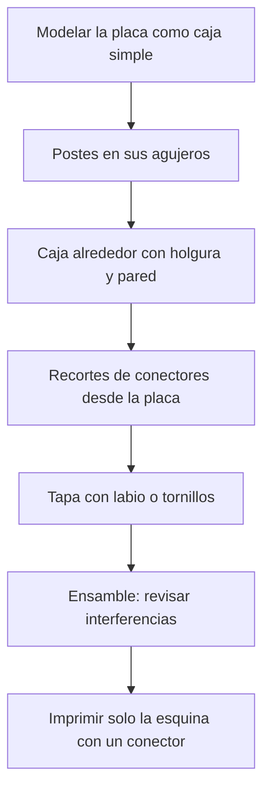

# Cajas para electrónica

Parte de: [[37-Modelado-3D-Tecnico/04 Proyectos técnicos/_Índice Proyectos técnicos|Proyectos técnicos]]

> [!info] Cómo avanzar
> `progreso`: **pendiente** → **viendo** (estudiando) → **visto** (contestaste la autoevaluación sin abrir las respuestas) → **dominado** (hiciste el laboratorio o lo aplicaste de verdad).

## Contenido

### Qué es
Una caja para electrónica (*enclosure*) protege una placa (Arduino, ESP32, Raspberry Pi, un módulo de relevadores, una fuente) y la hace usable: con sus conectores accesibles, botones, ventilación y una forma de abrirla para dar mantenimiento. Es el proyecto técnico más completo para practicar: combina medición, diseño en contexto, postes, tapas, holguras y ensambles.

### Cómo funciona
Además del hueco, una caja bien diseñada necesita:

1. **Holgura alrededor de la placa**: unos 0.5 mm por lado, para que entre aunque la placa tenga rebabas.
2. **Postes** para tornillos o insertos donde la placa tiene sus agujeros de montaje, a la altura que deja espacio para las soldaduras de abajo.
3. **Recortes para conectores** (USB-C, barril, pines) alineados con sus posiciones reales, con 0.3–0.5 mm de holgura.
4. **Ventilación** si algo calienta (reguladores, Raspberry Pi): ranuras con patrón lineal y voladizos ≤ 45°.
5. **Tapa**: a presión con labio (ver [[Ajuste a presión en piezas impresas]]) o atornillada con insertos.
6. **Paso de cables** y, si es para exterior, juntas o laberintos contra polvo.



**Modelar la placa dentro del CAD**: aunque sea como un prisma con cilindros en los agujeros y cubos en los conectores. Así colocas los postes y recortes con **referencias reales** (diseño en contexto) y, si cambias de placa, actualizas una sola pieza. Muchos fabricantes publican el dibujo con medidas o un modelo STEP de la placa; úsalos como referencia y verifica con calibrador.

**Postes que no se rompan**: diámetro exterior de al menos **2 veces el del tornillo**, redondeo en la base (la unión con el piso concentra esfuerzo), más perímetros en el laminador (4 o más) e idealmente **insertos térmicos** (ver [[Insertos térmicos, tornillería y pegado]]). Un poste vertical delgado con autorroscante se raja entre capas al apretar.

### Ejemplo
Caja paramétrica para una placa de 70 × 50 mm con agujeros M3 a 3.5 mm de las esquinas:

```openscad
placa = [70, 50, 1.6];
holgura = 0.5;
pared = 1.68;          // 4 líneas
piso = 1.6;
alto_poste = 5;        // espacio para soldaduras
d_poste = 7;           // > 2 x 3 mm
d_agujero = 2.6;       // autorroscante M3 (punto de partida a calibrar)
m = 3.5;               // margen del agujero en la placa
alto = 25;

ext = [placa.x + 2*(holgura + pared), placa.y + 2*(holgura + pared)];
difference() {
  cube([ext.x, ext.y, alto]);
  translate([pared, pared, piso]) cube([ext.x - 2*pared, ext.y - 2*pared, alto]);
  // recorte USB-C en la pared frontal (ajusta posición con tu placa)
  translate([pared + holgura + 20, -1, piso + alto_poste + 1.6]) cube([9.5, pared + 2, 3.8]);
}
for (x = [m, placa.x - m], y = [m, placa.y - m])
  translate([pared + holgura + x, pared + holgura + y, piso])
    difference() {
      cylinder(d = d_poste, h = alto_poste, $fn = 48);
      cylinder(d = d_agujero, h = alto_poste + 1, $fn = 24);
    }
```

### Práctica en tu Centauri 2
Toma una placa que tengas (o un cargador USB) y haz su caja. Primero imprime **solo la esquina** con un poste y el recorte del conector (cortada a 10 mm de alto) para validar posición y holgura. Después la caja completa en [[PETG]] si el aparato calienta, con tapa a presión y ranuras de ventilación.

### Cuándo usarlo y cuándo no
Ideal para proyectos caseros de electrónica de baja tensión (5–12 V). **No** imprimas cajas para conexiones de **corriente de la red (127 V)** ni para cargadores de baterías de litio sin certificación: el plástico impreso no es retardante de flama y una falla puede provocar un incendio. Para eso, compra cajas eléctricas certificadas.

### Errores comunes
- **Postes delgados con autorroscante**: se rompen; gruesos, con redondeo, más perímetros o insertos.
- **Recortes ubicados "a ojo"**: modela la placa y toma referencias de ella.
- **Sin holgura para la placa**: no entra por rebabas o capacitores que sobresalen.
- **Sin ventilación** en algo que calienta: el PLA se deforma.

### Para profundizar
- [Documentación oficial de OpenSCAD](https://openscad.org/documentation.html)
- [Assembly Workbench (wiki de FreeCAD) para revisar interferencias](https://wiki.freecad.org/Assembly_Workbench)

## Autoevaluación

Contesta primero en voz alta o en papel; luego despliega la respuesta.

> [!question]- ¿Qué necesita una caja para electrónica además del hueco?
> **Postes** para tornillos o insertos donde va la placa, recortes para conectores, ventilación si algo calienta, una tapa (a presión o atornillada) y holgura alrededor de la placa (~0.5 mm).

> [!question]- Caso: los postes de tornillo se rompen al atornillar. ¿Qué cambias?
> Hazlos más gruesos (al menos 2 veces el diámetro del tornillo), con redondeo en la base, más perímetros, o usa **insertos térmicos**.

> [!question]- ¿Por qué modelar la placa (o una caja de su tamaño) dentro del CAD?
> Para posicionar recortes y postes con referencias reales y revisar interferencias en un ensamble antes de imprimir.

## Práctica

- [[Lab 1 - Caja con tapa a presión en Onshape]]

