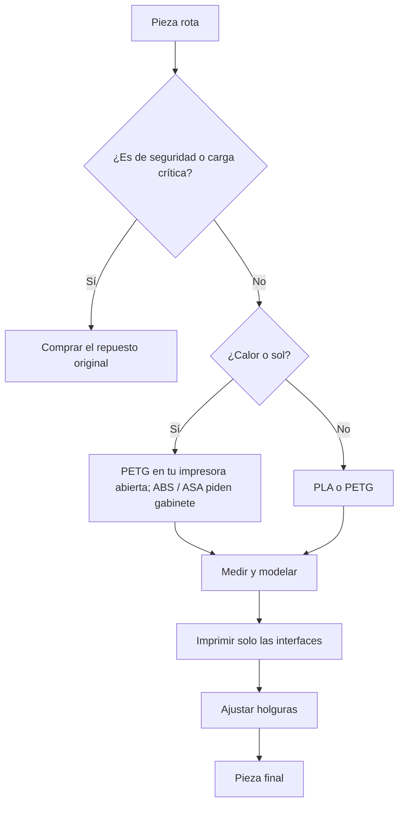

# Repuestos y adaptadores impresos

Parte de: [[37-Modelado-3D-Tecnico/04 Proyectos técnicos/_Índice Proyectos técnicos|Proyectos técnicos]]

> [!info] Cómo avanzar
> `progreso`: **pendiente** → **viendo** (estudiando) → **visto** (contestaste la autoevaluación sin abrir las respuestas) → **dominado** (hiciste el laboratorio o lo aplicaste de verdad).

## Contenido

### Qué es
Imprimir **repuestos** es reponer una pieza rota o perdida (una perilla de la estufa, la tapa de un control, el clip de una persiana) y hacer **adaptadores** es crear una pieza que une dos cosas que no fueron pensadas para ir juntas (una manguera de Ø20 con una de Ø12, una aspiradora con una herramienta de otra marca). Es donde la impresión 3D se paga sola, pero también donde hay que saber qué **no** imprimir.

### Cómo funciona
**Buenas candidatas**: piezas de plástico **sin carga crítica ni calor**: perillas, tapas, clips, guías, ganchos, separadores, adaptadores, topes, patas de muebles ligeros.

**Malas candidatas**: piezas de **seguridad** (frenos, partes de sillas de bebé, cascos, arneses), soportes de carga sobre personas, piezas en contacto con alimentos calientes o que requieran certificación, y piezas cerca de calor (motor, horno) sin un material adecuado.

**Elegir material**:

- [[PLA]]: fácil y preciso, pero se ablanda alrededor de 55–60 °C. Dentro de un coche al sol en México se deforma.
- [[PETG]]: más tenaz y aguanta algo más de temperatura; buen mínimo para coche, exterior o piezas que flexionan.
- **ABS / ASA**: aguantan mejor el calor y el sol, pero piden impresora cerrada. Tu [[Elegoo Centauri 2 Combo]] es de **marco abierto**: la boquilla llega a 350 °C y puedes intentarlos, pero sin gabinete tendrás warping, grietas entre capas y emisiones que exigen ventilar el cuarto. Ver [[Materiales que necesitan impresora cerrada (ABS, ASA, PC y nylon)]]. Con tu equipo, lo práctico para el coche es **PETG** con paredes gruesas, lejos del tablero y del sol directo; si de verdad necesitas ASA, encárgalo a un servicio de impresión con máquina cerrada.

**Validar interfaces**: un adaptador tiene dos (o más) **interfaces** que encajan con piezas existentes y un cuerpo que las une. Imprime primero **solo las interfaces**, cortas, cada una por separado; ajusta holguras; y al final une todo. Ahorras horas y filamento.

### Ejemplo
Adaptador de aspiradora: tubo de la aspiradora con Ø exterior de 35 mm (macho) a una boquilla de otra marca que recibe Ø32 mm:

1. Mide el Ø interior de la boquilla en tres puntos; mide el Ø exterior del tubo. Usa la técnica de la tira de papel si no tienes calibrador ([[Medir piezas e ingeniería inversa]]).
2. Interfaz A (hembra para el tubo): Ø interior 35 + 2·0.15 = **35.3 mm** (ajuste a presión ligero), 25 mm de largo.
3. Interfaz B (macho para la boquilla): Ø exterior 32 − 2·0.1 = **31.8 mm**, ligeramente cónico (31.8 → 31.4) para que apriete al empujar.
4. Imprime dos anillos de 8 mm, uno por interfaz. Prueba, ajusta, y luego une con una transición a 45° por revolución (ver [[Extruir, revolucionar, barrer y recubrir]]).

### Práctica en tu Centauri 2
Busca en tu casa una pieza rota o un adaptador que te haga falta. Haz el [[Lab 5 - Reparar o adaptar una pieza rota (ingeniería inversa)]]: mide, modela en el CAD que prefieras, imprime solo las interfaces y documenta en la nota del lab las holguras finales y el material elegido.

### Cuándo usarlo y cuándo no
Sí, cuando el repuesto original no existe, es carísimo o tarda semanas, y la pieza no compromete la seguridad. No, cuando la falla podría lastimar a alguien o dañar algo caro. Antes de modelar, busca si ya existe en repositorios con licencia que permita usarlo (ver [[Licencias de modelos 3D (Creative Commons y uso comercial)]]).

### Errores comunes
- **PLA para el coche o el exterior**.
- **Imprimir el adaptador completo para probar**.
- **Copiar la pieza rota tal cual**: si se rompió, mejora el diseño (más grosor, radios, otra orientación).
- **Ignorar la dirección de la carga** al orientar (ver [[Orientación de la pieza y resistencia por capas]]).

### Para profundizar
- [Página oficial de la Centauri 2 Combo (Elegoo)](https://us.elegoo.com/products/centauri-2-combo)
- [Documentación oficial de OpenSCAD](https://openscad.org/documentation.html)

## Autoevaluación

Contesta primero en voz alta o en papel; luego despliega la respuesta.

> [!question]- ¿Qué piezas son buenas candidatas para reponer imprimiendo?
> Piezas de plástico sin carga crítica ni calor: perillas, tapas, clips, guías, adaptadores. Evita piezas de seguridad (frenos, sillas de bebé, soportes de carga sobre personas) y cerca de calor sin un material adecuado.

> [!question]- ¿Qué material eliges para un repuesto que va dentro de un coche?
> Al sol el PLA se deforma; usa [[PETG]] como mínimo o un material de alta temperatura (ver [[Materiales que necesitan impresora cerrada (ABS, ASA, PC y nylon)]]; la Centauri 2 es abierta).

> [!question]- ¿Cómo validas un adaptador antes de imprimirlo completo?
> Imprime solo las **interfaces** (los dos extremos que encajan) en piezas cortas, ajusta holguras y luego une el diseño final.

## Práctica

- [[Lab 5 - Reparar o adaptar una pieza rota (ingeniería inversa)]]

