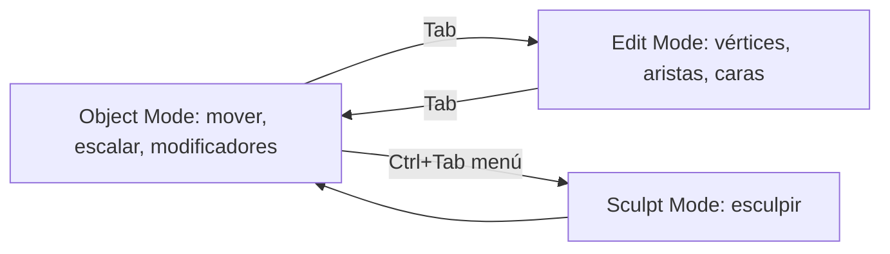

# Blender - interfaz, navegación y modos

Parte de: [[38-Modelado-3D-Artistico/01 Blender/_Índice Blender|Blender]]

> [!info] Cómo avanzar
> `progreso`: **pendiente** → **viendo** (estudiando) → **visto** (contestaste la autoevaluación sin abrir las respuestas) → **dominado** (hiciste el laboratorio o lo aplicaste de verdad).

## Contenido

### Qué es
Blender es un programa de creación 3D completo: modelado, escultura, materiales, animación, render, edición de video y más. Es **software libre** bajo licencia GNU GPL: lo puedes usar para cualquier fin y lo que creas con él (modelos, archivos `.blend`, imágenes, STL) es tuyo, incluso para uso comercial. La versión de soporte largo vigente es **Blender 5.2 LTS** (julio de 2026). Para impresión 3D artística es la herramienta central del área: modelas, esculpes, reparas y exportas sin pagar nada, y corre bien en tu PC con la GTX 1660 Ti.

### Cómo funciona
**La interfaz** se divide en *editores* (áreas) que puedes cambiar desde el ícono de su esquina superior izquierda. Los que más usarás:

- **3D Viewport**: la vista principal.
- **Outliner** (arriba a la derecha): la lista de objetos de la escena, como un árbol.
- **Properties** (abajo a la derecha): pestañas de objeto, modificadores, escena, materiales.
- **Barra lateral** (`N`) y **barra de herramientas** (`T`) dentro del Viewport.

**Navegación con mouse**:

| Acción | Atajo |
|---|---|
| Orbitar | rueda presionada y arrastrar |
| Desplazar (*pan*) | `Shift` + rueda presionada |
| Zoom | girar la rueda |
| Menú circular de vistas | `~` (tilde) |
| Encuadrar lo seleccionado | `.` del teclado numérico o *View → Frame Selected* |

Sin teclado numérico: *Edit → Preferences → Input → Emulate Numpad*. Entonces los números de arriba cambian de vista: `1` frente, `3` lado, `7` arriba, `5` alterna perspectiva y ortogonal.

**Modos** (cambian lo que editas):



Para imprimir usarás tres: **Object Mode** (organizar objetos, aplicar transformaciones y modificadores, exportar), **Edit Mode** (`Tab`, modelado poligonal y reparaciones) y **Sculpt Mode** (escultura). `Ctrl+Tab` abre el menú circular de modos.

**Unidades**: Blender trabaja por defecto en metros. Para imprimir conviene que 1 unidad = 1 mm: en *Scene Properties → Units* pon **Metric**, **Unit Scale 0.001** y **Length: Millimeters**. Así al exportar STL el laminador lee el tamaño correcto.

### Ejemplo
Como programador, puedes dejar esto listo con un script en el editor *Scripting* (Python de Blender):

```python
import bpy

escena = bpy.context.scene
u = escena.unit_settings
u.system = 'METRIC'
u.scale_length = 0.001          # 1 unidad = 1 mm
u.length_unit = 'MILLIMETERS'

# Rejilla del viewport en mm para que coincida con la escala
for area in bpy.context.screen.areas:
    if area.type == 'VIEW_3D':
        area.spaces.active.overlay.grid_scale = 0.001
print("Unidades listas para imprimir")
```

Después guarda el archivo como **plantilla de inicio** (*File → Defaults → Save Startup File*) y todos tus proyectos nuevos arrancan en milímetros.

### Práctica en tu Centauri 2
Con las unidades en mm, agrega un cubo (`Shift+A → Mesh → Cube`), ponle dimensiones 20 × 20 × 20 en la barra lateral (`N`), aplica la escala (`Ctrl+A → Scale`) y exporta (*File → Export → STL*). Ábrelo en [[ElegooSlicer y OrcaSlicer]]: debe medir exactamente 20 mm. Imprímelo y mide con el calibrador; es tu primera verificación de que la cadena Blender → laminador → impresora mantiene la escala.

### Cuándo usarlo y cuándo no
Blender es ideal para **formas orgánicas y artísticas**: figuras, bustos, macetas decorativas, dioramas, reparar mallas y escaneos. No es un CAD paramétrico: para piezas técnicas con medidas que vas a iterar (cajas, encajes, soportes), usa las herramientas del área de [[OpenSCAD|modelado técnico]] u Onshape. Puedes combinar: diseñar el encaje en CAD y la parte decorativa en Blender.

### Errores comunes
- **Modelar en metros**: la pieza sale 1000 veces más chica o grande en el laminador.
- **Perderse en la vista**: usa `~` o la vista desde arriba (`7`) y encuadra con *Frame Selected*.
- **Editar en el modo equivocado**: mover vértices en Object Mode mueve todo el objeto; revisa el modo en la esquina superior izquierda.
- **Seguir tutoriales de Blender 2.7x**: la interfaz cambió mucho desde 2.80; filtra por versiones 4.x o 5.x.

### Para profundizar
- [Licencia de Blender (oficial)](https://www.blender.org/about/license/)
- [Descargas de Blender](https://www.blender.org/download/)
- [Manual oficial: navegación en el 3D Viewport](https://docs.blender.org/manual/en/latest/editors/3dview/navigate/index.html)
- [Notas de la versión 5.2 LTS](https://www.blender.org/releases/5-2/)

## Autoevaluación

Contesta primero en voz alta o en papel; luego despliega la respuesta.

> [!question]- ¿Blender es gratis y puedes usar lo que hagas con él?
> Sí. Es software libre bajo licencia **GNU GPL**: lo puedes usar para cualquier fin, y lo que creas (modelos, `.blend`, imágenes) es tuyo, incluso para uso comercial ([licencia](https://www.blender.org/about/license/)).

> [!question]- ¿Cómo navegas con mouse y qué haces si tu teclado no tiene teclado numérico?
> Rueda presionada: orbitar; `Shift` + rueda presionada: desplazar; rueda: zoom; `~` abre el menú circular de vistas. Sin teclado numérico: *Edit → Preferences → Input → Emulate Numpad* (los números de arriba cambian de vista: `1` frente, `3` lado, `7` arriba).

> [!question]- ¿Qué modos usarás para imprimir y cómo cambias entre ellos?
> **Object Mode** (mover y escalar objetos, modificadores), **Edit Mode** (`Tab`, editar vértices, aristas y caras) y **Sculpt Mode** (esculpir). `Ctrl+Tab` abre el menú circular de modos.

> [!question]- ¿Qué ajuste de unidades conviene antes de modelar para imprimir?
> *Scene Properties → Units*: **Metric**, **Unit Scale 0.001** y **Length: Millimeters**. Así 1 unidad de Blender = 1 mm y al exportar STL el laminador lee el tamaño correcto. Error común: modelar con la escala por defecto (metros) y que la pieza salga 1000 veces más chica o grande.

## Práctica

- [[Lab 1 - Maceta con modelado poligonal en Blender]]

