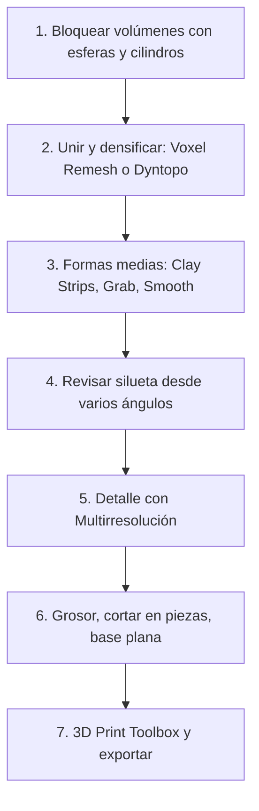

# Escultura digital en Blender

Parte de: [[38-Modelado-3D-Artistico/01 Blender/_Índice Blender|Blender]]

> [!info] Cómo avanzar
> `progreso`: **pendiente** → **viendo** (estudiando) → **visto** (contestaste la autoevaluación sin abrir las respuestas) → **dominado** (hiciste el laboratorio o lo aplicaste de verdad).

## Contenido

### Qué es
La **escultura digital** es modelar como si trabajaras barro: empujas, jalas, agregas y suavizas una malla muy densa con pinceles, sin pensar en vértices individuales. En Blender se hace en **Sculpt Mode**. Es la técnica natural para formas **orgánicas**: rostros, criaturas, figuras, ropa, rocas y texturas. Para impresión 3D es perfecta, porque la impresora no necesita una malla "bonita", solo una malla cerrada con buen detalle.

### Cómo funciona
**Esculpir vs. modelado poligonal**: en el [[Modelado poligonal en Blender]] controlas cada vértice; ideal para objetos geométricos (macetas, cajas, piezas duras). En escultura trabajas con cientos de miles o millones de polígonos y piensas en volúmenes y superficies. Muchas veces se combinan: bloque poligonal y detalle esculpido.

La escultura se apoya en tres subtemas:

- [[Pinceles básicos de escultura en Blender]]: las herramientas para dar forma (Clay Strips, Grab, Smooth…).
- [[Remesh y Dyntopo en Blender]]: cómo obtener una malla densa y pareja para esculpir.
- [[Multirresolución en Blender]]: cómo agregar detalle fino sin perder la forma base.

**Flujo general de una escultura para imprimir**:



**Esculpir con mouse**: se puede. Ajustes que ayudan:

- Baja la **fuerza** (`Shift+F`): con mouse no hay presión, así que cada trazo pega con toda la fuerza.
- Activa *Stroke → Stabilize Stroke* (el "lazy mouse") para líneas suaves.
- **Simetría en X** activada desde el inicio (botones X/Y/Z del encabezado).
- **Trazos cortos** y muchos, en vez de uno largo.
- Haz zoom para trabajar detalles, en lugar de reducir mucho el radio.

Una tableta con lápiz ayuda por la presión, pero no es indispensable (ver [[Tablet para escultura digital (opcional)]]).

**Rendimiento en tu PC**: la escultura usa sobre todo CPU y memoria; tu GTX 1660 Ti mueve la vista. Si el viewport se pone lento, baja la resolución del remesh, oculta partes con el menú *Visibility* o los *Face Sets* o trabaja por piezas.

### Ejemplo
Busto estilizado de un explorador original (idea propia, ver [[Bustos y figuras originales]]):

1. Esfera para el cráneo, esfera aplastada para la mandíbula, cilindro para el cuello y otro para el casco.
2. `Ctrl+J` para unirlos y **Voxel Remesh** de 1 mm (`R` y luego `Ctrl+R`).
3. **Grab** con radio grande para proporciones; **Clay Strips** para pómulos, nariz y cejas; **Smooth** entre pasos.
4. Gira la vista: frente, perfil, tres cuartos y desde abajo. Corrige silueta antes de detallar.
5. Agrega **Multiresolution**, subdivide 2–3 niveles y detalla arrugas del casco y ojos con **Crease**.
6. Aplica, revisa grosor y prepara la base (ver [[Preparar un modelo de Blender para imprimir]]).

### Práctica en tu Centauri 2
Haz el [[Lab 2 - Busto estilizado original esculpido con mouse]] a **8–10 cm** de alto. Imprímelo en PLA gris con capa de 0.12–0.16 mm para ver qué detalles sobreviven. Todo relieve de menos de ~1 mm se va a perder: anota cuáles se ven y cuáles no, y ajusta la profundidad de detalle en tu próxima escultura.

### Cuándo usarlo y cuándo no
Úsala para figuras, personajes originales, criaturas, texturas y objetos decorativos orgánicos. No la uses para piezas con medidas exactas o encajes: esculpir un agujero de 8.4 mm es una pesadilla; hazlo con [[Modificador Boolean en Blender]] o en un CAD.

### Errores comunes
- **Detallar demasiado pronto**: si las proporciones están mal, al corregirlas se pierden los detalles. Silueta primero.
- **Fuerza al máximo con mouse**: trazos brutos y llenos de bultos.
- **Esculpir sin simetría** una cara que debe ser simétrica.
- **Detalles demasiado finos para FDM**: no sobreviven a una capa de 0.12 mm ni a una boquilla de 0.4.

### Para profundizar
- [Manual oficial: escultura en Blender](https://docs.blender.org/manual/en/latest/sculpt_paint/sculpting/index.html)
- [Tutoriales oficiales de Blender](https://www.blender.org/support/tutorials/)

## Subtemas

- [[Pinceles básicos de escultura en Blender]]
- [[Remesh y Dyntopo en Blender]]
- [[Multirresolución en Blender]]

## Autoevaluación

Contesta primero en voz alta o en papel; luego despliega la respuesta.

> [!question]- ¿En qué se diferencia esculpir de modelar con polígonos?
> En escultura empujas, jalas y suavizas una malla densa como si fuera barro, sin pensar en vértices; ideal para formas orgánicas (rostros, criaturas). En poligonal controlas cada vértice; ideal para objetos geométricos.

> [!question]- ¿Se puede esculpir con mouse?
> Sí, con ajustes: baja la **fuerza** (no hay presión), activa *Stroke → Stabilize Stroke* (lazy mouse) para líneas suaves, trabaja con la **simetría en X** y usa trazos cortos. Una tableta ayuda pero no es indispensable ([[Tablet para escultura digital (opcional)]]).

> [!question]- ¿Cuál es el flujo general de una escultura para imprimir?
> 1) Bloquear volúmenes con formas simples. 2) Unificar y densificar con **Voxel Remesh** o **Dyntopo**. 3) Formas medias con Clay Strips, Grab y Smooth. 4) Detalle con **Multirresolución**. 5) Revisar grosor, cortar en piezas y exportar.

> [!question]- Error común de principiante. ¿Cuál?
> Detallar demasiado pronto. Si las proporciones están mal, los detalles se pierden al corregir. Revisa la silueta desde varios ángulos antes de pasar al detalle.

## Práctica

- [[Lab 2 - Busto estilizado original esculpido con mouse]]

## Progreso de los subtemas

```base
filters:
  and:
    - file.inFolder("38-Modelado-3D-Artistico/01 Blender/Escultura digital en Blender")
    - file.name != "Escultura digital en Blender"
views:
  - type: table
    name: Progreso
    order:
      - file.name
      - progreso
      - nivel
```
