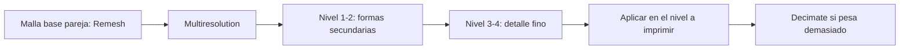

# Multirresolución en Blender

Parte de: [[Escultura digital en Blender]]

> [!info] Cómo avanzar
> `progreso`: **pendiente** → **viendo** (estudiando) → **visto** (contestaste la autoevaluación sin abrir las respuestas) → **dominado** (hiciste el laboratorio o lo aplicaste de verdad).

## Contenido

### Qué es
**Multiresolution** (Multires) es un modificador que subdivide la malla en **niveles** y te deja esculpir en el nivel alto sin destruir el nivel bajo. Puedes regresar a un nivel bajo para corregir la forma grande (girar una cabeza, alargar un brazo) y el detalle fino que esculpiste arriba se conserva y sigue a la forma. Es la herramienta de la etapa final: cuando la forma ya está y quieres arrugas, poros, textura de tela o detalles del casco.

### Cómo funciona
El modificador guarda la malla base y, encima, los desplazamientos de cada nivel de subdivisión.



Controles principales (en *Properties → Modifiers → Multiresolution*):

- **Subdivide**: agrega un nivel con suavizado (Catmull-Clark). **Simple** agrega sin suavizar y **Linear** sin cambiar la forma.
- **Sculpt Level**: el nivel en que esculpes.
- **Viewport Level** y **Render Levels**: cuántos niveles se muestran en la vista y en el render.
- **Apply Base**: ajusta la malla base a la forma esculpida (útil después de cambios grandes).
- **Unsubdivide / Rebuild Subdivisions**: intenta reconstruir niveles inferiores a partir de una malla densa.

Cada nivel multiplica los polígonos por unas **4 veces**. Una base de 50,000 caras pasa a 200,000, 800,000 y 3.2 millones en los niveles 1, 2 y 3.

**Multires vs. Remesh**: Remesh y Dyntopo (ver [[Remesh y Dyntopo en Blender]]) sirven para **bloquear y cambiar formas**, porque reconstruyen la malla y te permiten estirar sin deformar polígonos. Multires sirve cuando la forma ya está y quieres **detalle fino**. Si haces Voxel Remesh con Multires activo, pierdes los niveles; el orden importa.

### Ejemplo
Detalle del casco de tu busto original:

1. Termina la forma con Voxel Remesh de 0.8 mm (malla pareja de unas decenas de miles de caras).
2. Agrega **Multiresolution** y presiona **Subdivide** dos veces.
3. En nivel 2, usa *Clay Strips* suave para las placas del casco.
4. Sube a nivel 3 y usa *Crease* para las uniones y *Draw* con radio pequeño para remaches.
5. Si la nariz quedó desviada, baja a **Sculpt Level 1**, corrígela con *Grab* y regresa a nivel 3: los remaches siguen ahí.
6. Antes de exportar, vuelve a Object Mode y **aplica** el modificador en el nivel que vas a imprimir.

Con Python puedes revisar cuántos polígonos tienes antes de exportar:

```python
import bpy
obj = bpy.context.active_object
deps = bpy.context.evaluated_depsgraph_get()
malla = obj.evaluated_get(deps).to_mesh()
print(f"{obj.name}: {len(malla.polygons):,} caras con modificadores")
obj.evaluated_get(deps).to_mesh_clear()
```

### Práctica en tu Centauri 2
Exporta el mismo busto de 8 cm con Multires aplicado en nivel 2 y en nivel 4. Compara el tamaño de los STL y el tiempo que tarda el laminador en abrirlos. Imprime solo la cabeza en nivel 2 con capa de 0.12 mm: si el detalle se ve igual que en el nivel 4, ya sabes que no vale la pena exportar más.

### Cuándo usarlo y cuándo no
Úsalo para la etapa de detalle de esculturas, cuando la topología base ya no va a cambiar mucho. No lo uses para bloquear formas (usa Remesh o Dyntopo) ni si vas a seguir uniendo piezas con Boolean o Voxel Remesh: haz eso antes de agregar Multires.

### Errores comunes
- **Subir niveles sin necesidad**: archivos de millones de caras que no mejoran nada a 0.12–0.2 mm de capa.
- **Remesh con Multires activo**: borra el detalle.
- **Exportar sin aplicar** y luego revisar la malla equivocada en 3D Print Toolbox.
- **Decimate agresivo** después de aplicar: con razón 0.3–0.5 revisa que el detalle se mantenga.

### Para profundizar
- [Manual oficial: modificador Multiresolution](https://docs.blender.org/manual/en/latest/modeling/modifiers/generate/multiresolution.html)
- [Manual oficial: modificador Decimate](https://docs.blender.org/manual/en/latest/modeling/modifiers/generate/decimate.html)

## Autoevaluación

Contesta primero en voz alta o en papel; luego despliega la respuesta.

> [!question]- ¿Qué es el modificador Multiresolution?
> Subdivide la malla en niveles y te deja esculpir en el nivel alto **sin perder** el nivel bajo: puedes volver a niveles bajos para corregir formas grandes y el detalle se conserva.

> [!question]- ¿Cuándo usas Multires y cuándo Remesh?
> Remesh/Dyntopo para bloquear y cambiar formas; Multires cuando la forma ya está y quieres detalle fino (arrugas, textura de tela).

> [!question]- ¿Qué haces con Multires antes de exportar para imprimir?
> Aplicar el modificador en el nivel que quieres imprimir (o exportar con modificadores) y, si queda muy pesado, **Decimate** con razón 0.3–0.5 revisando que el detalle se mantenga.

## Práctica

- [[Lab 2 - Busto estilizado original esculpido con mouse]]

