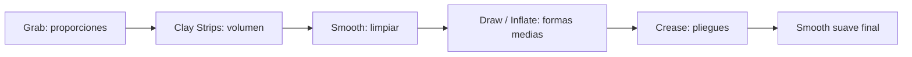

# Pinceles básicos de escultura en Blender

Parte de: [[Escultura digital en Blender]]

> [!info] Cómo avanzar
> `progreso`: **pendiente** → **viendo** (estudiando) → **visto** (contestaste la autoevaluación sin abrir las respuestas) → **dominado** (hiciste el laboratorio o lo aplicaste de verdad).

## Contenido

### Qué es
Los **pinceles** (*brushes*) son las herramientas de Sculpt Mode: cada uno deforma la superficie de una manera distinta. Con seis o siete pinceles puedes hacer casi cualquier escultura para imprimir. Desde Blender 4.3 los pinceles son **assets**: aparecen en una barra de recursos (*asset shelf*) en la parte inferior o superior del Viewport y algunos cambiaron de nombre o se dividieron en variantes; si no encuentras uno, búscalo por nombre en esa barra.

### Cómo funciona
**Los pinceles esenciales**:

| Pincel | Qué hace | Lo usas para |
|---|---|---|
| **Draw** | levanta (o hunde) una línea | marcar formas, cejas, costuras |
| **Clay Strips** | agrega masa en tiras planas | construir volumen: la base de casi todo |
| **Grab** | jala una zona completa | proporciones y posición de partes |
| **Smooth** | suaviza | limpiar bultos; con `Shift` sobre cualquier pincel |
| **Inflate** | infla en todas direcciones | mejillas, dedos, labios |
| **Crease** | marca un pliegue filoso | párpados, labios, arrugas, uniones de placas |

Otros útiles: **Flatten** o **Scrape** (aplanar), **Snake Hook** (jalar formas largas como cuernos o cabello, mejor con Dyntopo) y **Mask** (proteger zonas).

**Atajos clave**:

- `F`: radio del pincel (arrastra y haz clic).
- `Shift+F`: fuerza.
- `Ctrl` mientras pintas: **invierte** el pincel (hunde en vez de levantar).
- `Shift` mientras pintas: **suaviza**.
- `X`, `Y`, `Z` en el encabezado de Sculpt Mode: simetría por eje.
- `M`: máscara; `Alt+M` borra la máscara; `Ctrl+I` la invierte.

**Con mouse**: en *Stroke* activa **Stabilize Stroke** y súbele el radio; baja la fuerza a 0.3–0.5; usa trazos cortos; y suaviza al final. Trabajar con **zoom** amplio y radio mediano da mejor control que un radio diminuto lejos del modelo. *Radius Unit* en "View" hace que el radio sea en pixeles de pantalla; en "Scene", en unidades del modelo (útil para mantener el tamaño al hacer zoom).

### Ejemplo
Rostro estilizado en una esfera (ya con Voxel Remesh de 0.8 mm y simetría X):

1. **Grab** grande: estira la esfera hacia abajo para la mandíbula y aplana la cara.
2. **Clay Strips** (fuerza 0.4): arcos superciliares, pómulos y el puente de la nariz.
3. **Clay Strips** con `Ctrl`: cuencas de los ojos.
4. **Smooth** (`Shift`) entre cada paso.
5. **Inflate**: punta de la nariz y labios.
6. **Crease**: línea entre labios y párpados.
7. Revisa con la proporción de ojos a la mitad de la cabeza (ver [[Proporciones y anatomía básica para figuras]]).

### Práctica en tu Centauri 2
Esculpe una **placa de prueba de pinceles** de 60 × 40 × 4 mm: en una zona cada pincel con fuerza alta y baja, y en otra, líneas de Crease de distinta profundidad (0.3, 0.6, 1.0 y 1.5 mm). Imprímela parada en PLA con capa de 0.12 mm y observa qué profundidades se distinguen; esa placa será tu referencia de "qué detalle sí se imprime".

### Cuándo usarlo y cuándo no
Los pinceles son para formas orgánicas. Para superficies planas exactas, bordes rectos o agujeros, usa Edit Mode o modificadores (ver [[Modelado poligonal en Blender]] y [[Modificador Boolean en Blender]]).

### Errores comunes
- **Abusar de Draw**: hace figuras "de gusano". Construye con Clay Strips.
- **No suavizar**: se acumulan bultos y la impresión los exagera.
- **Fuerza alta con mouse**: trazos brutos.
- **Olvidar invertir con `Ctrl`**: para hundir no necesitas otro pincel.

### Para profundizar
- [Manual oficial: pinceles de escultura](https://docs.blender.org/manual/en/latest/sculpt_paint/sculpting/brushes/brushes.html)
- [Manual oficial: escultura en Blender](https://docs.blender.org/manual/en/latest/sculpt_paint/sculpting/index.html)

## Autoevaluación

Contesta primero en voz alta o en papel; luego despliega la respuesta.

> [!question]- ¿Qué hacen Draw, Clay Strips, Grab, Smooth, Inflate y Crease?
> **Draw**: levanta una línea. **Clay Strips**: agrega masa en tiras planas (la base de casi todo). **Grab**: jala una zona grande (proporciones). **Smooth**: suaviza (`Shift` con cualquier pincel). **Inflate**: infla. **Crease**: marca pliegues filosos (párpados, labios).

> [!question]- ¿Cuáles son los atajos clave al esculpir?
> `F` radio, `Shift+F` fuerza, `Ctrl` mientras pintas invierte el pincel (hunde en vez de levantar), `Shift` suaviza, `X`/`Y`/`Z` en el encabezado activan simetría.

> [!question]- Caso: con mouse los trazos salen temblorosos. ¿Qué ajustas?
> *Stabilize Stroke* con radio mayor, fuerza más baja, más trazos cortos, y suavizar al final. También ayuda trabajar con zoom amplio en lugar de radio pequeño.

## Práctica

- [[Lab 2 - Busto estilizado original esculpido con mouse]]

