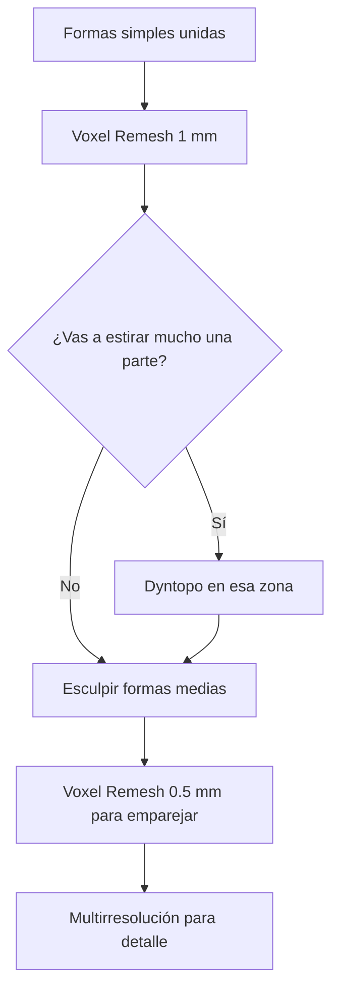

# Remesh y Dyntopo en Blender

Parte de: [[Escultura digital en Blender]]

> [!info] Cómo avanzar
> `progreso`: **pendiente** → **viendo** (estudiando) → **visto** (contestaste la autoevaluación sin abrir las respuestas) → **dominado** (hiciste el laboratorio o lo aplicaste de verdad).

## Contenido

### Qué es
Para esculpir necesitas una malla **densa y pareja**. Blender ofrece dos maneras de conseguirla y mantenerla mientras cambias la forma:

- **Voxel Remesh**: reconstruye toda la malla a partir de una cuadrícula de vóxeles (cubitos) del tamaño que elijas. El resultado es una malla uniforme, densa y **cerrada** (manifold).
- **Dyntopo** (*Dynamic Topology*): agrega o quita triángulos **solo donde pasa el pincel**, según el nivel de detalle que configures.

Ambas sirven para la etapa de volúmenes. Para el detalle final se usa [[Multirresolución en Blender]].

### Cómo funciona
**Voxel Remesh** (en Sculpt Mode, encabezado → *Remesh*):

- `R`: ajusta el **tamaño del vóxel** de forma interactiva (verás una cuadrícula sobre el modelo).
- `Ctrl+R`: aplica el remesh.
- Une objetos que se encimaban en una sola malla cerrada. Muy útil para impresión: juntas esferas y cilindros con `Ctrl+J` y un remesh los fusiona en un solo sólido.
- Con unidades en mm (ver [[Blender - interfaz, navegación y modos]]), un vóxel de 1 mm es bueno para bloquear un busto de 10 cm; 0.4–0.6 mm para formas medias.

**Dyntopo** (Sculpt Mode → *Dyntopo*, `Ctrl+D`):

- **Detailing**: *Relative Detail* (depende del zoom), *Constant Detail* (en unidades de escena) o *Brush Detail* (depende del radio).
- Ideal para formas largas que se estiran: cuernos, cabello, colas, dedos. Con Voxel Remesh esos polígonos se estiran hasta que vuelves a remeshear; con Dyntopo se crean al vuelo.
- Su malla es de triángulos irregulares; no es problema para imprimir.



**Cuidado con el orden**: Voxel Remesh borra niveles de Multires y **derrite los detalles finos** si el vóxel es más grande que el detalle. Remesh es para volúmenes; para conservar un detalle de 0.5 mm, el vóxel debe ser más chico que 0.5 mm, con el costo de muchos más polígonos.

### Ejemplo
Criatura original con cuernos para imprimir a 10 cm:

1. Bloque: esferas para cabeza y cuerpo, cilindros para patas. `Ctrl+J`.
2. Voxel Remesh de 1 mm: una sola malla cerrada.
3. Activa Dyntopo (*Constant Detail*, resolución que dé triángulos de ~0.5 mm) y saca los cuernos con **Snake Hook**.
4. Desactiva Dyntopo, Voxel Remesh de 0.5 mm para emparejar todo.
5. Agrega Multires para escamas y arrugas.

El tamaño del vóxel se puede fijar por script cuando repites el flujo:

```python
import bpy
obj = bpy.context.active_object
obj.data.remesh_voxel_size = 0.5      # mm, si tu escena está en mm
bpy.ops.object.voxel_remesh()
print(len(obj.data.polygons), "caras tras el remesh")
```

### Práctica en tu Centauri 2
Toma tu escultura y haz tres copias con Voxel Remesh de 1.0, 0.6 y 0.3 mm. Compara el número de caras y el detalle; imprime la cabeza de la de 0.6 mm a 8 cm con capa de 0.12. Si los detalles que te importan sobreviven, ese es tu tamaño de vóxel para bustos.

### Cuándo usarlo y cuándo no
**Voxel Remesh**: al inicio para unir y emparejar, y para cerrar mallas rotas (escaneos, ver [[Limpiar un escaneo y hacerlo imprimible]]). **Dyntopo**: cuando estiras formas o quieres densidad solo en algunas zonas. **Ninguno** al final si ya tienes detalle fino.

### Errores comunes
- **Voxel Remesh final con vóxel grande**: se pierden los detalles (se "derriten").
- **Olvidar la escala**: si la escena está en metros, un vóxel de "1" es de 1 m y el resultado es una bola.
- **Dyntopo con detalle muy fino en todo el modelo**: millones de triángulos y el viewport se arrastra.
- **Remesh con Multires**: borra los niveles de detalle.

### Para profundizar
- [Manual oficial: Remesh en Sculpt Mode](https://docs.blender.org/manual/en/latest/sculpt_paint/sculpting/tool_settings/remesh.html)
- [Manual oficial: Dyntopo](https://docs.blender.org/manual/en/latest/sculpt_paint/sculpting/tool_settings/dyntopo.html)

## Autoevaluación

Contesta primero en voz alta o en papel; luego despliega la respuesta.

> [!question]- ¿Qué es Voxel Remesh?
> Reconstruye la malla con una cuadrícula de vóxeles del tamaño que elijas: queda densa, pareja y **cerrada**. En Sculpt Mode: `R` para el tamaño, `Ctrl+R` para aplicar. Une objetos encimados en uno solo: muy útil para imprimir.

> [!question]- ¿Qué es Dyntopo y cuándo lo prefieres?
> *Dynamic Topology*: agrega o quita triángulos solo donde pasa el pincel. Útil para agregar formas largas (cuernos, cabello) sin estirar polígonos. Con Remesh tienes una malla uniforme; con Dyntopo, densidad local.

> [!question]- Error común: hacer Voxel Remesh al final con un tamaño grande. ¿Qué pasa?
> Se pierden los detalles finos (se "derriten"). Remesh es para la etapa de volúmenes; para el detalle final usa Multirresolución o un tamaño de vóxel menor al detalle que quieres conservar.

## Práctica

- [[Lab 2 - Busto estilizado original esculpido con mouse]]

