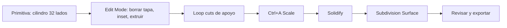

# Modelado poligonal en Blender

Parte de: [[38-Modelado-3D-Artistico/01 Blender/_Índice Blender|Blender]]

> [!info] Cómo avanzar
> `progreso`: **pendiente** → **viendo** (estudiando) → **visto** (contestaste la autoevaluación sin abrir las respuestas) → **dominado** (hiciste el laboratorio o lo aplicaste de verdad).

## Contenido

### Qué es
El **modelado poligonal** es construir objetos editando directamente su malla: **vértices** (puntos), **aristas** (líneas entre vértices) y **caras** (polígonos). Se hace en **Edit Mode** (`Tab`). Es la técnica para objetos de forma controlada: macetas, jarrones, bases, cajas decorativas, piezas duras de una figura (armaduras, armas de fantasía originales), letreros. Combinado con modificadores, es muy rápido para objetos que vas a imprimir.

### Cómo funciona
**Selección**: `1` vértices, `2` aristas, `3` caras. `A` selecciona todo, `Alt+A` nada, `Alt+clic` un bucle (*loop*), `L` lo conectado bajo el cursor, `Ctrl+L` todo lo conectado a la selección.

**Herramientas básicas**:

| Atajo | Herramienta | Uso típico |
|---|---|---|
| `G` / `R` / `S` | mover / girar / escalar | con `X`, `Y`, `Z` para restringir eje y un número para el valor exacto (`S` `Z` `0.5`) |
| `E` | extruir | sacar caras o aristas nuevas |
| `I` | inset | una cara dentro de otra (borde de una maceta) |
| `Ctrl+R` | loop cut | agregar bucles de aristas |
| `Ctrl+B` | bisel | redondear aristas |
| `K` | cuchillo | cortes libres |
| `M` | merge | unir vértices; `M → By Distance` limpia duplicados |
| `F` | fill | crear una cara entre vértices o aristas |
| `X` | borrar | vértices, aristas o caras |

**Aplicar transformaciones**: en Object Mode, si escalas un objeto, Blender guarda la escala como propiedad del objeto (por ejemplo 2.5) sin cambiar la malla. Biseles, Solidify y las mediciones de grosor trabajan con valores distorsionados: un grosor de 2 mm sale de 5 mm. Por eso, **antes de modificadores o exportar**, aplica la escala con `Ctrl+A → Scale` (o *All Transforms*). La escala vuelve a 1 y las medidas reales quedan en la malla.



### Ejemplo
Maceta de 80 mm de diámetro y 75 mm de alto:

1. `Shift+A → Mesh → Cylinder` con 32 vértices, radio 40 y profundidad 75 (escena en mm).
2. `Tab`, modo caras (`3`), selecciona la tapa de arriba y bórrala (`X → Faces`).
3. Selecciona la cara de abajo, `I` para un inset de 15 mm y `E` hacia adentro para un agujero de drenaje (o hazlo después con [[Modificador Boolean en Blender]]).
4. `Ctrl+R` para agregar bucles de apoyo cerca del borde superior y de la base.
5. Selecciona el bucle superior y escálalo `S` `1.1` para que la maceta se abra un poco hacia arriba (voladizo de pocos grados, imprimible).
6. Object Mode, `Ctrl+A → Scale`, agrega [[Modificador Solidify en Blender|Solidify]] de 2.1 mm y [[Modificador Subdivision Surface en Blender|Subdivision Surface]] nivel 2.

Así lo harías en Python para tenerlo como plantilla:

```python
import bpy
bpy.ops.mesh.primitive_cylinder_add(vertices=32, radius=40, depth=75, location=(0, 0, 37.5))
maceta = bpy.context.active_object
maceta.name = "Maceta"
sol = maceta.modifiers.new("Pared", 'SOLIDIFY')
sol.thickness = 2.1     # 5 líneas de 0.42 mm
sol.offset = -1         # crece hacia adentro: conserva el diámetro exterior
sub = maceta.modifiers.new("Suave", 'SUBSURF')
sub.levels = 2
```

### Práctica en tu Centauri 2
Haz el [[Lab 1 - Maceta con modelado poligonal en Blender]]. Antes de la maceta completa, exporta solo los primeros 10 mm (usa *Bisect* o un Boolean) para comprobar el grosor de pared y el agujero de drenaje en la impresión.

### Cuándo usarlo y cuándo no
Úsalo para objetos de forma geométrica o controlada y como base de esculturas. Para formas orgánicas finas, esculpe (ver [[Escultura digital en Blender]]). Para piezas técnicas con encajes, un CAD paramétrico es mejor.

### Errores comunes
- **Extruir y cancelar con clic derecho**: la geometría nueva queda encimada en el mismo lugar. Limpia con `A` y `M → By Distance`.
- **No aplicar la escala**: Solidify y biseles dan grosores falsos.
- **Caras internas** que quedaron al unir piezas: el laminador se confunde. Revisa con *Select All by Trait → Interior Faces*.
- **Normales invertidas**: revisa con el overlay *Face Orientation* y `Shift+N`.

### Para profundizar
- [Manual oficial: modelado de mallas](https://docs.blender.org/manual/en/latest/modeling/meshes/index.html)
- [Manual oficial: aplicar transformaciones](https://docs.blender.org/manual/en/latest/scene_layout/object/editing/apply.html)

## Autoevaluación

Contesta primero en voz alta o en papel; luego despliega la respuesta.

> [!question]- ¿Cuáles son las herramientas básicas de Edit Mode?
> `G`/`R`/`S` mover, girar y escalar (con `X`/`Y`/`Z` para restringir eje); `E` extruir; `I` inset; `Ctrl+R` corte de bucle (*loop cut*); `Ctrl+B` bisel; `K` cuchillo; `M` unir vértices; `1`/`2`/`3` vértice, arista, cara; `Alt+clic` selecciona un bucle.

> [!question]- ¿Por qué aplicar la escala (`Ctrl+A → Scale`) antes de usar modificadores o exportar?
> Si el objeto tiene escala distinta de 1, biseles, Solidify y la medición de grosor trabajan con valores distorsionados (un grosor de 2 mm sale de 1 o 4). Aplicarla deja la escala en 1 y las medidas reales en la malla.

> [!question]- Caso: quieres una maceta con pared y fondo. ¿Por dónde empiezas?
> Cilindro de 32 lados → borras la tapa superior → `I` (inset) y `E` en el fondo para el agujero de drenaje o lo haces con Boolean → *Solidify* para la pared → *Subdivision Surface* con bucles de apoyo en los bordes.

> [!question]- Error común: caras duplicadas o vértices encimados después de extruir y cancelar. ¿Cómo lo limpias?
> En Edit Mode: seleccionar todo y `M → By Distance` (*Merge by Distance*). Si extruyes y cancelas con clic derecho, la geometría nueva queda en el mismo lugar: revísalo siempre.

## Práctica

- [[Lab 1 - Maceta con modelado poligonal en Blender]]

