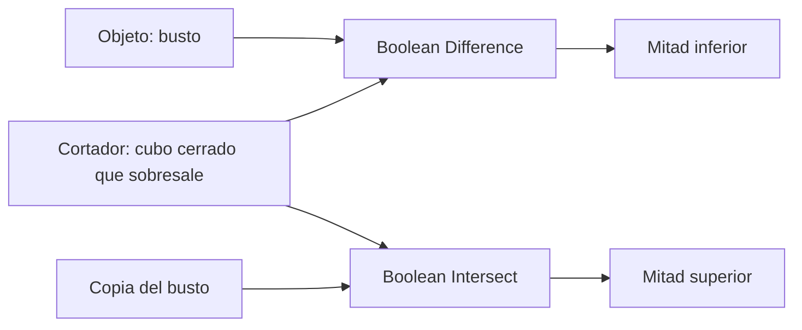

# Modificador Boolean en Blender

Parte de: [[Modificadores en Blender]]

> [!info] Cómo avanzar
> `progreso`: **pendiente** → **viendo** (estudiando) → **visto** (contestaste la autoevaluación sin abrir las respuestas) → **dominado** (hiciste el laboratorio o lo aplicaste de verdad).

## Contenido

### Qué es
El modificador **Boolean** combina dos mallas cerradas con operaciones de conjuntos, igual que el CSG de [[OpenSCAD]]:

- **Difference**: resta la malla "cortadora" del objeto (agujeros, ranuras, grabados).
- **Union**: une ambas en una sola malla y elimina las caras interiores.
- **Intersect**: se queda solo con el volumen común.

Para impresión lo usarás para agujeros de drenaje, cortar figuras en piezas, grabar texto, hacer huecos para imanes y pines, y unir accesorios a una figura.

### Cómo funciona
El modificador se agrega al objeto que se va a modificar y apunta a un **objeto** o a una **colección** de cortadores. Tiene tres **solvers**:

| Solver | Características |
|---|---|
| **Float** | sencillo y rápido, pero no soporta geometría encimada |
| **Exact** | el más confiable y el que mejor maneja geometría encimada; más lento |
| **Manifold** | normalmente el más rápido, pero solo funciona con mallas manifold (agregado en Blender 4.5) |

Para impresión, **Exact** es la opción segura; **Manifold** es excelente si tus mallas ya están limpias. Exact tiene opciones extra: *Self Intersection* (mallas que se cruzan consigo mismas) y *Hole Tolerant* (mallas no manifold, más lento).



**Reglas para que no falle**:

1. El cortador debe ser una malla **cerrada** (manifold).
2. Evita caras **coplanares** (una cara del cortador exactamente sobre una cara del objeto): haz que el cortador **sobresalga** un poco.
3. Normales hacia afuera en ambos objetos.
4. Escala aplicada en ambos (`Ctrl+A → Scale`).
5. Oculta el cortador (o ponlo en modo de visualización *Wire* o *Bounds*) para ver el resultado.

### Ejemplo
**Cortar un busto en dos para imprimir** (el corte en el cuello o en el borde de una prenda, ver [[Cortar modelos en piezas y pines de unión]]):

1. Agrega un cubo grande que cubra la parte superior del busto y que el plano inferior del cubo quede justo donde quieres el corte.
2. Duplica el busto (`Shift+D`).
3. En el busto original: Boolean **Difference** con el cubo → queda la parte de abajo.
4. En la copia: Boolean **Intersect** con el mismo cubo → queda la parte de arriba.
5. Las dos piezas encajan exactas porque salen del mismo plano de corte.
6. Agrega dos cilindros como cortadores para los agujeros de los pines (Difference en ambas piezas) con holgura de 0.25 por lado.

Con Python:

```python
import bpy
busto = bpy.data.objects["Busto"]
cubo = bpy.data.objects["Cortador"]

copia = busto.copy(); copia.data = busto.data.copy(); copia.name = "Busto_arriba"
bpy.context.collection.objects.link(copia)

for obj, op in ((busto, 'DIFFERENCE'), (copia, 'INTERSECT')):
    m = obj.modifiers.new("Corte", 'BOOLEAN')
    m.operation = op
    m.object = cubo
    m.solver = 'EXACT'
cubo.display_type = 'WIRE'
```

### Práctica en tu Centauri 2
Corta tu busto con este método, agrega agujeros de Ø4.5 mm y 5.5 mm de profundidad en ambas piezas e imprime un pin de Ø4 × 10 mm **acostado**. Antes de imprimir el busto completo, haz un Boolean Intersect con un cubo delgado para imprimir solo una "rebanada" de 4 mm alrededor del corte y probar el encaje de los pines.

### Cuándo usarlo y cuándo no
Úsalo para operaciones geométricas precisas en mallas cerradas. Para unir muchas piezas orgánicas (un sombrero metido en la cabeza), un **Voxel Remesh** suele ser más robusto que varios Union (ver [[Remesh y Dyntopo en Blender]]). Para cortar con un plano en Edit Mode también existe *Bisect*, más simple si no necesitas las dos mitades a la vez.

### Errores comunes
- **Cortador abierto** (un plano o un cubo sin una cara): huecos o resultado vacío.
- **Caras coplanares**: caras parpadeando o resultado con agujeros; sobresale el cortador.
- **Normales invertidas** en el cortador: resta lo contrario.
- **Solver Float** con geometría encimada: resultados rotos; usa Exact.
- **Olvidar aplicar** antes de seguir esculpiendo sobre el resultado.

### Para profundizar
- [Manual oficial: modificador Boolean](https://docs.blender.org/manual/en/latest/modeling/modifiers/generate/booleans.html)
- [Notas de versión 4.5 LTS (solver Manifold)](https://www.blender.org/download/releases/4-5/)

## Autoevaluación

Contesta primero en voz alta o en papel; luego despliega la respuesta.

> [!question]- ¿Qué operaciones ofrece Boolean?
> **Difference** (restar), **Union** (unir) e **Intersect** (quedarse con lo común). El solver **Exact** es más lento pero más confiable para impresión.

> [!question]- Caso: quieres cortar un busto en dos para imprimir. ¿Cómo lo haces con Boolean?
> Duplica el busto, usa un cubo grande como cortador: en una copia **Difference** y en la otra **Intersect** con el mismo cubo. Obtienes dos piezas que encajan exactas; luego agregas pines.

> [!question]- Error común con Boolean. ¿Cuál?
> Usar como cortador una malla abierta (no manifold) o con caras coplanares con el objeto: el resultado sale con huecos. El cortador debe ser cerrado y sobresalir un poco.

## Práctica

- [[Lab 2 - Busto estilizado original esculpido con mouse]]

