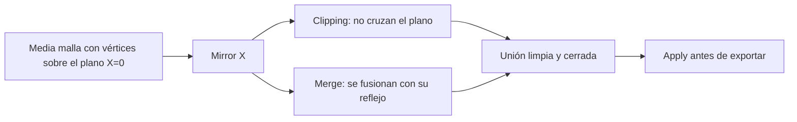

# Modificador Mirror en Blender

Parte de: [[Modificadores en Blender]]

> [!info] Cómo avanzar
> `progreso`: **pendiente** → **viendo** (estudiando) → **visto** (contestaste la autoevaluación sin abrir las respuestas) → **dominado** (hiciste el laboratorio o lo aplicaste de verdad).

## Contenido

### Qué es
El modificador **Mirror** refleja una malla sobre uno o más ejes del objeto: modelas **una mitad** y Blender genera la otra en tiempo real. Todo lo que hagas de un lado aparece del otro. Es indispensable para cuerpos, rostros, criaturas, jarrones, logotipos simétricos y cualquier objeto que deba ser simétrico. Para impresión, además, te asegura que la pieza quede balanceada y que ambas mitades sean idénticas.

### Cómo funciona
El reflejo se hace respecto al **origen del objeto** (el punto naranja), no al centro del mundo, a menos que uses un objeto como referencia en *Mirror Object*. Opciones principales:

- **Axis X / Y / Z**: ejes de reflejo (normalmente X).
- **Bisect**: corta la parte de la malla que cruza al otro lado del plano.
- **Flip**: invierte qué lado se conserva al usar Bisect.
- **Clipping**: impide que los vértices del centro crucen el plano de simetría y los mantiene **pegados** a él cuando los mueves.
- **Merge** con distancia: fusiona los vértices del centro que quedan a menos de esa distancia de su reflejo.



**Por qué importan Clipping y Merge para imprimir**: si un vértice del centro queda 0.01 mm fuera del plano y no se fusiona, al aplicar el Mirror quedan **dos bordes abiertos** uno junto al otro. La malla se ve cerrada, pero es **no manifold**: el laminador puede marcar errores o dejar una ranura en la pieza. Con Clipping y Merge activados antes de aplicar, la unión queda soldada.

Orden en la pila: Mirror va **antes** de Subdivision Surface y de Solidify, para que el suavizado y el grosor se calculen sobre la pieza completa.

### Ejemplo
Jarrón simétrico de sección ondulada:

1. Agrega un cilindro de 16 lados, entra a Edit Mode y borra la mitad con X negativa (selecciona vértices con `X < 0` y `X → Vertices`).
2. Asegúrate de que los vértices del corte estén exactamente en X = 0: selecciónalos y escala `S` `X` `0`.
3. Agrega **Mirror** en X con **Clipping** y **Merge** activados.
4. Modela la mitad: extruye, escala bucles, agrega ondas con `G` en vértices alternos; el otro lado se actualiza.
5. Agrega Solidify (1.68 mm) y Subdivision nivel 2 **debajo** del Mirror.

Para revisar después de aplicar si quedó algún borde abierto:

```python
import bpy, bmesh
obj = bpy.context.active_object
bm = bmesh.new(); bm.from_mesh(obj.data)
abiertas = [e for e in bm.edges if not e.is_manifold]
print(f"Aristas no manifold: {len(abiertas)}")
bm.free()
```

### Práctica en tu Centauri 2
Haz el jarrón dos veces: una con Clipping y Merge, otra sin ellos y con un vértice del centro movido 0.05 mm. Aplica el Mirror en ambos, revisa con el script o con *Select → Select All by Trait → Non Manifold* y abre los dos en [[ElegooSlicer y OrcaSlicer]] para ver qué avisa el laminador. Imprime el correcto.

### Cuándo usarlo y cuándo no
Úsalo desde el inicio en todo lo que sea simétrico. En esculturas, en vez del modificador puedes usar la **simetría del pincel** (X/Y/Z en Sculpt Mode), que es más práctica. Si quieres romper la simetría al final (una figura con la cabeza ladeada, un gesto asimétrico), **aplica** el Mirror y luego haz los cambios: un personaje perfectamente simétrico se ve rígido.

### Errores comunes
- **Origen del objeto fuera del centro**: el reflejo aparece desplazado. Mueve el origen (*Object → Set Origin*) o usa *Mirror Object*.
- **Sin Clipping ni Merge**: bordes abiertos en la unión.
- **Caras sobre el plano de simetría**: quedan caras internas al reflejar; bórralas antes.
- **Mirror debajo de Subdivision** en la pila: costura visible en el centro.

### Para profundizar
- [Manual oficial: modificador Mirror](https://docs.blender.org/manual/en/latest/modeling/modifiers/generate/mirror.html)
- [Manual oficial: modificadores](https://docs.blender.org/manual/en/latest/modeling/modifiers/index.html)

## Autoevaluación

Contesta primero en voz alta o en papel; luego despliega la respuesta.

> [!question]- ¿Para qué sirve Mirror?
> Modelas una mitad y el modificador crea la otra reflejada sobre un eje. Ideal para cuerpos, rostros, jarrones.

> [!question]- ¿Qué hace la opción *Clipping*?
> Evita que los vértices del centro crucen el plano de simetría y los mantiene pegados a él; sin *Clipping*, puedes dejar un hueco o una cresta en la unión.

> [!question]- Caso: aplicas Mirror y al revisar aparecen aristas no manifold en el centro. ¿Por qué?
> Los vértices del centro no estaban exactamente en el plano y no se fusionaron. Activa *Merge* (y *Clipping*) en el modificador antes de aplicar, o usa `M → By Distance` después.

