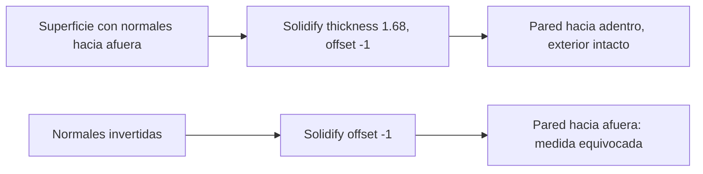

# Modificador Solidify en Blender

Parte de: [[Modificadores en Blender]]

> [!info] Cómo avanzar
> `progreso`: **pendiente** → **viendo** (estudiando) → **visto** (contestaste la autoevaluación sin abrir las respuestas) → **dominado** (hiciste el laboratorio o lo aplicaste de verdad).

## Contenido

### Qué es
El modificador **Solidify** da **grosor** a una superficie: convierte una malla de una sola capa de caras (sin volumen) en un sólido con dos caras y un borde que las une. Es imprescindible para imprimir, porque una superficie sin grosor no tiene volumen y el laminador no puede generar nada: una maceta, una pantalla de lámpara, una capa de ropa o una hoja modeladas como superficie necesitan Solidify antes de exportar.

### Cómo funciona
Solidify desplaza una copia de la superficie a lo largo de sus **normales** y une los bordes. Parámetros clave:

- **Thickness** (grosor): en unidades de la escena; con la escena en mm (ver [[Blender - interfaz, navegación y modos]]), `1.68` son 1.68 mm.
- **Offset**: hacia dónde crece el grosor respecto a la superficie original.
  - `-1`: crece hacia **adentro** (lado opuesto a la normal). Conservas la medida **exterior**: ideal para una maceta que debe medir 80 mm por fuera.
  - `+1`: crece hacia **afuera**. Conservas la medida **interior**: ideal para un estuche que debe contener algo.
  - `0`: mitad y mitad.
- **Even Thickness**: mantiene el grosor parejo en esquinas agudas (más lento, más preciso).
- **Fill Rim**: cierra el borde (activado por defecto); sin él la pieza queda abierta.



**Qué grosor poner**: al menos 2–3 líneas de boquilla y, mejor, un **múltiplo del ancho de línea** de tu perfil. Con la boquilla de 0.4 mm de tu [[Elegoo Centauri 2 Combo]] y línea de 0.42 mm: 1.26 mm (3 líneas), 1.68 mm (4) o 2.1 mm (5). Para detalles finos que deben aguantar, no menos de 1.2 mm.

**Normales**: Solidify depende de la dirección de las normales. Activa el overlay **Face Orientation** (menú *Overlays* del viewport): **azul** es el lado de afuera y **rojo** el de adentro. Si ves rojo por fuera, en Edit Mode selecciona todo y usa `Shift+N` (*Recalculate Outside*).

### Ejemplo
Pantalla de lámpara de 120 mm de diámetro exterior:

```python
import bpy
obj = bpy.context.active_object      # superficie de la pantalla, escala aplicada
m = obj.modifiers.new("Pared", 'SOLIDIFY')
m.thickness = 1.68                   # 4 líneas de 0.42 mm
m.offset = -1                        # conserva los 120 mm exteriores
m.use_even_offset = True             # grosor parejo en curvas
m.use_rim = True                     # cierra el borde
```

Recuerda aplicar la escala antes (`Ctrl+A → Scale`): con una escala de objeto de 2, el grosor real sería de 3.36 mm.

### Práctica en tu Centauri 2
Haz un cilindro abierto de 60 mm de diámetro y dale Solidify de 1.26, 1.68 y 2.1 mm con offset −1. Exporta los tres y revisa en la vista previa del laminador cuántas líneas pone en cada pared: con un grosor múltiplo del ancho de línea no debería aparecer relleno de huecos (*gap fill*). Imprime el de 1.68 y mide el diámetro exterior con calibrador: debe ser 60 mm.

### Cuándo usarlo y cuándo no
Úsalo en cualquier modelo de superficie: macetas, jarrones, pantallas, ropa, hojas, alas, letreros curvos. No lo necesitas en esculturas sólidas (ya tienen volumen). Para **ahuecar** una escultura maciza y ahorrar material, es mejor la función *Hollow* de 3D Print Toolbox o dejar que el laminador use poco relleno, porque Solidify sobre una malla cerrada crea una pared interior sin salida para el aire.

### Errores comunes
- **Normales invertidas**: la pared crece al lado contrario y la medida cambia. Revisa con Face Orientation y `Shift+N`.
- **Escala sin aplicar**: grosor falso.
- **Grosor arbitrario** (1.0, 1.5): líneas delgadas o huecos en la pared.
- **Autointersecciones** en curvas cerradas: si el grosor es mayor que el radio de curvatura, la pared se cruza consigo misma; baja el grosor o suaviza la curva.

### Para profundizar
- [Manual oficial: modificador Solidify](https://docs.blender.org/manual/en/latest/modeling/modifiers/generate/solidify.html)
- [Manual oficial: normales](https://docs.blender.org/manual/en/latest/modeling/meshes/structure.html)

## Autoevaluación

Contesta primero en voz alta o en papel; luego despliega la respuesta.

> [!question]- ¿Qué hace Solidify y cuándo lo usas al imprimir?
> Da **grosor** a una superficie: una maceta hecha de una sola capa de caras se vuelve un sólido con pared real. Imprescindible: un modelo sin grosor no se puede imprimir.

> [!question]- ¿Qué grosor pones y qué significa *Offset*?
> Un grosor de al menos 2–3 líneas de boquilla (con 0.4 mm, **1.2–2 mm**). *Offset* −1 crece hacia adentro (conservas la medida exterior), +1 hacia afuera.

> [!question]- Error común: Solidify con normales invertidas. ¿Qué pasa y cómo lo corriges?
> La pared crece hacia el lado contrario. Activa el *overlay* **Face Orientation** (azul = afuera, rojo = adentro) y corrige con `Shift+N` (*Recalculate Outside*) en Edit Mode.

## Práctica

- [[Lab 1 - Maceta con modelado poligonal en Blender]]

