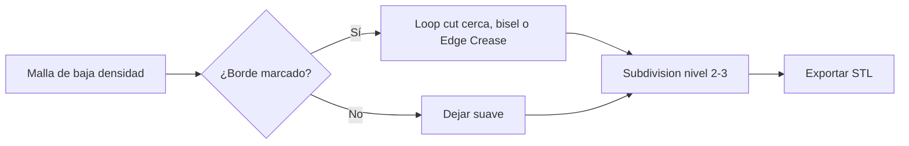

# Modificador Subdivision Surface en Blender

Parte de: [[Modificadores en Blender]]

> [!info] Cómo avanzar
> `progreso`: **pendiente** → **viendo** (estudiando) → **visto** (contestaste la autoevaluación sin abrir las respuestas) → **dominado** (hiciste el laboratorio o lo aplicaste de verdad).

## Contenido

### Qué es
**Subdivision Surface** (Subsurf) divide cada cara de la malla en caras más pequeñas y **suaviza** la forma con el algoritmo Catmull-Clark. Con una malla de pocos polígonos, fácil de editar, obtienes superficies curvas y suaves. Es la herramienta que convierte un cilindro de 32 lados en una maceta redonda y orgánica, o un bloque tosco en una pieza con curvas agradables.

### Cómo funciona
Cada nivel de subdivisión divide cada cara cuadrada en cuatro y recoloca los vértices para suavizar. Por eso los polígonos se multiplican por **4 en cada nivel**:

| Nivel | Caras a partir de 1,000 |
|---|---|
| 1 | 4,000 |
| 2 | 16,000 |
| 3 | 64,000 |
| 4 | 256,000 |
| 5 | 1,024,000 |

Atajos: en Object Mode, `Ctrl+1`, `Ctrl+2`, `Ctrl+3` agregan Subsurf con ese nivel. El modificador tiene **Levels Viewport** (lo que ves) y **Render** (lo que se usa al renderizar); el exportador STL usa lo que evalúa la vista, así que revisa ese valor antes de exportar.

**El suavizado redondea todo**, incluidos los bordes que quieres marcados. Para conservar un borde definido:

- **Bucles de apoyo** (`Ctrl+R`) cerca del borde: cuanto más cerca, más filo.
- **Bisel** pequeño (`Ctrl+B`) en la arista.
- **Edge Crease** (`Shift+E` en Edit Mode, valor de 0 a 1): marca la arista como dura sin agregar geometría.



**Para imprimir**: con capas de 0.12–0.2 mm y boquilla de 0.4 mm, la impresora no reproduce facetas más chicas que unas décimas de milímetro. Por eso un nivel **2–3** casi siempre basta. Niveles 4 o 5 generan archivos enormes que tardan en exportar y en laminar y no mejoran la pieza.

### Ejemplo
Maceta con borde superior marcado y base redondeada:

1. Cilindro de 32 lados con la tapa borrada y la pared ya con Solidify.
2. `Ctrl+R` dos bucles muy cerca del borde superior (a 1 mm): el borde queda definido.
3. Un bucle a 5 mm de la base: la base queda redondeada suave, pero sigue plana para apoyar en la cama.
4. `Ctrl+2`. Revisa el número de caras en la barra de estado (activa *Scene Statistics* con clic derecho en ella).

Con Python, para dejar el nivel bajo control antes de exportar:

```python
import bpy
for obj in bpy.context.selected_objects:
    for m in obj.modifiers:
        if m.type == 'SUBSURF' and m.levels > 3:
            print(f"{obj.name}: bajando Subsurf de {m.levels} a 3")
            m.levels = 3
```

### Práctica en tu Centauri 2
Exporta la misma maceta con nivel 1, 2 y 4. Compara el tamaño del STL y observa en el laminador la vista previa: imprime solo los primeros 15 mm de los niveles 1 y 2 y compara las facetas. Lo normal es que el nivel 2 ya se vea liso; el 4 no se distinguirá del 2.

### Cuándo usarlo y cuándo no
Úsalo en modelado poligonal de objetos curvos y orgánicos de forma controlada: macetas, jarrones, piezas duras de figuras, perillas decorativas. No lo necesitas en esculturas (ya son densas; para ellas existe [[Multirresolución en Blender]]) ni en piezas técnicas con caras planas exactas, donde redondea lo que no debe.

### Errores comunes
- **Nivel 4 o 5 para imprimir**: archivos gigantes sin ganancia.
- **Bordes y bases redondeados sin querer**: falta un bucle de apoyo; la base debe quedar plana para la cama.
- **Triángulos y polos de muchas aristas** en la malla base: arrugas al subdividir; prefiere caras de 4 lados.
- **Subsurf antes que Mirror** en la pila: costura en el centro.

### Para profundizar
- [Manual oficial: Subdivision Surface](https://docs.blender.org/manual/en/latest/modeling/modifiers/generate/subdivision_surface.html)
- [Manual oficial: Edge Crease](https://docs.blender.org/manual/en/latest/modeling/meshes/editing/edge/edge_data.html)

## Autoevaluación

Contesta primero en voz alta o en papel; luego despliega la respuesta.

> [!question]- ¿Qué hace Subdivision Surface?
> Divide cada cara y suaviza la forma (Catmull-Clark). Con pocos polígonos obtienes superficies curvas. Atajo en Object Mode: `Ctrl+1`, `Ctrl+2`…

> [!question]- ¿Cómo mantienes un borde marcado con subdivisión?
> Con **bucles de apoyo** (`Ctrl+R`) cerca del borde, un bisel pequeño o *Edge Crease* (`Shift+E`). Cuanto más cerca el bucle, más filo.

> [!question]- Error común para imprimir: nivel 4 o 5 de subdivisión. ¿Por qué evitarlo?
> Multiplica los polígonos ×4 por nivel: archivos enormes que no mejoran nada a 0.2 mm de capa. Nivel 2–3 basta casi siempre.

## Práctica

- [[Lab 1 - Maceta con modelado poligonal en Blender]]

