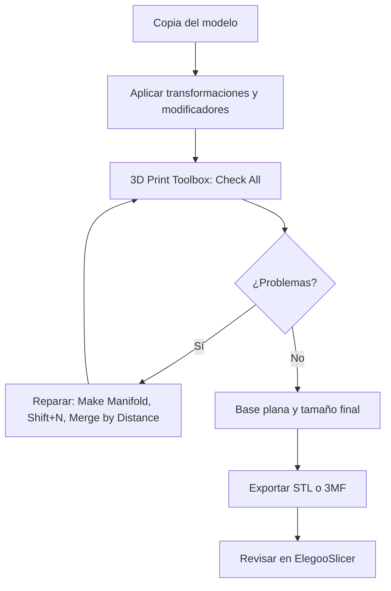

# Preparar un modelo de Blender para imprimir

Parte de: [[38-Modelado-3D-Artistico/01 Blender/_Índice Blender|Blender]]

> [!info] Cómo avanzar
> `progreso`: **pendiente** → **viendo** (estudiando) → **visto** (contestaste la autoevaluación sin abrir las respuestas) → **dominado** (hiciste el laboratorio o lo aplicaste de verdad).

## Contenido

### Qué es
Es la revisión final entre "se ve bien en Blender" y "sale bien de la impresora". Un modelo puede verse perfecto en pantalla y aun así llegar al laminador con la escala equivocada, huecos invisibles, normales invertidas, paredes de 0.3 mm o sin una base plana. Preparar el modelo es una **lista de verificación** que repites siempre antes de exportar, apoyada en la extensión **3D Print Toolbox**.

### Cómo funciona
**Lista de verificación**:

1. **Escala real en mm**: unidades de la escena en milímetros (ver [[Blender - interfaz, navegación y modos]]) y transformaciones aplicadas (`Ctrl+A → All Transforms`).
2. **Modificadores aplicados** (en una copia) para revisar la malla real.
3. **Malla manifold**: cerrada, sin bordes sueltos ni aristas compartidas por más de dos caras (ver [[Reparar mallas para impresión]]).
4. **Normales hacia afuera**: overlay *Face Orientation* y `Shift+N`.
5. **Sin intersecciones raras** ni caras internas.
6. **Grosor mínimo**: detalles finos de al menos ~1.2 mm con boquilla de 0.4.
7. **Base plana** para apoyar en la cama (o planear soportes).
8. **Tamaño** dentro del volumen de tu [[Elegoo Centauri 2 Combo]] (256 × 256 × 256 mm); si no cabe, corta en piezas.

**3D Print Toolbox** es una extensión gratuita (GPL) para Blender 4.2 o posterior. Se instala desde *Edit → Preferences → Get Extensions* buscando "3D Print Toolbox" y aparece en la barra lateral (`N`), pestaña **3D-Print**. Funciones:

- **Statistics**: volumen y área (útil para estimar filamento).
- **Checks**: sólido (manifold), intersecciones, caras degeneradas, distorsión, grosor y voladizos.
- **Clean Up**: *Make Manifold* intenta reparar.
- **Transform**: escalar a un tamaño o volumen objetivo y alinear a la cama.
- **Hollow**: ahuecar con grosor constante.
- **Export**: exportación rápida a STL, PLY u OBJ.



**STL o 3MF**: STL guarda solo la malla, sin unidades ni colores (el laminador asume mm). **3MF** guarda unidades, varias piezas y colores: mejor para multicolor con el CANVAS. Blender exporta STL de forma nativa (*File → Export → STL*); para 3MF instala la extensión **3MF Import/Export** (GPL, Blender 4.2+), que conserva materiales, colores y varios objetos. Ver [[Archivos para imprimir (STL, 3MF, OBJ y STEP)]].

### Ejemplo
Exportar por script los objetos seleccionados a STL, con escala de la escena y modificadores:

```python
import bpy, os
ruta = os.path.join(os.path.expanduser("~"), "Desktop", "busto.stl")
bpy.ops.wm.stl_export(
    filepath=ruta,
    export_selected_objects=True,
    apply_modifiers=True,
    use_scene_unit=True,     # respeta Unit Scale 0.001 → mm
)
print("Exportado:", ruta)
```

**Caso típico**: en ElegooSlicer tu busto de 10 cm aparece de 0.1 mm. Modelaste en metros con la escala por defecto y un valor de "0.1" se interpretó como 0.1 mm. Arreglo correcto: unidades en mm con *Unit Scale 0.001*, escala el modelo a 100 mm, aplica transformaciones y exporta de nuevo. Parche rápido: escalar ×1000 en el laminador.

### Práctica en tu Centauri 2
Haz el [[Lab 3 - Inspeccionar con 3D Print Toolbox y exportar STL y 3MF]] con tu busto o maceta. Anota el volumen que reporta el toolbox y compáralo con el filamento que estima el laminador: con relleno bajo, el laminador debe estimar bastante menos que el volumen macizo.

### Cuándo usarlo y cuándo no
Siempre, antes de cada exportación para imprimir. Los modelos descargados también conviene revisarlos: muchos tienen errores que el laminador repara a medias.

### Errores comunes
- **Escala por defecto en metros**.
- **Revisar sin aplicar modificadores**: el toolbox mira la malla original.
- **Exportar todo en vez de lo seleccionado**: entran cortadores ocultos, luces o referencias.
- **Detalles de menos de 1 mm** que se pierden en la impresión.
- **Sin base plana**: la figura se cae o necesita soportes innecesarios.

### Para profundizar
- [Extensión 3D Print Toolbox](https://extensions.blender.org/add-ons/print3d-toolbox/)
- [Extensión 3MF Import/Export](https://extensions.blender.org/add-ons/threemf-io/)
- [Manual oficial: importar y exportar archivos](https://docs.blender.org/manual/en/latest/files/import_export/index.html)

## Autoevaluación

Contesta primero en voz alta o en papel; luego despliega la respuesta.

> [!question]- ¿Qué revisas antes de exportar?
> 1) **Escala real** en mm y transformaciones aplicadas. 2) Malla **manifold** (cerrada, sin bordes sueltos). 3) Normales hacia afuera. 4) Sin intersecciones raras. 5) **Grosor** mínimo (≥ 1.2 mm aprox. para detalles finos con boquilla de 0.4). 6) Base plana para apoyarlo en la cama.

> [!question]- ¿Qué es 3D Print Toolbox y de dónde lo instalas?
> Una extensión gratuita (GPL) para Blender 4.2 o más reciente que analiza la malla, mide volumen y área, repara con *Make Manifold*, ahueca, escala a un tamaño objetivo y exporta rápido a STL, PLY u OBJ ([extensión](https://extensions.blender.org/add-ons/print3d-toolbox/)). Se instala desde *Edit → Preferences → Get Extensions*. Aparece en la barra lateral (`N`), pestaña de 3D Print.

> [!question]- ¿STL o 3MF?
> STL solo guarda la malla (sin unidades ni colores). **3MF** guarda unidades, varias piezas y colores: mejor para multicolor. Blender exporta STL de forma nativa; para 3MF instala la extensión [3MF Import/Export](https://extensions.blender.org/add-ons/threemf-io/). Ver [[Archivos para imprimir (STL, 3MF, OBJ y STEP)]].

> [!question]- Caso: en ElegooSlicer tu busto de 10 cm aparece de 0.1 mm. ¿Qué pasó?
> Modelaste en metros (escala por defecto). Configura *Unit Scale 0.001* y milímetros, ajusta el tamaño y vuelve a exportar; o escala ×1000 en el laminador como parche.

## Práctica

- [[Lab 3 - Inspeccionar con 3D Print Toolbox y exportar STL y 3MF]]

