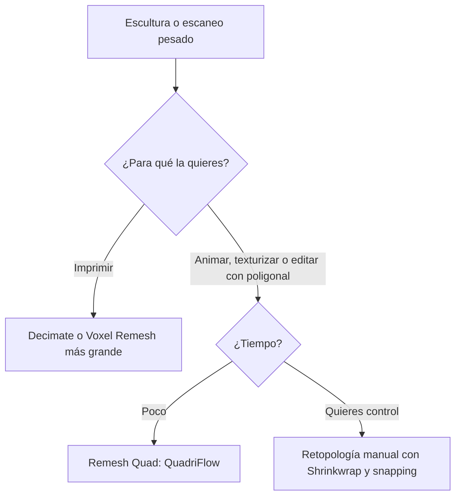

# Retopología básica

Parte de: [[38-Modelado-3D-Artistico/01 Blender/_Índice Blender|Blender]]

> [!info] Cómo avanzar
> `progreso`: **pendiente** → **viendo** (estudiando) → **visto** (contestaste la autoevaluación sin abrir las respuestas) → **dominado** (hiciste el laboratorio o lo aplicaste de verdad).

## Contenido

### Qué es
La **retopología** es rehacer una malla densa e irregular (una escultura de millones de triángulos, un escaneo) con una malla nueva, ligera y ordenada, normalmente de **cuadriláteros** que siguen el flujo de la forma. Es una técnica clave en animación, videojuegos y texturizado, donde la malla debe deformarse bien y tener pocos polígonos. **Para imprimir en 3D no es necesaria**: el laminador solo necesita una malla cerrada y de tamaño razonable, sin importar si son triángulos desordenados.

### Cómo funciona
Hay tres caminos, de más automático a más manual:



**Alternativas para aligerar sin retopología manual**:

- **Decimate** (modificador): reduce triángulos manteniendo la forma. Modo *Collapse* con una razón (*Ratio*) de 0.3–0.5 suele conservar bien el detalle visible en una impresión. Revisa con zoom que no aparezcan facetas en zonas curvas importantes.
- **Remesh → Quad (QuadriFlow)**: en *Object Data Properties → Remesh*, genera automáticamente una malla de cuadriláteros con el número de caras que pidas. Útil si después quieres editar en Edit Mode.
- **Voxel Remesh más grande** en zonas sin detalle: reduce polígonos y cierra la malla (ver [[Remesh y Dyntopo en Blender]]).

**Retopología manual en Blender** (para practicar o para un personaje que vas a animar además de imprimir):

1. Agrega un **plano** pequeño frente a la escultura.
2. Activa **snapping** a caras (*Snap to Face*, con *Face Project*) para que los vértices se peguen a la superficie de la escultura.
3. Agrega el modificador **Shrinkwrap** al plano con la escultura como objetivo, para que la malla nueva se ajuste a ella.
4. Agrega **Mirror** con Clipping para trabajar media cara.
5. Extruye aristas (`E`) siguiendo los bucles naturales: alrededor de ojos y boca, a lo largo de la mandíbula.
6. Overlay *In Front* (en las propiedades del objeto) para ver la malla nueva sobre la escultura.

### Ejemplo
Una escultura de 4 millones de caras tarda en exportar y el laminador se pone lento. Para imprimirla:

```python
import bpy
obj = bpy.context.active_object
antes = len(obj.data.polygons)
m = obj.modifiers.new("Aligerar", 'DECIMATE')
m.decimate_type = 'COLLAPSE'
m.ratio = 0.4
bpy.ops.object.modifier_apply(modifier=m.name)
print(f"{antes:,} → {len(obj.data.polygons):,} caras")
```

Con una razón de 0.4 pasas de 4 millones a 1.6 millones de caras. Repite si hace falta, revisando el detalle.

### Práctica en tu Centauri 2
Duplica tu busto tres veces: original, Decimate 0.5 y Decimate 0.2. Exporta los tres y compara tamaños de archivo. Imprime la cabeza de la versión 0.2 a 8 cm con capa de 0.12 mm: si no ves facetas, sabes cuánto puedes aligerar tus esculturas sin perder calidad de impresión.

### Cuándo usarlo y cuándo no
**Para imprimir**: Decimate o Remesh y listo. **Retopología manual**: si el modelo también se va a animar, texturizar para render o usar en un videojuego, o si quieres convertir una escultura en una base editable con modelado poligonal y [[Modificador Subdivision Surface en Blender]]. Como hobby es una buena práctica de anatomía y flujo de formas, pero no es un requisito de la impresión.

### Errores comunes
- **Pasar horas en retopología manual solo para imprimir**.
- **Decimate demasiado agresivo** (0.05): facetas visibles en curvas.
- **Retopología sin snapping**: los vértices flotan lejos de la superficie.
- **Olvidar Shrinkwrap o In Front**: no ves lo que haces.

### Para profundizar
- [Manual oficial: modificador Decimate](https://docs.blender.org/manual/en/latest/modeling/modifiers/generate/decimate.html)
- [Manual oficial: modificador Shrinkwrap](https://docs.blender.org/manual/en/latest/modeling/modifiers/deform/shrinkwrap.html)
- [Manual oficial: Remesh (Voxel y QuadriFlow)](https://docs.blender.org/manual/en/latest/modeling/meshes/retopology.html)

## Autoevaluación

Contesta primero en voz alta o en papel; luego despliega la respuesta.

> [!question]- ¿Qué es la retopología y la necesitas para imprimir?
> Rehacer una malla densa con una malla limpia de cuadrados. Es clave para animación y texturas, pero **para imprimir no es necesaria**: el laminador solo necesita una malla cerrada y de tamaño razonable.

> [!question]- ¿Qué alternativas tienes para aligerar una escultura sin retopología manual?
> **Decimate** (reduce triángulos manteniendo forma), **Remesh → Quad** (QuadriFlow, automático) o un Voxel Remesh más grande donde no hay detalle.

> [!question]- Si quieres practicar retopología manual en Blender, ¿qué preparas?
> Un plano con modificador **Shrinkwrap** hacia la escultura y *snapping* a caras (*Face Project*), y vas extruyendo bordes sobre la superficie.

