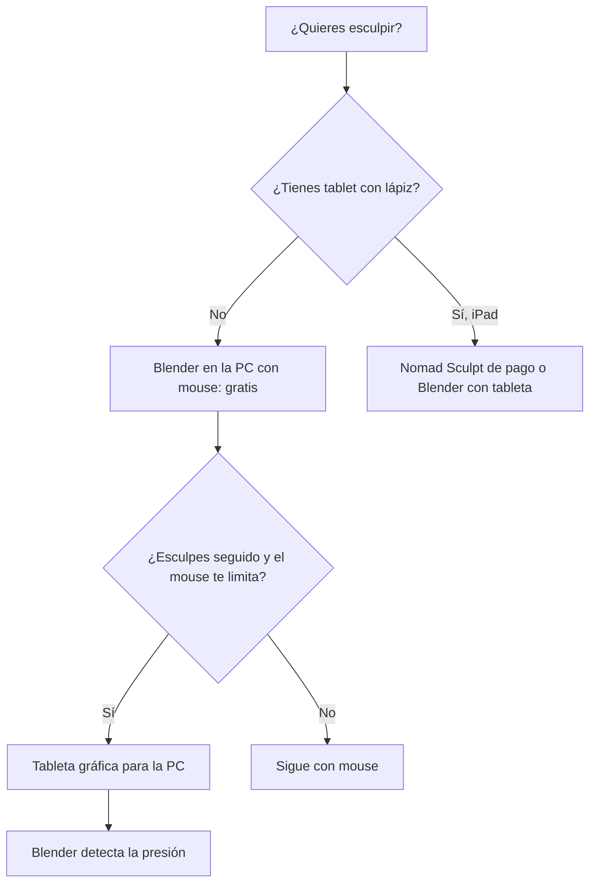

# Escultura en tablet (Nomad Sculpt y alternativas)

Parte de: [[38-Modelado-3D-Artistico/02 Otras herramientas/_Índice Otras herramientas|Otras herramientas]]

> [!info] Cómo avanzar
> `progreso`: **pendiente** → **viendo** (estudiando) → **visto** (contestaste la autoevaluación sin abrir las respuestas) → **dominado** (hiciste el laboratorio o lo aplicaste de verdad).

## Contenido

### Qué es
La **escultura en tablet** es esculpir con una tableta o pantalla táctil y un lápiz en lugar de mouse. La app más conocida para iPad y iPhone es **Nomad Sculpt**, un escultor completo con pinceles de arcilla, capas, remesh por vóxeles, multirresolución, pintura de vértices y exportación a formatos que acepta un laminador. Para ti es una herramienta **opcional**: tu flujo principal y gratuito es Blender en la PC, pero conviene saber qué ofrece la tablet y cuándo valdría la pena.

### Cómo funciona
**Nomad Sculpt** (App Store, revisado en noviembre de 2026):

| Dato | Valor |
|---|---|
| Precio | **de pago**: 19.99 USD en la tienda de EE. UU. (el precio en México puede variar) |
| Compra adicional | Quad Remesher, 15.99 USD |
| Requisitos | iOS / iPadOS 16 o posterior; también corre en iPhone |
| Exporta | glTF, OBJ, STL y PLY (las notas de versión mencionan también USD y FBX) |
| Versión de escritorio | se anunció una beta pública en 2025; si sigue disponible y gratis: (Pendiente de confirmar) |

Como prefieres herramientas gratuitas, no es una compra necesaria. Tu iPhone 15 Pro puede correrla, pero una pantalla de 6.1" es incómoda para esculpir más de unos minutos.

**La ventaja real de una tablet con lápiz es la presión**: el lápiz manda cuánta fuerza aplicas en cada punto del trazo, en tiempo real, y el gesto es como dibujar. Con mouse, cada trazo pega con la misma fuerza; lo compensas bajando la fuerza, usando *Stabilize Stroke* y haciendo más trazos cortos (ver [[Pinceles básicos de escultura en Blender]]).

**Alternativa sin comprar app**: una **tableta gráfica** (de las que se conectan por USB a la PC, sin pantalla o con pantalla) con Blender. Blender reconoce la presión del lápiz en Windows y la usa en los pinceles de escultura (*Use Pressure* para radio y fuerza). Antes de comprar, revisa [[Tablet para escultura digital (opcional)]].

### Ejemplo
Flujo mixto si algún día usas un iPad prestado o compras Nomad:

1. Bloquea y esculpe la figura en Nomad en el sillón, con lápiz.
2. Exporta en **OBJ** o **glTF** (conservan mejor la escala y la estructura que un STL suelto).
3. En Blender: importa, ajusta unidades a mm y escala la figura a 90 mm de alto.
4. Corta en piezas con [[Modificador Boolean en Blender]], revisa con 3D Print Toolbox y exporta STL o 3MF (ver [[Preparar un modelo de Blender para imprimir]]).

Sin tablet, el mismo flujo empieza directamente en el paso 3 con escultura en Blender.

### Práctica en tu Centauri 2
Esculpe en Blender con mouse una pieza pequeña (una piedra con textura o un llavero orgánico de 40 mm). Activa *Stabilize Stroke* y baja la fuerza a 0.3. Imprímela en PLA con capa de 0.12 mm. Si después de varias piezas sientes que el mouse te limita en suavidad, entonces evalúa una tableta; si no, ahorraste el dinero.

### Cuándo usarlo y cuándo no
Una tablet vale la pena si esculpes con frecuencia, te gusta dibujar o quieres esculpir lejos del escritorio. No hace falta para aprender ni para imprimir figuras: Blender con mouse da resultados muy buenos con los ajustes correctos. No compres una app de pago antes de saber si la escultura te engancha.

### Errores comunes
- **Comprar antes de probar**: aprende primero en Blender (gratis) y decide después.
- **Exportar de la tablet sin revisar la escala**: muchas apps no trabajan en mm; escala en Blender con una medida conocida.
- **Mallas enormes desde la tablet**: aplica Decimate antes de laminar (ver [[Retopología básica]]).
- **Esculpir en el iPhone por horas**: pantalla pequeña, mala postura; úsalo solo para bocetos rápidos.

### Para profundizar
- [Nomad Sculpt en la App Store](https://apps.apple.com/app/id1519508653)
- [Manual oficial de Blender: escultura](https://docs.blender.org/manual/en/latest/sculpt_paint/sculpting/index.html)

## Autoevaluación

Contesta primero en voz alta o en papel; luego despliega la respuesta.

> [!question]- ¿Nomad Sculpt es gratis?
> En la App Store es una app **de pago**, con una compra adicional para el Quad Remesher; funciona también en iPhone con iOS 16 o más reciente ([App Store](https://apps.apple.com/app/id1519508653)). En 2025 se anunció una versión de escritorio en beta gratuita; si sigue gratis hoy está (Pendiente de confirmar). Como solo usas programas gratuitos, tu herramienta principal es Blender.

> [!question]- No tienes tablet. ¿Qué haces para esculpir?
> Blender en la PC con mouse (ver [[Escultura digital en Blender]]): baja fuerza, *Stabilize Stroke* y simetría. Si después quieres una tableta, revisa [[Tablet para escultura digital (opcional)]].

> [!question]- ¿Qué ventaja tiene una tableta o pantalla táctil con lápiz al esculpir?
> La **presión** del lápiz controla la fuerza del trazo en tiempo real y el gesto es más natural; con mouse lo compensas con ajustes y más trazos.

