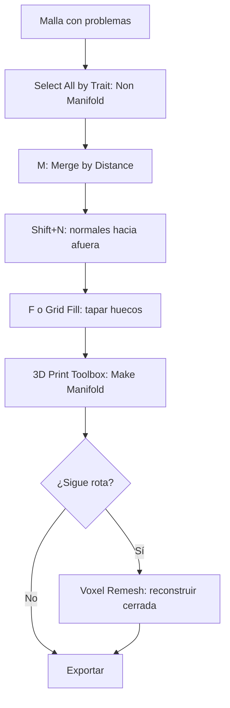

# Reparar mallas para impresión

Parte de: [[38-Modelado-3D-Artistico/02 Otras herramientas/_Índice Otras herramientas|Otras herramientas]]

> [!info] Cómo avanzar
> `progreso`: **pendiente** → **viendo** (estudiando) → **visto** (contestaste la autoevaluación sin abrir las respuestas) → **dominado** (hiciste el laboratorio o lo aplicaste de verdad).

## Contenido

### Qué es
**Reparar una malla** es corregir los defectos que impiden que el laminador entienda qué es "adentro" y qué es "afuera" de la pieza. Una malla imprimible debe ser **manifold** (también llamada "estanca" o *watertight*): una superficie cerrada que encierra un volumen sin ambigüedades. Las mallas que vienen de escaneos, de esculturas con piezas encimadas, de Booleans fallidos o de modelos descargados muchas veces no lo son.

### Cómo funciona
**Defectos típicos de una malla no manifold**:

| Defecto | Qué es | Efecto en el laminador |
|---|---|---|
| Hueco (borde abierto) | aristas con una sola cara | no sabe cerrar la capa; huecos o capas faltantes |
| Arista con 3+ caras | dos sólidos que comparten una arista o una "aleta" interna | regiones de relleno raras |
| Caras sueltas o internas | caras que no forman parte del contorno | paredes dentro de la pieza |
| Vértices duplicados | dos vértices en el mismo lugar sin unir | grietas invisibles |
| Normales invertidas | caras que "miran" hacia adentro | zonas que se toman como vacío |
| Autointersecciones | partes que se cruzan | resultados impredecibles |



**Herramientas de Blender** (Edit Mode):

1. *Select → Select All by Trait → Non Manifold*: resalta los bordes problemáticos.
2. `M → By Distance`: une vértices duplicados.
3. `Shift+N` (*Recalculate Outside*): normales hacia afuera; revisa con el overlay *Face Orientation* (azul afuera, rojo adentro).
4. `F` (llenar) o *Face → Grid Fill* para tapar huecos.
5. *Select All by Trait → Interior Faces* y borrar.
6. **3D Print Toolbox → Make Manifold** (ver [[Preparar un modelo de Blender para imprimir]]).
7. Si la malla es un desastre (típico de escaneos), **Voxel Remesh** la reconstruye completa como una malla cerrada (ver [[Remesh y Dyntopo en Blender]]).

**Piezas que se intersectan** (un sombrero metido en la cabeza, un brazo atravesando el torso): para FDM casi siempre se imprimen bien, porque el laminador calcula la unión. Lo limpio es unirlas: Boolean **Union** con solver **Exact**, o `Ctrl+J` y Voxel Remesh. Los laminadores también tienen una opción para reparar modelos; qué tanto corrige la de ElegooSlicer: (Pendiente de confirmar).

### Ejemplo
Script para diagnosticar la malla activa antes de exportar:

```python
import bpy, bmesh

obj = bpy.context.active_object
bm = bmesh.new()
bm.from_mesh(obj.data)

bordes_abiertos = [e for e in bm.edges if e.is_boundary]
no_manifold = [e for e in bm.edges if not e.is_manifold]
caras_cero = [f for f in bm.faces if f.calc_area() < 1e-8]

print(f"Bordes abiertos: {len(bordes_abiertos)}")
print(f"Aristas no manifold: {len(no_manifold)}")
print(f"Caras de área cero: {len(caras_cero)}")
bm.free()
```

Si todo da 0, la malla está lista para revisar grosor y exportar.

### Práctica en tu Centauri 2
Descarga un modelo con licencia que permita uso personal (ver [[Licencias de modelos 3D (Creative Commons y uso comercial)]]) o usa un escaneo propio. Pásale el script, repáralo con la secuencia de arriba e imprímelo en PLA. Compara en el laminador la vista previa antes y después de reparar: busca capas con huecos o paredes faltantes. Los labs relacionados son [[Lab 3 - Inspeccionar con 3D Print Toolbox y exportar STL y 3MF]] y [[Lab 7 - Escanear un objeto con el iPhone y dejarlo imprimible]].

### Cuándo usarlo y cuándo no
Siempre que el laminador avise errores o la vista previa muestre capas raras, y siempre con escaneos. Si el modelo es tuyo, mejor evita crear el problema: unidades correctas, Mirror con Merge, cortadores cerrados en Boolean y `Merge by Distance` después de extruir.

### Errores comunes
- **Confiar en que "se ve bien"**: un vértice duplicado no se ve.
- **Make Manifold en una malla muy rota**: puede empeorarla; mejor Voxel Remesh.
- **Voxel Remesh con vóxel grande**: repara, pero borra detalle.
- **Reparar en el laminador y no en el modelo**: el arreglo se pierde cada vez que reexportas.

### Para profundizar
- [Extensión 3D Print Toolbox](https://extensions.blender.org/add-ons/print3d-toolbox/)
- [Manual oficial de Blender: selección por rasgos](https://docs.blender.org/manual/en/latest/modeling/meshes/selecting/all_by_trait.html)

## Autoevaluación

Contesta primero en voz alta o en papel; luego despliega la respuesta.

> [!question]- ¿Qué es una malla *no manifold* y por qué el laminador se queja?
> Una malla que no encierra un volumen claro: huecos, aristas compartidas por 3 o más caras, caras sueltas, vértices en un solo punto. El laminador no sabe qué es "adentro" y genera capas erróneas o falla.

> [!question]- ¿Cómo encuentras y reparas problemas en Blender?
> Edit Mode: *Select → Select All by Trait → Non Manifold*; `M → By Distance` para vértices duplicados; `Shift+N` normales; `F` o *Grid Fill* para tapar huecos; 3D Print Toolbox → *Make Manifold*. Si la malla es un desastre (escaneos), **Voxel Remesh** la reconstruye cerrada.

> [!question]- ¿Qué hacer si dos piezas se intersectan (p. ej. un sombrero metido en la cabeza)?
> Para FDM casi siempre se imprime bien, pero lo limpio es unirlas: Boolean **Union** (solver Exact) o unirlas con `Ctrl+J` y aplicar Voxel Remesh. El laminador también tiene una opción de reparar modelo: en los laminadores de la familia OrcaSlicer/Bambu Studio (de donde viene ElegooSlicer) la reparación automática usa el servicio de reparación de Windows, así que en tu PC corrige casos simples (caras invertidas, huecos pequeños), pero no sustituye limpiar la malla en Blender (Pendiente de confirmar el alcance exacto en tu versión de ElegooSlicer).

## Práctica

- [[Lab 3 - Inspeccionar con 3D Print Toolbox y exportar STL y 3MF]]
- [[Lab 7 - Escanear un objeto con el iPhone y dejarlo imprimible]]

