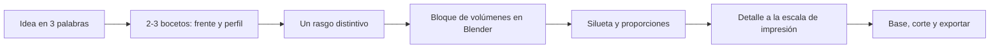

# Bustos y figuras originales

Parte de: [[38-Modelado-3D-Artistico/03 Técnicas artísticas/_Índice Técnicas artísticas|Técnicas artísticas]]

> [!info] Cómo avanzar
> `progreso`: **pendiente** → **viendo** (estudiando) → **visto** (contestaste la autoevaluación sin abrir las respuestas) → **dominado** (hiciste el laboratorio o lo aplicaste de verdad).

## Contenido

### Qué es
Un **busto** es una escultura de la cabeza, cuello y parte de los hombros; una **figura** es un personaje completo. Para impresión 3D son el proyecto artístico por excelencia: practicas escultura, proporciones, corte en piezas y pintura. La clave de este tema es que sean **originales**: diseñados por ti a partir de una idea propia, no copias de personajes de películas, videojuegos o cómics.

### Cómo funciona
**Por qué originales**: los personajes con marca están protegidos por derechos de autor y marcas registradas. Recrearlos para compartir, vender o publicar en un repositorio puede infringir esos derechos, aunque el modelo lo hayas esculpido tú. Para uso privado el riesgo es menor, pero la costumbre sana es diseñar los tuyos o usar modelos cuya licencia lo permita. Ver [[Personajes y marcas registradas en impresión 3D]] y [[Licencias de modelos 3D (Creative Commons y uso comercial)]]. Además, un diseño propio es tuyo: puedes compartirlo y hasta venderlo.

**Diseñar un busto original sencillo**:

1. **Idea en 3 palabras**: "explorador, casco, sonriente"; "anciana, pañoleta, sabia"; "robot, oxidado, curioso".
2. **Bocetos** de frente y perfil, aunque sean en papel o en la app de notas del iPhone. Te ahorran horas de esculpir sin rumbo.
3. **Un rasgo distintivo**: casco, peinado, orejas, bigote, cicatriz, un accesorio. Es lo que hará que la figura sea reconocible.
4. **Formas simples y grandes**: en FDM, los volúmenes claros se leen mejor que los detalles diminutos.
5. **Estilización**: elige un canon de proporciones (realista o estilizado) y sé consistente (ver [[Proporciones y anatomía básica para figuras]]).

**Tamaño para el primer busto**: unos **8–10 cm** de alto. Con capa de 0.12–0.16 mm se ve buen detalle y se imprime en pocas horas. Los relieves menores a ~1 mm tienden a perderse con boquilla de 0.4 mm; un busto más grande (15 cm) muestra más detalle, pero tarda mucho más.

### Ejemplo
Busto "explorador con casco":

1. En Blender, esfera para el cráneo, esfera aplastada para la mandíbula, cilindro para el cuello y un cilindro achatado para la base de los hombros.
2. Casco: media esfera con Solidify, más grande que el cráneo, con una visera extruida.
3. `Ctrl+J` todo y Voxel Remesh de 1 mm (ver [[Remesh y Dyntopo en Blender]]).
4. Proporciones con **Grab**: ojos a la mitad de la cabeza, nariz y boca según el canon.
5. Rasgos con **Clay Strips** y **Crease**; sonrisa exagerada (estilización consistente).
6. Detalle del casco con [[Multirresolución en Blender]]: remaches de 1.5 mm de diámetro y 0.8 mm de alto.
7. Base plana con un chaflán, nombre grabado de 0.6 mm de profundidad.
8. Escala final: 90 mm de alto.

### Práctica en tu Centauri 2
Haz el [[Lab 2 - Busto estilizado original esculpido con mouse]] e imprime el busto a 9 cm en PLA gris (el gris muestra mejor el detalle para revisarlo), capa de 0.12 mm, soportes de árbol solo bajo la barbilla y la visera. Después píntalo con el [[Lab 6 - Pintar una figura impresa (primer, base, lavado y pincel seco)]]. Si el busto tiene un casco de otro color, considera imprimirlo aparte y aprovechar el CANVAS (ver [[Modelos pensados para impresión multicolor]]).

### Cuándo usarlo y cuándo no
Ideal para practicar escultura y para regalos personalizados (con permiso de la persona si es un retrato). Evita retratos de personas sin su consentimiento y copias de personajes con marca para compartir o vender. Si quieres una figura de un personaje conocido para ti, busca modelos con licencia oficial.

### Errores comunes
- **Esculpir sin idea**: horas de cambios. Bocetea primero.
- **Detallar antes de las proporciones**.
- **Detalles demasiado finos** para la escala de impresión.
- **Sin base**: la figura se cae o necesita muchos soportes; diseña una base plana desde el inicio.

### Para profundizar
- [Manual oficial de Blender: escultura](https://docs.blender.org/manual/en/latest/sculpt_paint/sculpting/index.html)
- [Tutoriales oficiales de Blender](https://www.blender.org/support/tutorials/)

## Autoevaluación

Contesta primero en voz alta o en papel; luego despliega la respuesta.

> [!question]- ¿Por qué diseños originales y no personajes conocidos?
> Los personajes con marca (de películas, videojuegos, cómics) tienen derechos de autor y marca: no los recrees para compartir o vender. Diseña los tuyos o usa modelos con licencia que lo permita. Ver [[Personajes y marcas registradas en impresión 3D]] y [[Licencias de modelos 3D (Creative Commons y uso comercial)]].

> [!question]- ¿Cómo diseñas un busto original sencillo?
> Define una idea en 3 palabras ("explorador, casco, sonriente"), haz 2–3 bocetos de frente y perfil (pueden ser en papel), elige un rasgo distintivo (casco, peinado, orejas) y mantén formas simples y grandes.

> [!question]- ¿Qué tamaño conviene para tu primer busto en FDM?
> Unos **8–10 cm**: suficiente para ver detalle con capa de 0.12–0.16 mm y rápido de imprimir. Detalles menores a ~1 mm de relieve se pierden.

## Práctica

- [[Lab 2 - Busto estilizado original esculpido con mouse]]
- [[Lab 6 - Pintar una figura impresa (primer, base, lavado y pincel seco)]]

