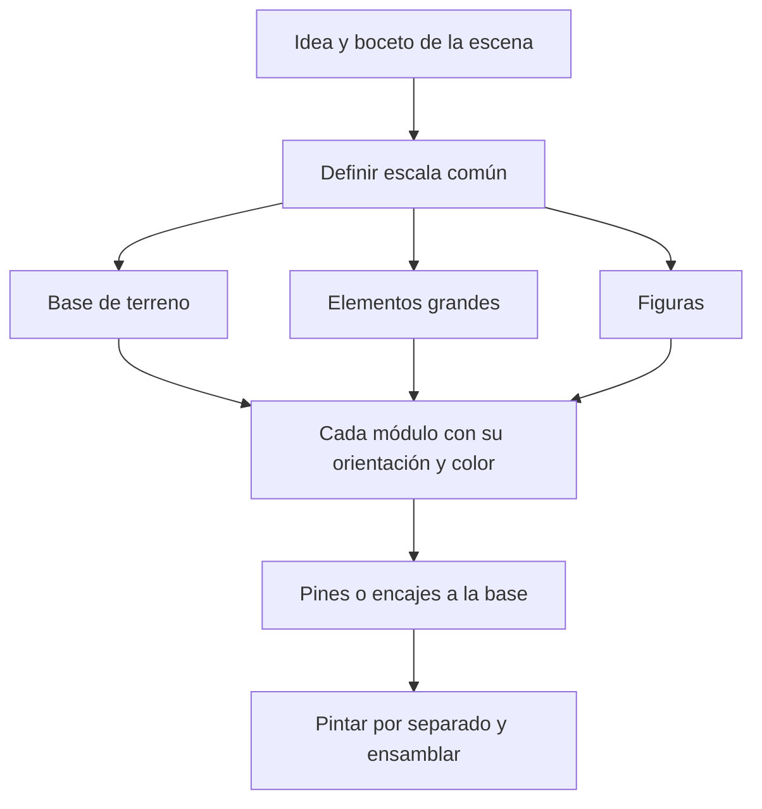

# Dioramas

Parte de: [[38-Modelado-3D-Artistico/03 Técnicas artísticas/_Índice Técnicas artísticas|Técnicas artísticas]]

> [!info] Cómo avanzar
> `progreso`: **pendiente** → **viendo** (estudiando) → **visto** (contestaste la autoevaluación sin abrir las respuestas) → **dominado** (hiciste el laboratorio o lo aplicaste de verdad).

## Contenido

### Qué es
Un **diorama** es una escena en miniatura: una base con terreno y ambiente, uno o más elementos (una casa, un árbol, una roca, una máquina) y casi siempre un personaje haciendo algo. Lo que lo hace interesante no es la cantidad de detalle, sino que **cuenta una pequeña historia**: un explorador descubriendo una cueva, un robot regando una planta, un gato durmiendo sobre una pila de libros. Es un proyecto que combina todo el área: modelado, escultura, corte en piezas, multicolor y pintura.

### Cómo funciona
**Composición**:

- **Punto focal**: un solo lugar donde va la mirada (el personaje, el objeto descubierto). Todo lo demás lo apoya.
- **Capas de profundidad**: primer plano, plano medio y fondo, aunque la base mida 10 cm.
- **Contraste de tamaños**: algo grande (roca, pared) junto a algo pequeño (personaje) da escala.
- **Romper el borde**: algo que salga de los límites de la base (una rama, una cola, una escalera) evita que parezca una caja.
- **Desniveles** en el terreno: escalones, rampas, rocas.

**Planear la impresión en módulos**:



Define la **escala** desde el inicio. Un personaje de 1.70 m a escala 1:35 mide unos 49 mm; a 1:24, unos 71 mm. Todo lo demás (puertas, árboles, herramientas) se calcula con la misma escala. Imprimir por módulos te deja elegir la mejor orientación de cada parte, aprovechar el CANVAS en piezas concretas (pasto verde, piedras grises) y pintar sin tener que meter el pincel entre objetos.

**Texturas de la base**: en Blender puedes usar el modificador **Displace** con una textura de ruido (*Clouds*, *Voronoi*) sobre un plano subdividido para terreno o piedra, o esculpir con pinceles como *Clay Strips* y *Crease* para grietas. Los detalles de textura deben tener al menos 0.4–0.6 mm de relieve para sobrevivir a la impresión.

### Ejemplo
Diorama "robot jardinero" en una base hexagonal de 100 mm:

1. Base: cilindro de 6 lados con desniveles esculpidos (un escalón de 8 mm) y textura de tierra con Displace.
2. Elementos: una maceta pequeña (modelado poligonal) y una regadera.
3. Personaje: robot original estilizado de 45 mm, inclinado regando la maceta (punto focal).
4. Una planta trepadora que sale por un lado de la base (rompe el borde).
5. Pines de Ø3 mm en la base para el robot y la maceta.
6. Impresión: la base con el CANVAS (tierra café en las capas bajas y pasto verde en las altas, cambio por altura de capa con poca purga), el robot en gris para pintar.

Calcular escalas con Python te evita errores de proporción:

```python
escala = 35                     # 1:35
alturas_reales_mm = {"robot": 1600, "maceta": 400, "puerta": 2100}
for nombre, h in alturas_reales_mm.items():
    print(f"{nombre}: {h / escala:.1f} mm")
```

### Práctica en tu Centauri 2
Diseña un diorama de base de 80–100 mm con una historia de una línea. Imprime primero la base sola para revisar la textura; si un detalle no se lee, súbele relieve. Después imprime el resto de módulos, píntalos (ver [[Pintura de figuras impresas]]) y ensambla.

### Cuándo usarlo y cuándo no
Es un gran proyecto cuando ya dominas lo básico de escultura y modelado. Si estás empezando, haz primero un busto o una figura sola; un diorama con muchas piezas puede volverse un proyecto eterno. Mantén la escena pequeña y con pocos elementos.

### Errores comunes
- **Base plana y aburrida**: agrega desniveles, texturas y algo que rompa el borde.
- **Sin punto focal**: muchos objetos compitiendo.
- **Escalas mezcladas**: una puerta más chica que el personaje.
- **Imprimir todo junto**: soportes imposibles y pintura complicada.

### Para profundizar
- [Manual oficial de Blender: modificador Displace](https://docs.blender.org/manual/en/latest/modeling/modifiers/deform/displace.html)
- [Manual oficial de Blender: escultura](https://docs.blender.org/manual/en/latest/sculpt_paint/sculpting/index.html)

## Autoevaluación

Contesta primero en voz alta o en papel; luego despliega la respuesta.

> [!question]- ¿Qué es un diorama y qué lo hace interesante?
> Una escena en miniatura con base, ambiente y una pequeña **historia** (un personaje haciendo algo en un lugar). Lo interesante es la composición: un punto focal, capas de profundidad y contraste de tamaños.

> [!question]- ¿Cómo planeas la impresión de un diorama?
> En **módulos**: base de terreno, elementos grandes y figuras por separado; así eliges orientación y color de cada uno y pintas más fácil. Define una **escala** común desde el inicio.

> [!question]- Error común: la base plana y aburrida. ¿Qué haces?
> Desniveles, texturas (piedra, pasto con *Displace* o pinceles de escultura), y que algo rompa el borde de la base para que no parezca una caja.

