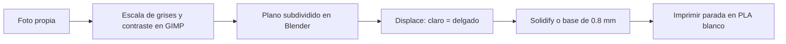

# Litofanías

Parte de: [[38-Modelado-3D-Artistico/03 Técnicas artísticas/_Índice Técnicas artísticas|Técnicas artísticas]]

> [!info] Cómo avanzar
> `progreso`: **pendiente** → **viendo** (estudiando) → **visto** (contestaste la autoevaluación sin abrir las respuestas) → **dominado** (hiciste el laboratorio o lo aplicaste de verdad).

## Contenido

### Qué es
Una **litofanía** es una placa delgada de plástico, normalmente blanco, cuyo **grosor cambia según una imagen**. Sin luz se ve como un relieve abstracto; con una luz detrás, aparece la foto: donde el plástico es **grueso** pasa poca luz y se ve **oscuro**; donde es **delgado**, pasa mucha luz y se ve **claro**. Es uno de los proyectos más vistosos y sencillos para una impresora FDM, ideal para regalar con fotos propias.

### Cómo funciona
**Mapa de alturas**: la imagen se convierte a escala de grises y cada pixel se traduce en un grosor:

- Pixel **blanco** → grosor **mínimo** (claro con luz).
- Pixel **negro** → grosor **máximo** (oscuro con luz).

Si haces lo contrario (blanco = grueso), la imagen sale **invertida**, como un negativo. Es el error más común, porque el modificador Displace de Blender, por defecto, levanta más donde la imagen es más clara.

**Punto de partida** (calíbralo con una prueba pequeña):

| Parámetro | Valor |
|---|---|
| Grosor mínimo | 0.8 mm |
| Grosor máximo | 3.2 mm |
| Orientación | **parada** (vertical), para que el detalle quede en XY |
| Relleno | 100 % o suficientes perímetros para que sea maciza |
| Capa | 0.12–0.16 mm |
| Velocidad | moderada |
| Filamento | PLA blanco |

Imprimir parada hace que el relieve se forme con el movimiento de la boquilla en X/Y, que es mucho más fino que los escalones de las capas en Z. Una placa parada de 100 × 80 mm necesita un borde o pie para no tambalearse.



**Foto ideal**: propia (así no hay problemas de derechos), con **buen contraste**, sujeto grande, fondo simple y sin zonas enormes completamente blancas o negras. Prepárala en [[GIMP]] o [[Photopea]]: escala de grises, ajuste de curvas para separar tonos y recorte a la proporción de la placa.

### Ejemplo
Litofanía en Blender con el modificador Displace, sin tener que invertir la imagen:

```python
import bpy

img = bpy.data.images.load(r"C:\Fotos\litofania_gris.png")
tex = bpy.data.textures.new("Foto", type='IMAGE')
tex.image = img

bpy.ops.mesh.primitive_grid_add(x_subdivisions=500, y_subdivisions=400, size=1)
placa = bpy.context.active_object
placa.scale = (100, 80, 1)                 # 100 x 80 mm
bpy.ops.object.transform_apply(scale=True)

sol = placa.modifiers.new("Base", 'SOLIDIFY')
sol.thickness = 0.8                        # grosor mínimo
sol.offset = -1                            # la base crece hacia abajo (de z=0 a z=-0.8)
bpy.ops.object.modifier_apply(modifier=sol.name)

# Solo la cara de arriba recibe el relieve; la de atrás queda plana
arriba = placa.vertex_groups.new(name="Arriba")
arriba.add([v.index for v in placa.data.vertices if v.co.z > -0.001], 1.0, 'REPLACE')

d = placa.modifiers.new("Relieve", 'DISPLACE')
d.texture = tex
d.texture_coords = 'UV'
d.direction = 'Z'
d.vertex_group = "Arriba"
d.mid_level = 1.0                          # blanco = 0 desplazamiento
d.strength = -2.4                          # negro = (0 - 1) * -2.4 = 2.4 mm
```

El Displace calcula `(valor - mid_level) * strength`. Con `mid_level = 1` y fuerza negativa, el blanco no se desplaza (queda en 0.8 mm) y el negro sube 2.4 mm (total 3.2 mm): claro = delgado sin editar la foto. El grupo de vértices limita el relieve a la cara frontal para que la cara de atrás quede plana; con 500 × 400 subdivisiones cada "pixel" de la malla mide 0.2 mm.

### Práctica en tu Centauri 2
Haz el [[Lab 4 - Litofanía con una foto propia]]. Antes de la placa completa, imprime un recorte de 30 × 30 mm de una zona con mucho contraste (un ojo, una ventana) y míralo contra una lámpara LED. Si se ve deslavado, sube el grosor máximo a 3.6 mm; si se ve oscuro, bájalo.

### Cuándo usarlo y cuándo no
Ideal para regalos, lámparas de noche (con LED, nunca focos que calienten) y portarretratos. No funciona bien con filamentos de color oscuro o muy translúcidos, ni con fotos de bajo contraste. Para fotos de otras personas, pide permiso.

### Errores comunes
- **Imagen invertida**: claro debe ser delgado.
- **Imprimir acostada**: los escalones de las capas se notan y pierde detalle.
- **Relleno bajo**: el patrón de relleno se ve a contraluz.
- **Grosor mínimo muy delgado** (menos de 0.6 mm): agujeros o zonas quemadas de luz.

### Para profundizar
- [Manual oficial de Blender: modificador Displace](https://docs.blender.org/manual/en/latest/modeling/modifiers/deform/displace.html)
- [Manual oficial de GIMP](https://docs.gimp.org/)

## Autoevaluación

Contesta primero en voz alta o en papel; luego despliega la respuesta.

> [!question]- ¿Qué es una litofanía y cómo funciona?
> Una placa delgada donde el **grosor** cambia según la imagen: con luz detrás, lo grueso se ve oscuro y lo delgado claro. Se imprime en filamento blanco.

> [!question]- ¿Qué grosores y configuración usas como punto de partida?
> Mínimo **0.8 mm** y máximo **3.2 mm** aprox.; impresión **parada** (vertical) para que el detalle quede en XY, relleno 100 % o muchos perímetros, capa baja (0.12–0.16 mm) y velocidad moderada. Calíbralo con una prueba pequeña.

> [!question]- Error común: la imagen sale invertida (claros oscuros). ¿Por qué?
> Porque las zonas claras deben ser **delgadas**. Invierte la imagen en escala de grises antes de usarla como mapa de desplazamiento (o invierte la lógica en tu herramienta).

> [!question]- ¿Qué foto funciona mejor?
> Una foto **propia**, con buen contraste, sujeto grande y fondo simple. Retrátala en escala de grises y ajusta curvas en [[GIMP]] o [[Photopea]] antes.

## Práctica

- [[Lab 4 - Litofanía con una foto propia]]

