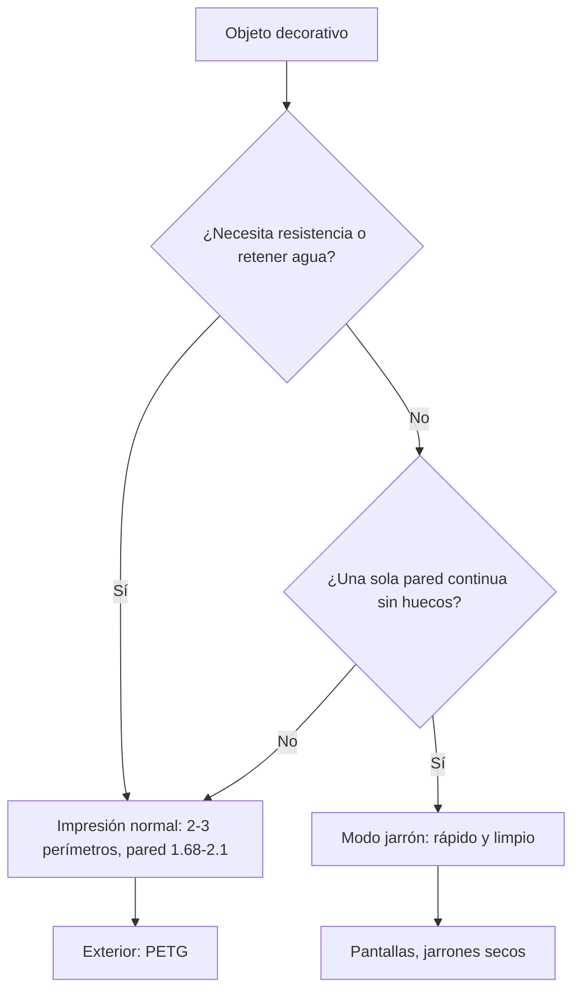

# Macetas, lámparas y objetos decorativos

Parte de: [[38-Modelado-3D-Artistico/03 Técnicas artísticas/_Índice Técnicas artísticas|Técnicas artísticas]]

> [!info] Cómo avanzar
> `progreso`: **pendiente** → **viendo** (estudiando) → **visto** (contestaste la autoevaluación sin abrir las respuestas) → **dominado** (hiciste el laboratorio o lo aplicaste de verdad).

## Contenido

### Qué es
Son los objetos decorativos más agradecidos de imprimir: **macetas** (para suculentas, cactus o plantas de interior), **pantallas de lámpara**, **jarrones**, portavelas LED, cuencos y figuras de repisa. Se modelan muy bien en Blender con modelado poligonal y modificadores, o en CAD si quieres medidas exactas, y aprovechan técnicas como el **modo jarrón** del laminador. Tienen sus propias reglas por el agua, el sol y el calor.

### Cómo funciona
**Maceta impresa**:

- **Drenaje**: agujero en el fondo y un plato, o una maceta interior que se saca. Sin drenaje, las raíces se pudren.
- **Paredes** de 1.6–2.4 mm (por ejemplo 1.68 o 2.1, múltiplos del ancho de línea) para que sea firme y no filtre.
- **Base plana** y sin redondeos inferiores grandes; un chaflán pequeño en el borde de la cama.
- **Voladizo de la pared**: una maceta que se abre hacia arriba debe hacerlo con un ángulo de hasta ~45° respecto a la vertical (ver la regla en el área técnica).
- **Material**: el [[PLA]] al sol se degrada con los rayos UV y se deforma con el calor (se ablanda alrededor de 55–60 °C). Para exterior, [[PETG]].
- **Impermeabilidad**: una impresión FDM puede filtrar agua por microporos entre líneas; si va a contener tierra húmeda, más perímetros y relleno, o una maceta interior de plástico o barro.

**Modo jarrón** (*vase mode*, "Spiral vase" en [[ElegooSlicer y OrcaSlicer]]): el laminador imprime **una sola pared** en espiral continua, subiendo en Z poco a poco, sin costura, sin relleno y sin capas superiores; solo el fondo lleva algunas capas sólidas. Resultado: superficies muy limpias y rápidas. Limitaciones: una sola pared de un ancho de línea (unos 0.4–0.5 mm, o algo más si subes el ancho de línea), así que es frágil; no puede tener huecos ni partes separadas en una misma capa, y no garantiza retener agua.

**Pantalla de lámpara**: usa **solo focos LED**, que casi no calientan, y deja distancia entre el foco y la pantalla. Un foco incandescente o halógeno puede deformar el PLA en minutos. El PLA blanco o natural difunde muy bien la luz en modo jarrón.

### Ejemplo
Pantalla de lámpara facetada en Blender para modo jarrón:

1. Cilindro de 12 lados, radio 60 mm, alto 140 mm; borra la tapa de arriba y **deja** la de abajo con un agujero central de 40 mm para el socket (el modo jarrón no permite huecos en capas superiores, pero sí en el fondo).
2. `Ctrl+R` para cuatro bucles horizontales; gira cada bucle 15° (`R` `Z` `15`) para formar una torsión.
3. Escala el bucle superior a 0.8 para que cierre un poco (voladizo hacia adentro, imprimible).
4. Sin Solidify: el modo jarrón ya genera una pared. Exporta como sólido cerrado (el laminador toma el contorno exterior).
5. En el laminador: modo jarrón, PLA blanco, ancho de línea 0.5 mm, capa de 0.2 mm.

### Práctica en tu Centauri 2
Haz el [[Lab 1 - Maceta con modelado poligonal en Blender]] e imprime la maceta en PLA con 3 perímetros. Después imprime la pantalla en modo jarrón y compara tiempo y aspecto. Si tienes una tira o foco LED, colócalo a más de 5 cm de la pared y revisa al tacto después de una hora que la pantalla no se caliente.

### Cuándo usarlo y cuándo no
Decorativos de interior: casi siempre en PLA. Exterior o sol directo: PETG. Contenedores de comida o agua para beber: no; el plástico impreso tiene poros donde crecen bacterias y no sabes si el filamento y el pigmento son aptos para alimentos. Lámparas: solo LED.

### Errores comunes
- **Maceta sin drenaje**.
- **PLA en el balcón al sol**: se deforma y se vuelve quebradizo.
- **Modo jarrón en piezas que deben ser resistentes**.
- **Foco que calienta** en una pantalla de PLA.

### Para profundizar
- [Wiki de OrcaSlicer, base de ElegooSlicer (modo jarrón y ajustes)](https://github.com/SoftFever/OrcaSlicer/wiki)
- [Manual oficial de Blender: modelado de mallas](https://docs.blender.org/manual/en/latest/modeling/meshes/index.html)

## Autoevaluación

Contesta primero en voz alta o en papel; luego despliega la respuesta.

> [!question]- ¿Qué debes cuidar en una maceta impresa?
> Agujero de drenaje y plato, paredes de 1.6–2.4 mm, base plana. El PLA en exterior al sol se degrada y deforma: para afuera usa [[PETG]].

> [!question]- ¿Qué es el modo jarrón (*vase mode*) y cuándo lo usas?
> El laminador imprime una sola pared en espiral continua sin costura ni relleno. Ideal para pantallas de lámpara y jarrones decorativos; no sirve para piezas que deban ser resistentes o retener agua de forma confiable.

> [!question]- Caso: una pantalla de lámpara impresa. ¿Qué precaución tomas?
> Usar solo focos **LED** (casi no calientan) y dejar distancia al foco; el PLA se ablanda a temperaturas bajas.

## Práctica

- [[Lab 1 - Maceta con modelado poligonal en Blender]]

