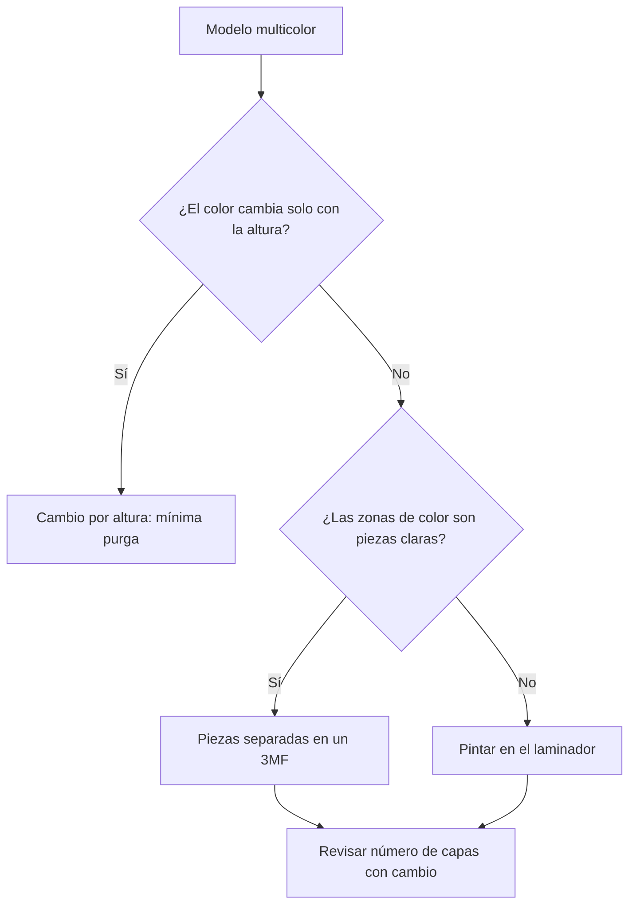

# Modelos pensados para impresión multicolor

Parte de: [[38-Modelado-3D-Artistico/03 Técnicas artísticas/_Índice Técnicas artísticas|Técnicas artísticas]]

> [!info] Cómo avanzar
> `progreso`: **pendiente** → **viendo** (estudiando) → **visto** (contestaste la autoevaluación sin abrir las respuestas) → **dominado** (hiciste el laboratorio o lo aplicaste de verdad).

## Contenido

### Qué es
Es diseñar un modelo **desde el principio** para imprimirse en varios colores con el **CANVAS** de tu [[Elegoo Centauri 2 Combo]], que alimenta hasta **4 filamentos** y cambia entre ellos durante la impresión. Cada cambio de color cuesta: el cabezal corta, retrae, carga el nuevo filamento y **purga** el color viejo (en una torre de purga u otro destino). Un modelo pensado para multicolor logra buen resultado con pocos cambios, poco desperdicio y menos horas.

### Cómo funciona
**Tres formas de dar color** a un modelo:

1. **Piezas separadas por color**: cada parte es un objeto o malla distinta (los ojos, el casco, la base) y en el laminador se cargan juntas como **un solo objeto con varias partes**, asignando un filamento a cada una. Es lo más preciso.
2. **Pintar caras en el laminador**: con la herramienta de pintura de color de [[ElegooSlicer y OrcaSlicer]] marcas zonas de una sola malla. Rápido para detalles, menos preciso en los bordes. Ver [[Impresión multicolor (pintar colores y torre de purga)]].
3. **Cambio de color por altura de capa**: un color por franja de altura. Solo hay un cambio por franja, sin desperdicio entre colores en cada capa; ideal para letreros, llaveros, placas y litofanías de color.



**Reglas de diseño** para 4 colores:

- **Máximo 4 colores a la vez** (ver [[Sistema multicolor CANVAS de Elegoo]]); el TPU no pasa por el CANVAS.
- **Pocas capas con cambios**: concentra los colores en franjas de altura o en la parte de arriba. El tiempo y la purga crecen con el número de capas que tienen más de un color.
- **Relieve o incrustación de 0.4–0.6 mm** en la cara superior: texto, logos y detalles de color quedan en 2–3 capas.
- **Detalles de color de al menos 2 anchos de línea** (unos 0.8–0.9 mm): más chicos no se imprimen limpios.
- **Bordes de color que coincidan con la geometría** (un canal, un escalón): disimulan pequeñas mezclas.
- **Color de base neutro** y detalles arriba.

**El error típico**: un diseño con franjas verticales de color en todo el alto (un personaje con un brazo de cada color, un jarrón de rayas verticales). **Cada capa** necesita cambios de filamento: la impresión tarda muchísimo más y la torre de purga crece tanto como la pieza.

### Ejemplo
Insignia original de 60 mm con 4 colores:

- Base de 3 mm en negro (capas 1–15 con capa de 0.2 mm).
- Borde en relieve de 0.6 mm en dorado.
- Símbolo central en relieve de 0.6 mm en blanco.
- Detalle interior en rojo incrustado en el símbolo.

Los cambios de color se concentran en las últimas 3 capas. Exportar desde Blender: cada color como **objeto separado** y exportar **3MF** con la extensión *3MF Import/Export*, que conserva varios objetos, materiales y colores. Alternativa: un STL por color y en el laminador cargarlos como partes de un mismo objeto.

```python
import bpy
colores = {"Base": "Negro", "Borde": "Dorado", "Simbolo": "Blanco", "Detalle": "Rojo"}
for nombre, color in colores.items():
    obj = bpy.data.objects[nombre]
    mat = bpy.data.materials.get(color) or bpy.data.materials.new(color)
    obj.data.materials.clear()
    obj.data.materials.append(mat)
print("Un material por pieza: la extensión 3MF los exporta como colores")
```

### Práctica en tu Centauri 2
Haz el [[Lab 5 - Modelo original para 4 colores con CANVAS]]. Lamina la insignia dos veces: una con los colores solo en las capas de arriba y otra con el símbolo atravesando todo el grosor. Compara en el laminador el tiempo estimado y el filamento de purga; imprime la versión eficiente.

### Cuándo usarlo y cuándo no
Úsalo en letreros, llaveros, insignias, figuras estilizadas con zonas de color claras y piezas donde pintar sería difícil. Para figuras con mucho detalle de color (ojos diminutos, degradados), pintar a mano suele dar mejor resultado y gasta menos filamento (ver [[Pintura de figuras impresas]]).

### Errores comunes
- **Colores en todas las capas**: horas extra y mucha purga.
- **Detalles de color muy finos**: salen manchados.
- **STL con todo junto**: pierdes la separación por colores; usa piezas separadas o 3MF.
- **Más de 4 colores** sin planear pausas para cambiar carretes.

### Para profundizar
- [Extensión 3MF Import/Export para Blender](https://extensions.blender.org/add-ons/threemf-io/)
- [Página oficial de la Centauri 2 Combo (Elegoo)](https://us.elegoo.com/products/centauri-2-combo)

## Autoevaluación

Contesta primero en voz alta o en papel; luego despliega la respuesta.

> [!question]- ¿Qué tres formas hay de dar color a un modelo para el CANVAS?
> 1) **Piezas separadas** por color (cada objeto o parte con su filamento) dentro de un mismo objeto. 2) **Pintar** caras en el laminador (ver [[Impresión multicolor (pintar colores y torre de purga)]]). 3) **Cambio por altura de capa** (un color por franja de altura): sin desperdicio entre colores, ideal para letreros y llaveros.

> [!question]- ¿Qué reglas de diseño ahorran tiempo y desperdicio con 4 colores?
> Máximo 4 colores a la vez ([[Sistema multicolor CANVAS de Elegoo]]); pocas capas con cambios de color (cada cambio purga filamento); colores en relieve o incrustados de 0.4–0.6 mm en la cara superior; detalles de color de al menos 2 anchos de línea; bordes de color que coincidan con la geometría.

> [!question]- ¿Cómo exportas desde Blender un modelo de varias piezas de color?
> Opción A: cada color como **objeto separado** y exportas 3MF con la extensión [3MF Import/Export](https://extensions.blender.org/add-ons/threemf-io/), que conserva materiales y colores. Opción B: un STL por color y en el laminador los cargas como **un solo objeto con varias partes** para asignar un filamento a cada parte.

> [!question]- Error común: diseñar con colores que solo cambian en paredes verticales en todas las capas. ¿Qué pasa?
> Cada capa necesita cambios de filamento: la impresión tarda mucho más y la torre de purga crece. Concentra los colores en pocas capas o usa un color de base y detalles arriba.

## Práctica

- [[Lab 5 - Modelo original para 4 colores con CANVAS]]

