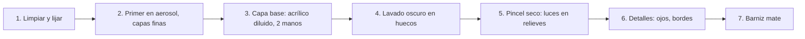

# Pintura de figuras impresas

Parte de: [[38-Modelado-3D-Artistico/03 Técnicas artísticas/_Índice Técnicas artísticas|Técnicas artísticas]]

> [!info] Cómo avanzar
> `progreso`: **pendiente** → **viendo** (estudiando) → **visto** (contestaste la autoevaluación sin abrir las respuestas) → **dominado** (hiciste el laboratorio o lo aplicaste de verdad).

## Contenido

### Qué es
Pintar una figura impresa es darle color y profundidad con pinturas acrílicas y pincel, siguiendo técnicas de la pintura de miniaturas: **primer**, **capa base**, **lavado** y **pincel seco**, y un **barniz** al final. Con pocas pinturas y algo de práctica, un busto impreso en PLA gris se ve como una pieza de colección; además, disimula las líneas de capa que el ojo nota en el plástico sin pintar.

### Cómo funciona
**Orden básico**:

1. **Limpiar y lijar**: quita soportes, lija las marcas y rellena uniones de piezas (ver [[Lijado y relleno de piezas impresas]]).
2. **Primer** en aerosol: una base que hace que la pintura se adhiera al plástico y unifica el color. Pasadas cortas, a unos 20–30 cm, varias capas finas. Ver [[Primer, pintura y barniz para piezas impresas]].
3. **Capa base**: acrílicos diluidos con agua hasta **consistencia de leche**. Dos manos delgadas son mejores que una gruesa. Deja secar entre capas.
4. **Lavado** (*wash*): pintura muy diluida y oscura (o un lavado comercial) que se mete en los huecos y marca sombras: arrugas, uniones, ojos.
5. **Pincel seco** (*drybrush*): cargas un pincel viejo de cerdas firmes con poca pintura clara, la quitas casi toda en un papel y pasas el pincel rápido y suave sobre la figura. Solo pinta las **aristas y relieves**, resaltando la textura.
6. **Detalles**: ojos, bordes, pequeños accesorios, con pincel fino.
7. **Barniz mate**: protege la pintura y quita brillos.

**El detalle se borra con pintura espesa**: la pintura sin diluir rellena las grietas finas y las texturas que esculpiste. Diluye, aplica capas delgadas y deja secar entre ellas. El primer también: una nube gruesa borra el detalle tanto como la pintura.

**Seguridad con el primer en aerosol**: aplícalo **afuera** o con mucha ventilación, con cubrebocas adecuado para vapores orgánicos, lejos de flamas, y nada de aerosol dentro del cuarto de la impresora. Lee la etiqueta del producto. Las pinturas acrílicas al agua son de bajo riesgo, pero lávate las manos y no mezcles el agua de los pinceles con la de beber.

### Ejemplo
Busto de explorador original de 9 cm impreso en PLA gris:

| Zona | Base | Lavado | Pincel seco |
|---|---|---|---|
| Piel | tono piel medio | café rojizo | tono piel claro |
| Casco | verde oliva | café oscuro | beige |
| Remaches | metálico plata | negro | — |
| Base | gris oscuro | negro | gris claro |

Material mínimo: primer gris en aerosol, 6–8 acrílicos (blanco, negro, rojo, amarillo, azul, café, verde, piel), un lavado oscuro, tres pinceles (plano mediano, redondo fino, uno viejo para pincel seco), paleta (un azulejo sirve) y barniz mate.

### Práctica en tu Centauri 2
Haz el [[Lab 6 - Pintar una figura impresa (primer, base, lavado y pincel seco)]]. Antes de pintar tu busto, imprime **dos piezas de prueba** pequeñas (la placa de pinceles o una roca texturizada): en una aplica la pintura espesa y en la otra diluida, y compara cuánto detalle se pierde. Si imprimes figuras para pintar, el gris es mejor que el blanco o los colores fuertes porque muestra el detalle y cubre fácil.

### Cuándo usarlo y cuándo no
Pinta cuando la figura tiene detalles de color pequeños, degradados o sombras que el multicolor no logra. Si la pieza tiene zonas de color grandes y planas (letreros, insignias), el CANVAS puede ser más rápido y limpio (ver [[Modelos pensados para impresión multicolor]]). Puedes combinar: imprimir en colores base y pintar solo detalles y lavados.

### Errores comunes
- **Pintura espesa**: borra el detalle.
- **Saltarse el primer**: la pintura se descarapela del PLA.
- **Pincel seco con mucha pintura**: manchas en lugar de luces.
- **Aerosol en interiores**.
- **No dejar secar** entre capas: se levanta la de abajo.

### Para profundizar
- [Acrílicos Vallejo (fabricante de pinturas para modelismo)](https://acrylicosvallejo.com/)
- En tu bóveda: [[Primer, pintura y barniz para piezas impresas]] y [[Lijado y relleno de piezas impresas]]

## Autoevaluación

Contesta primero en voz alta o en papel; luego despliega la respuesta.

> [!question]- ¿Cuál es el orden básico para pintar una figura?
> 1) Limpiar y lijar ([[Lijado y relleno de piezas impresas]]). 2) **Primer** en aerosol, en capas finas. 3) **Capa base** con acrílicos diluidos, dos manos delgadas mejor que una gruesa. 4) **Lavado** (*wash*) oscuro para sombras en huecos. 5) **Pincel seco** para luces en relieves. 6) **Barniz** mate. Ver [[Primer, pintura y barniz para piezas impresas]].

> [!question]- ¿Qué es el pincel seco y cómo lo haces?
> Cargas poca pintura clara, la quitas casi toda en un papel y pasas el pincel rápido sobre la figura: solo pinta las aristas y relieves, resaltando la textura.

> [!question]- Error común: pintura espesa que borra el detalle. ¿Cómo lo evitas?
> Diluye con agua (consistencia de leche), aplica capas delgadas y deja secar entre capas. El primer también va en pasadas cortas y a distancia.

> [!question]- ¿Qué seguridad tomas con el primer en aerosol?
> Aplicarlo afuera o con mucha ventilación, con cubrebocas adecuado y lejos de fuego; nada de aerosol dentro del cuarto de la impresora.

## Práctica

- [[Lab 6 - Pintar una figura impresa (primer, base, lavado y pincel seco)]]

