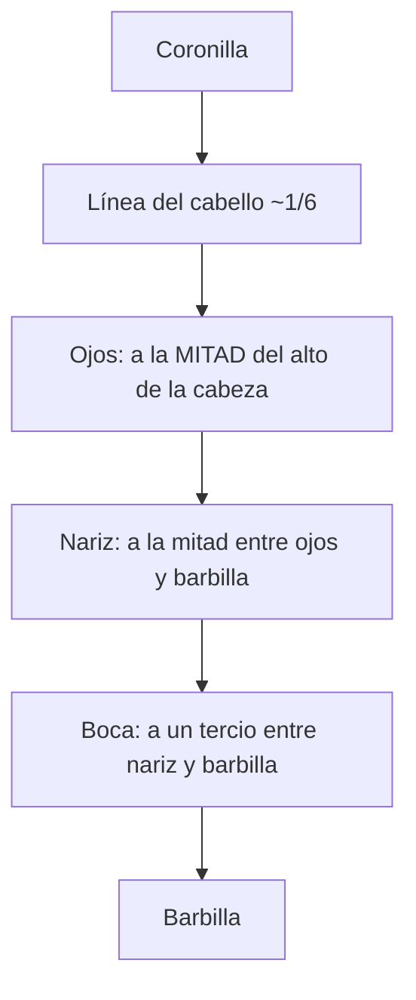

# Proporciones y anatomía básica para figuras

Parte de: [[38-Modelado-3D-Artistico/03 Técnicas artísticas/_Índice Técnicas artísticas|Técnicas artísticas]]

> [!info] Cómo avanzar
> `progreso`: **pendiente** → **viendo** (estudiando) → **visto** (contestaste la autoevaluación sin abrir las respuestas) → **dominado** (hiciste el laboratorio o lo aplicaste de verdad).

## Contenido

### Qué es
Las **proporciones** son las relaciones de tamaño entre las partes de una figura: cuánto mide la cabeza respecto al cuerpo, dónde van los ojos, qué tan largos son los brazos. La **anatomía básica** es saber qué estructuras dan forma al cuerpo (cráneo, caja torácica, pelvis, articulaciones). No necesitas ser artista académico para esculpir figuras originales que se vean bien; necesitas unas cuantas reglas que te sirvan de andamio, y saber que puedes **estilizar** si lo haces de forma consistente.

### Cómo funciona
**Medir en "cabezas"**: la unidad es el **alto de la cabeza** (de la coronilla a la barbilla). Elegir cuántas cabezas mide tu figura (el **canon**) define su estilo:

| Estilo | Alto aproximado | Efecto |
|---|---|---|
| Adulto realista | 7.5–8 cabezas | natural |
| Heroico | más de 8 | alto e imponente |
| Estilizado tipo caricatura | 4–6 | amigable |
| "Chibi" | 2–4 | tierno, cabeza enorme |

Para un adulto realista de 8 cabezas: la entrepierna queda cerca de la mitad del alto, el ombligo alrededor de la tercera cabeza, y con los brazos caídos la punta de los dedos llega a medio muslo.

**La cabeza vista de frente**:



- Los **ojos** van a la **mitad** del alto de la cabeza. El error clásico del principiante es ponerlos muy arriba, porque olvida el volumen del cráneo y el cabello.
- La **separación entre ojos** es aproximadamente **un ojo de ancho**; la cabeza de frente mide unos cinco ojos de ancho.
- La **nariz** termina a la mitad entre los ojos y la barbilla; la **boca** queda más o menos a un tercio entre la nariz y la barbilla.
- Las **orejas** van entre la línea de las cejas y la base de la nariz.

**Estilizar sin que "se vea mal"**: exagera de forma **consistente** (si la cabeza es grande, todo el cuerpo sigue esa lógica; si los ojos son enormes, ambos lo son y conservan su posición relativa) y conserva las relaciones de base: simetría, ejes del cuerpo y una silueta clara. Una prueba útil: mira la figura como **silueta negra** (en Blender, vista sólida con color plano negro y fondo claro). Si la pose y el personaje se leen en silueta, la figura funciona.

### Ejemplo
Personaje original estilizado de 4 cabezas, 100 mm de alto (cabeza de 25 mm):

```python
alto_total = 100       # mm
cabezas = 4
h = alto_total / cabezas
cabeza = {
    "ojos (desde la coronilla)": h / 2,
    "base de la nariz": h / 2 + (h / 2) / 2,
    "boca": h / 2 + h / 4 + (h / 4) / 3,
}
print(f"Cabeza: {h:.1f} mm")
for k, v in cabeza.items():
    print(f"{k}: {v:.1f} mm")
```

La salida (ojos a 12.5 mm, nariz a 18.8 mm, boca a 20.8 mm) te da las alturas para colocar en Blender esferas de referencia o líneas guía antes de esculpir. Con *Snap* a incrementos y la escena en mm, las colocas exactas.

### Práctica en tu Centauri 2
Esculpe tres cabezas del mismo personaje con distinta estilización (realista, caricatura y chibi) a 30 mm de alto cada una. Imprímelas juntas en una sola placa en PLA gris con capa de 0.12 mm y colócalas lado a lado: verás cómo el canon cambia la personalidad. Úsalas como referencia para el [[Lab 2 - Busto estilizado original esculpido con mouse]].

### Cuándo usarlo y cuándo no
Aplica las proporciones como **punto de partida** en cualquier figura humanoide; para criaturas, adapta la lógica (ejes, masas principales, articulaciones). No las conviertas en una camisa de fuerza: la estilización intencional es lo que hace interesante a un personaje original. Lo importante es que las desviaciones sean decisiones, no errores.

### Errores comunes
- **Ojos demasiado arriba**.
- **Estilizar de forma inconsistente**: cabeza chibi en un cuerpo realista sin intención.
- **Revisar solo de frente**: el perfil y los tres cuartos revelan errores de volumen.
- **Detalles antes que proporciones** (ver [[Escultura digital en Blender]]).

### Para profundizar
- [Manual oficial de Blender: escultura](https://docs.blender.org/manual/en/latest/sculpt_paint/sculpting/index.html)
- [Tutoriales oficiales de Blender](https://www.blender.org/support/tutorials/)

## Autoevaluación

Contesta primero en voz alta o en papel; luego despliega la respuesta.

> [!question]- ¿Qué es medir en "cabezas" y qué rangos se usan?
> Usar el alto de la cabeza como unidad. Un adulto realista mide unas **7.5–8 cabezas**; un estilo heroico, más; un estilo estilizado o "chibi", **2–4 cabezas** (cabeza grande, cuerpo corto). Elegir el canon te da consistencia.

> [!question]- ¿Dónde van los ojos en una cabeza humana vista de frente?
> Aproximadamente a la **mitad** del alto de la cabeza (no arriba, error clásico); la separación entre ojos es cerca de un ojo de ancho. Nariz a la mitad entre ojos y barbilla, boca a un tercio entre nariz y barbilla.

> [!question]- ¿Qué cambias al estilizar sin que "se vea mal"?
> Exagera **de forma consistente** (ojos más grandes, cabeza más grande) y conserva las relaciones de base: simetría, ejes, silueta clara. Revisa la silueta en negro: si se lee bien, la figura funciona.

## Práctica

- [[Lab 2 - Busto estilizado original esculpido con mouse]]

