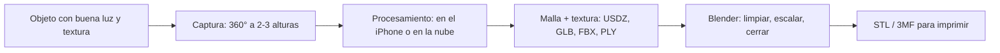

# Fotogrametría y escaneo con iPhone

Parte de: [[38-Modelado-3D-Artistico/04 Escaneo 3D/_Índice Escaneo 3D|Escaneo 3D]]

> [!info] Cómo avanzar
> `progreso`: **pendiente** → **viendo** (estudiando) → **visto** (contestaste la autoevaluación sin abrir las respuestas) → **dominado** (hiciste el laboratorio o lo aplicaste de verdad).

## Contenido

### Qué es
El **escaneo 3D** convierte un objeto real en un modelo digital. Con tu **iPhone 15 Pro** tienes dos tecnologías:

- **Fotogrametría**: reconstruye la forma a partir de **muchas fotos** desde distintos ángulos, buscando puntos comunes entre ellas. Da buen detalle en objetos pequeños y medianos con textura.
- **LiDAR**: el sensor del iPhone mide distancias con láser. Es rápido para cuartos, muebles y objetos grandes, pero con poco detalle fino.

Varias apps combinan ambas: usan el LiDAR para la escala y la forma general y las fotos para el detalle y la textura.

### Cómo funciona

**Apps gratuitas o con plan gratis** (revisadas en noviembre de 2026):

| App | Qué es | Exporta | Condiciones |
|---|---|---|---|
| **Reality Composer** (Apple) | incluye **Object Capture** con captura guiada | USDZ | gratis; iOS 17+; aprovecha el LiDAR de iPhone 12 Pro o posterior |
| **Scaniverse** (Niantic Spatial) | escaneo con LiDAR y fotos | SPZ, PLY, GLB, FBX; USDZ en modelos procesados en la nube | plan gratuito para uso personal con procesamiento en la nube limitado |
| **RealityScan Mobile** (Epic Games) | fotogrametría, mínimo 20 fotos, procesa en servidor | FBX y descarga al dispositivo; lista completa (Pendiente de confirmar) | gratis |
| **Polycam** | escaneo con fotos y LiDAR | plan gratis: solo glTF | gratis con capturas limitadas (10 de fotogrametría, hasta 150 imágenes) |

Blender importa glTF/GLB, FBX, PLY, OBJ y USD/USDZ; de ahí exportas a STL o 3MF (ver [[Limpiar un escaneo y hacerlo imprimible]]).

**Qué se escanea mal**: objetos **brillantes**, **transparentes**, muy **negros**, muy **delgados** (hojas, cables) o **sin textura** (una taza blanca lisa). La fotogrametría necesita puntos reconocibles. Cómo mejorar:

- **Luz difusa y pareja**: día nublado, sombra o una caja de luz; nada de sol directo ni flash.
- **Fondo con textura** (periódico, mantel estampado) y el objeto sobre una base que puedas recortar después.
- **60–80 % de traslape** entre fotos consecutivas; vueltas completas a 2–3 alturas.
- **No mover el objeto** entre fotos (o usar una base giratoria con fondo liso, según la app).
- Spray de escaneo o talco **solo** en objetos que no se dañen.

**Escala real**: mide una distancia del objeto con regla o calibrador y escala el modelo en Blender para que coincida. Las apps con LiDAR dan escala aproximada; compruébala siempre.

**Con el dron**: el [[DJI Mini 4K]] puede hacer fotogrametría de edificios o terrenos con muchas fotos traslapadas, respetando reglas de vuelo y privacidad. Para objetos de mesa, el iPhone es mucho mejor.

### Ejemplo
Escanear una piedra decorativa de 8 cm para imprimir una réplica:

1. Afuera en la sombra, piedra sobre una hoja de periódico.
2. Reality Composer → Object Capture; sigue la guía de la app dando dos vueltas (una alta y una baja) y voltea la piedra para una tercera pasada si la app lo permite.
3. Exporta el USDZ y pásalo a la PC.
4. En Blender: importa, borra el piso, mide la piedra real (80 mm) y escala.
5. Limpia, cierra con Voxel Remesh y exporta.

### Práctica en tu Centauri 2
Haz el [[Lab 7 - Escanear un objeto con el iPhone y dejarlo imprimible]]. Escanea el mismo objeto con dos apps distintas y compara el detalle en Blender; imprime la mejor versión a escala 1:1 en PLA y compárala con el original. Prueba también con un objeto brillante para ver la falla y cómo mejora con talco.

### Cuándo usarlo y cuándo no
**Sí**: objetos orgánicos (piedras, frutas, esculturas propias), réplicas decorativas y como referencia de forma para modelar. **No**: piezas que deben encajar con precisión de décimas (para eso, mide y modela en CAD) ni objetos protegidos por derechos para compartir o vender.

### Errores comunes
- **Luz dura o sol directo**: sombras que cambian entre fotos.
- **Poco traslape**: huecos y deformaciones.
- **Objetos brillantes o transparentes** sin preparar.
- **Confiar en la escala de la app** sin medir.

### Para profundizar
- [Object Capture (Apple Developer)](https://developer.apple.com/augmented-reality/object-capture/)
- [Reality Composer en la App Store](https://apps.apple.com/mx/app/reality-composer/id1462358802)
- [Scaniverse en la App Store](https://apps.apple.com/app/id1541433223)
- [Planes de Polycam](https://poly.cam/pricing)

## Autoevaluación

Contesta primero en voz alta o en papel; luego despliega la respuesta.

> [!question]- ¿Qué diferencia hay entre fotogrametría y escaneo LiDAR?
> **Fotogrametría**: reconstruye la forma a partir de muchas fotos desde distintos ángulos; da buen detalle en objetos pequeños con textura. **LiDAR** (tu iPhone 15 Pro lo tiene): mide distancias con láser; rápido para cuartos y objetos grandes, pero con poco detalle fino.

> [!question]- ¿Qué apps gratuitas puedes usar y qué exportan?
> - **Reality Composer** (Apple, gratis): incluye **Object Capture**, pide iPhone con LiDAR (12 Pro o posterior) y iOS 17; exporta **USDZ** ([App Store](https://apps.apple.com/mx/app/reality-composer/id1462358802)).
> - **Scaniverse** (Niantic Spatial): plan gratuito para uso personal con procesamiento limitado en la nube; exporta GLB, FBX, PLY y USDZ, entre otros ([App Store](https://apps.apple.com/app/id1541433223)).
> - **RealityScan Mobile** (Epic): gratis, fotogrametría que se procesa en línea; formatos de exportación completos (Pendiente de confirmar) ([App Store](https://apps.apple.com/app/id1584832280)).
> - **Polycam**: plan gratuito con capturas limitadas y exportación de malla solo en glTF ([planes](https://poly.cam/pricing)).
> Blender importa glTF/GLB, FBX, PLY, OBJ y USD; de ahí exportas STL o 3MF.

> [!question]- ¿Qué objetos se escanean mal y cómo lo mejoras?
> Brillantes, transparentes, negros, muy delgados o sin textura. Mejora: luz **difusa** pareja (nublado o sombra), fondo con textura, 60–80 % de traslape entre fotos, varias alturas alrededor del objeto. Spray de escaneo o talco solo en objetos que no se dañen.

> [!question]- ¿Cómo das escala real a un escaneo?
> Mide una distancia del objeto real (con regla) y escala el modelo en Blender para que coincida. Algunas apps con LiDAR ya dan escala aproximada: compruébala igual.

> [!question]- ¿Se puede hacer fotogrametría con el dron?
> Sí, de edificios o terrenos con muchas fotos traslapadas desde el [[DJI Mini 4K]], respetando reglas de vuelo y privacidad. Para objetos de mesa, el iPhone es mejor.

## Práctica

- [[Lab 7 - Escanear un objeto con el iPhone y dejarlo imprimible]]

