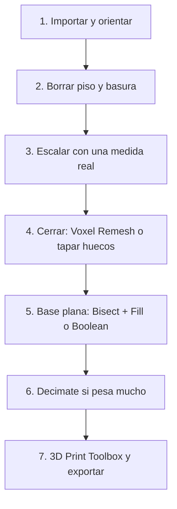

# Limpiar un escaneo y hacerlo imprimible

Parte de: [[38-Modelado-3D-Artistico/04 Escaneo 3D/_Índice Escaneo 3D|Escaneo 3D]]

> [!info] Cómo avanzar
> `progreso`: **pendiente** → **viendo** (estudiando) → **visto** (contestaste la autoevaluación sin abrir las respuestas) → **dominado** (hiciste el laboratorio o lo aplicaste de verdad).

## Contenido

### Qué es
Es el proceso para convertir la malla que entrega una app de escaneo (ver [[Fotogrametría y escaneo con iPhone]]) en un sólido que el laminador pueda imprimir. Un escaneo **casi nunca se imprime directo**: suele venir abierto por abajo (sin base), con huecos, triángulos sueltos flotando, el piso o la mesa pegados, ruido en la superficie y millones de polígonos. Además, el color viene en una **textura** (una imagen), que el STL no guarda.

### Cómo funciona
**Pasos en Blender**:



1. **Importar y orientar**: *File → Import* (glTF/GLB, FBX, PLY, OBJ, USD). Gira el modelo para que quede derecho y apoyado en Z = 0; aplica transformaciones (`Ctrl+A`).
2. **Borrar piso y basura**: en Edit Mode, selecciona islas sueltas con `L` sobre ellas o con caja (`B`) y bórralas. *Select → Select Linked* ayuda a encontrar la pieza principal; invierte la selección (`Ctrl+I`) para borrar todo lo demás.
3. **Escalar**: mide una distancia del objeto real (por ejemplo, el ancho de 80 mm). En Blender, mide esa distancia con la herramienta **Measure** y escala con `S` y el factor `real / medido`. Aplica la escala.
4. **Cerrar la malla**: lo más robusto es **Voxel Remesh** (ver [[Remesh y Dyntopo en Blender]]), que reconstruye todo como una malla cerrada. Si quieres conservar mejor el detalle, tapa los huecos a mano con `F` o *Grid Fill* y usa Remesh solo donde haya problemas.
5. **Base plana**: corta la parte de abajo con *Bisect* (Edit Mode, con *Fill* activado para cerrar el corte) o con un Boolean contra un cubo (ver [[Modificador Boolean en Blender]]). Así la pieza se apoya en la cama sin soportes.
6. **Aligerar**: **Decimate** con razón 0.3–0.5 si el archivo es enorme (ver [[Retopología básica]]).
7. **Revisar y exportar** con 3D Print Toolbox (ver [[Preparar un modelo de Blender para imprimir]] y [[Reparar mallas para impresión]]).

**Tamaño de vóxel**: el vóxel debe ser más chico que el detalle que quieres conservar. Si tras el Remesh se "derritieron" detalles finos, bájalo (por ejemplo, de 1 mm a 0.4 mm), a costa de más polígonos, o tapa los huecos a mano y aplica Remesh solo a zonas problemáticas.

### Ejemplo
Script para los pasos mecánicos (escala, remesh y corte de base) después de borrar la basura a mano:

```python
import bpy, bmesh

obj = bpy.context.active_object
medida_real = 80.0                       # mm, medido con calibrador
medida_modelo = obj.dimensions.x         # ancho actual en la escena
f = medida_real / medida_modelo
obj.scale = (f, f, f)
bpy.ops.object.transform_apply(scale=True)

obj.data.remesh_voxel_size = 0.4         # mm: más chico que el detalle a conservar
bpy.ops.object.voxel_remesh()

# Base plana: corta 1 mm por encima del punto más bajo y tapa el corte
bm = bmesh.new()
bm.from_mesh(obj.data)
z_min = min(v.co.z for v in bm.verts)
res = bmesh.ops.bisect_plane(
    bm, geom=bm.verts[:] + bm.edges[:] + bm.faces[:],
    plane_co=(0, 0, z_min + 1.0), plane_no=(0, 0, 1),
    clear_inner=True)                    # borra lo que queda debajo del plano
borde = [e for e in res["geom_cut"] if isinstance(e, bmesh.types.BMEdge)]
bmesh.ops.holes_fill(bm, edges=borde)    # cierra la base
bm.to_mesh(obj.data)
bm.free()
print(len(obj.data.polygons), "caras")
```

### Práctica en tu Centauri 2
Toma tu escaneo del [[Lab 7 - Escanear un objeto con el iPhone y dejarlo imprimible]] y haz dos versiones: Remesh de 1 mm y de 0.4 mm. Imprime ambas a escala real en PLA gris con capa de 0.16 mm y compáralas con el objeto original: verás cuánto detalle cuesta cada décima de vóxel. Si quieres el color del escaneo, una opción es pintarlo a mano (ver [[Pintura de figuras impresas]]).

### Cuándo usarlo y cuándo no
Siempre que imprimas un escaneo. Escanea y comparte **tus propios** diseños, esculturas, objetos cotidianos sin diseño protegido y piezas de la naturaleza. **No** escanees para distribuir o vender figuras de personajes con marca ni diseños de otros artistas (ver [[Personajes y marcas registradas en impresión 3D]]); y pide permiso antes de escanear a una persona.

### Errores comunes
- **Imprimir el escaneo directo**: sin base y lleno de huecos.
- **Remesh con vóxel grande**: se derrite el detalle.
- **Escalar sin medida real**.
- **Dejar islas sueltas**: el laminador las imprime como basura flotante.
- **Olvidar aplicar transformaciones** antes de exportar.

### Para profundizar
- [Manual oficial de Blender: Bisect](https://docs.blender.org/manual/en/latest/modeling/meshes/editing/mesh/bisect.html)
- [Manual oficial de Blender: Remesh](https://docs.blender.org/manual/en/latest/modeling/modifiers/generate/remesh.html)
- [Extensión 3D Print Toolbox](https://extensions.blender.org/add-ons/print3d-toolbox/)

## Autoevaluación

Contesta primero en voz alta o en papel; luego despliega la respuesta.

> [!question]- ¿Cuáles son los pasos para limpiar un escaneo en Blender?
> 1) Importar y orientar. 2) **Borrar** piso y basura (Edit Mode, selección con `L` o caja). 3) **Escalar** con una medida real. 4) Cerrar con **Voxel Remesh** (o tapar huecos con `F`/*Grid Fill*). 5) **Base plana**: cortar con Boolean o *Bisect* + llenar. 6) **Decimate** si pesa mucho. 7) 3D Print Toolbox y exportar.

> [!question]- ¿Por qué un escaneo casi nunca se puede imprimir directo?
> Suele venir abierto (sin base), con huecos, triángulos sueltos, ruido y millones de polígonos; además el color viene en la textura, que el STL no guarda.

> [!question]- Caso: tras Voxel Remesh se perdió detalle fino. ¿Qué ajustas?
> Baja el tamaño del vóxel (p. ej. de 1 mm a 0.4 mm) o tapa los huecos a mano y usa Remesh solo en zonas problemáticas.

> [!question]- ¿Qué objetos sí y qué objetos no deberías escanear para compartir?
> Sí: tus propios diseños, objetos cotidianos sin diseño protegido, esculturas propias. No: figuras de personajes con marca o diseños de otros para distribuir o vender.

## Práctica

- [[Lab 7 - Escanear un objeto con el iPhone y dejarlo imprimible]]

