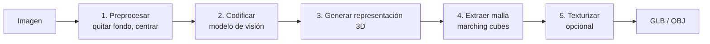

# Cómo funciona un modelo de imagen a 3D

Parte de: [[39-IA-Modelado-3D/01 Conceptos/_Índice Conceptos|Conceptos]]

> [!info] Cómo avanzar
> `progreso`: **pendiente** → **viendo** (estudiando) → **visto** (contestaste la autoevaluación sin abrir las respuestas) → **dominado** (hiciste el laboratorio o lo aplicaste de verdad).

## Contenido

### Qué es
Un modelo de **imagen a 3D** es una red neuronal entrenada con muchísimos objetos 3D y sus vistas, que aprendió a responder "si así se ve de frente, así debe ser su forma completa". Recibe una imagen de un solo objeto y devuelve una malla. Saber qué pasa por dentro te ayuda a elegir parámetros, a entender cuánta VRAM se va a usar y a reconocer de dónde vienen los defectos.

### Cómo funciona

1. **Preprocesar.** Se quita el fondo, se recorta al objeto y se redimensiona (TripoSR usa `rembg` y `--foreground-ratio 0.85`). Ver [[Quitar el fondo de una imagen]].
2. **Codificar.** Un modelo de visión (tipo DINO) convierte la imagen en un conjunto de *tokens* que describen forma, partes y material.
3. **Generar la representación 3D.** Aquí está la gran diferencia entre familias:
   - **Reconstrucción directa** (TripoSR, Stable Fast 3D): un transformer produce **en una sola pasada** un triplano o campo consultable. Rápido (segundos) y estable, pero inventa menos detalle.
   - **Difusión** (Hunyuan3D, TRELLIS): se parte de ruido en un espacio latente de formas y se "limpia" en muchos pasos (`num_inference_steps`), guiado por la imagen. Más lento y con más memoria, pero da formas más definidas.
4. **Extraer la malla.** El campo resultante se evalúa en una rejilla y se aplica marching cubes ([[Campos implícitos (SDF y ocupación)]]).
5. **Texturizar.** Algunos sistemas generan color por vértice (TripoSR) o una textura con UV (Stable Fast 3D, Hunyuan3D-Paint). Esta etapa suele ser la que más VRAM pide: en Hunyuan3D-2 el README oficial habla de unos 6 GB solo para forma y 16 GB para forma con textura.

### Ejemplo: parámetros que vas a tocar
| Parámetro | Dónde | Efecto |
|---|---|---|
| `--mc-resolution 256` | TripoSR | Resolución de la rejilla. A 512 hay 8 veces más celdas (2³): más detalle y triángulos, más tiempo y VRAM. |
| `--chunk-size 8192` | TripoSR | Cuántos puntos evalúa a la vez. Menor = menos VRAM, más lento. |
| `num_inference_steps` | Hunyuan3D | Pasos de difusión. Más pasos ayudan hasta cierto punto; luego solo cuestan tiempo. |
| `octree_resolution` | Hunyuan3D | Finura de la extracción de malla. |
| `guidance_scale` | Difusión | Cuánto obedece a la imagen frente a "inventar". |

```bash
# TripoSR con más detalle pero cuidando memoria en 6 GB
python run.py mi_figura.png --output-dir out/ --mc-resolution 384 --chunk-size 4096
```

### Más pasos no siempre es mejor
En difusión, los primeros pasos definen la forma gruesa y los últimos pulen. Pasado cierto número, la mejora es invisible y el tiempo crece en línea recta. Por eso existen variantes **destiladas**: Hunyuan3D-2mini tiene *Fast* (destilación de la guía) y *Turbo* (destilación de pasos), que logran calidad parecida con muchos menos pasos. Prueba con el valor por defecto, luego la mitad y luego el doble, y compara en Blender, no en el visor.

### Cuándo usar cada familia
- **Reconstrucción directa** para iterar rápido en tu GTX 1660 Ti: probar 10 imágenes en pocos minutos ([[TripoSR]], [[Stable Fast 3D]]).
- **Difusión** cuando la forma importa más que el tiempo: figura final, detalles definidos ([[Hunyuan3D-2mini]] solo forma en local, o [[TRELLIS]] en la nube).

### Errores comunes
1. **Creer que más pasos de difusión siempre mejoran.** Mide: muchas veces 30 y 50 pasos se ven igual.
2. **Subir resolución de malla y textura a la vez en 6 GB.** Cambia una cosa por vez y mide VRAM ([[VRAM - medirla y qué hacer cuando no alcanza]]).
3. **Culpar al modelo de un mal preprocesado.** Fondo sucio o objeto cortado arruinan cualquier modelo.
4. **Comparar modelos con imágenes distintas.** Usa las mismas 3 imágenes para todas las pruebas.

### Para profundizar
- [TripoSR en GitHub](https://github.com/VAST-AI-Research/TripoSR)
- [Hunyuan3D-2 en GitHub](https://github.com/Tencent/Hunyuan3D-2)
- [Tarjeta de Hunyuan3D-2mini](https://huggingface.co/tencent/Hunyuan3D-2mini)

## Autoevaluación

Contesta primero en voz alta o en papel; luego despliega la respuesta.

> [!question]- ¿Cuáles son las etapas típicas de imagen a 3D?
> 1) **Preprocesar**: quitar fondo, centrar y redimensionar. 2) **Codificar** la imagen con un modelo de visión. 3) **Generar** una representación 3D (triplano/NeRF en TripoSR; latentes de forma con difusión en Hunyuan3D). 4) **Extraer malla** (marching cubes). 5) Opcional: **texturizar**.

> [!question]- ¿Qué diferencia hay entre un modelo de reconstrucción directa (TripoSR) y uno de difusión (Hunyuan3D)?
> La reconstrucción directa hace una sola pasada de red: es rápida y estable pero inventa menos detalle. La difusión hace muchos pasos de *denoising* (`num_inference_steps`): es más lenta y usa más memoria, pero suele dar formas más definidas.

> [!question]- Caso: subes `--mc-resolution` de 256 a 512. ¿Qué cambia?
> La rejilla de marching cubes tiene 8 veces más celdas (2³): más detalle y más triángulos, pero más VRAM y tiempo. En 6 GB súbelo con cuidado y baja `--chunk-size` si se agota la memoria.

> [!question]- Error común: creer que más pasos de difusión siempre mejoran el modelo.
> Pasado cierto punto solo aumentan el tiempo. Las versiones *Turbo* o *Fast* de Hunyuan3D-2mini están destiladas para usar menos pasos con calidad parecida.

## Práctica

- [[Lab 3 - Hunyuan3D-2mini en poca VRAM vs TripoSR]]

