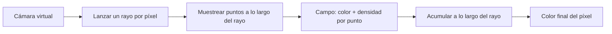

# NeRF (campos de radiancia neuronal)

Parte de: [[Representaciones 3D (malla, NeRF, Gaussian splatting y campos implícitos)]]

> [!info] Cómo avanzar
> `progreso`: **pendiente** → **viendo** (estudiando) → **visto** (contestaste la autoevaluación sin abrir las respuestas) → **dominado** (hiciste el laboratorio o lo aplicaste de verdad).

## Contenido

### Qué es
Un **NeRF** (*Neural Radiance Field*, campo de radiancia neuronal) es una red neuronal que representa una escena 3D como una función: le das un punto del espacio (x, y, z) y una dirección de vista, y te devuelve **un color y una densidad**. No guarda triángulos; guarda "cómo se ve el espacio" desde cualquier ángulo. Se presentó en 2020 para generar vistas nuevas de una escena a partir de muchas fotos, y la idea de "campo consultable" pasó a muchos modelos de imagen a 3D.

### Cómo funciona

1. **Rayos:** para dibujar una imagen, por cada píxel se lanza un rayo desde la cámara.
2. **Muestreo:** a lo largo del rayo se toman muchos puntos.
3. **Consulta:** en cada punto, el campo responde cuánta "materia" hay (densidad) y de qué color.
4. **Acumulación:** se combinan esos valores: donde la densidad sube rápido, ahí está la superficie visible.

El NeRF original se **entrena** para cada escena con decenas de fotos y tarda mucho. Los modelos de imagen a 3D modernos, en cambio, **predicen** en una sola pasada una estructura parecida a partir de una imagen.

### Relación con TripoSR
TripoSR usa un transformer que, a partir de tu imagen, predice un **triplano**: tres planos de características (XY, XZ, YZ). Para saber qué hay en un punto 3D se proyecta en los tres planos, se combinan las características y una pequeña red devuelve densidad y color, igual que un NeRF. Por eso su `run.py` tiene la opción `--render`, que guarda un video girando alrededor del objeto renderizado como campo de radiancia. La malla que exporta se obtiene evaluando la **densidad** en una rejilla y aplicando **marching cubes** (`--mc-resolution`).

### Ejemplo
```bash
# Genera la malla y además un video renderizado con el campo de radiancia
python run.py examples/chair.png --output-dir output/ --render
```
En `output/0/` encontrarás la malla y un video. Si el video se ve bien pero la malla tiene huecos o ruido, el problema está en la **extracción** (umbral y resolución), no en lo que el modelo "entendió". Probar `--mc-resolution 320` puede cerrar detalles delgados, a cambio de más memoria.

### Por qué un NeRF no sirve tal cual para imprimir
- **No hay superficie explícita.** El campo dice "aquí hay densidad 0.7"; tú decides en qué umbral empieza el objeto. Un umbral bajo engorda la pieza y pega ruido; uno alto la adelgaza y abre huecos.
- **El color depende de la vista.** Los reflejos se "hornean" de forma rara al pasar a color por vértice.
- **Zonas poco vistas son ruido.** Detrás del objeto, con una sola imagen, la densidad es una suposición.

Por eso, después de extraer la malla, siempre la cierras y limpias en Blender ([[Limpiar un modelo generado por IA en Blender]]).

### Cuándo usarlo y cuándo no
- **Úsalo** (o un modelo basado en él) cuando quieras rapidez: TripoSR genera en segundos con 6 GB.
- **No** lo uses como formato de entrega: lo que entregas siempre es la malla. Para escanear objetos reales hoy es más común Gaussian splatting o fotogrametría ([[Gaussian splatting en IA 3D]], [[Fotogrametría y escaneo con iPhone]]).

### Errores comunes
1. **Juzgar la calidad por el render y no por la malla.** El video puede verse bien y la malla tener huecos. Revisa la malla en Blender.
2. **Subir la resolución sin ajustar memoria.** Más resolución de marching cubes = más VRAM; baja `--chunk-size` si falla.
3. **Esperar textura limpia.** El color sale por vértice y algo borroso; para imprimir en un color o pintar con CANVAS no importa.

### Para profundizar
- [Proyecto NeRF (Mildenhall et al.)](https://matthewtancik.com/nerf)
- [Artículo de NeRF en arXiv](https://arxiv.org/abs/2003.08934v2)
- [run.py de TripoSR](https://github.com/VAST-AI-Research/TripoSR/blob/main/run.py)

## Autoevaluación

Contesta primero en voz alta o en papel; luego despliega la respuesta.

> [!question]- ¿Qué es un NeRF?
> Una red neuronal que, para cada punto 3D y dirección de vista, devuelve **color y densidad**. Al acumular eso a lo largo de rayos se renderizan vistas nuevas del objeto.

> [!question]- ¿Qué relación tiene TripoSR con NeRF?
> TripoSR predice una representación tipo *triplano* que se consulta como un campo de radiancia; su opción `--render` guarda un video renderizado con NeRF y la malla se extrae con marching cubes ([run.py](https://github.com/VAST-AI-Research/TripoSR/blob/main/run.py)).

> [!question]- ¿Por qué un NeRF no sirve tal cual para imprimir?
> Porque no tiene una superficie explícita: hay que extraerla umbralizando la densidad, y el resultado puede tener ruido o huecos que luego limpias en Blender.

