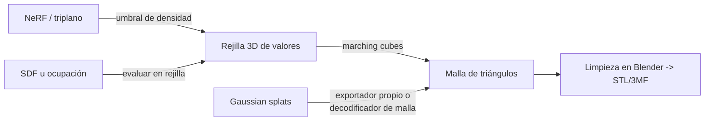

# Representaciones 3D (malla, NeRF, Gaussian splatting y campos implícitos)

Parte de: [[39-IA-Modelado-3D/01 Conceptos/_Índice Conceptos|Conceptos]]

> [!info] Cómo avanzar
> `progreso`: **pendiente** → **viendo** (estudiando) → **visto** (contestaste la autoevaluación sin abrir las respuestas) → **dominado** (hiciste el laboratorio o lo aplicaste de verdad).

## Contenido

### Qué es
Una **representación 3D** es la manera en que una computadora guarda la forma (y a veces el color) de un objeto. Los modelos de IA trabajan internamente con representaciones que les resultan fáciles de aprender, pero tu impresora solo entiende una: la **malla** de triángulos cerrada. Este tema es el mapa de las cuatro que vas a encontrar y de cómo se convierten entre sí; cada una tiene su propia nota con el detalle.

### Las cuatro representaciones
| Representación | Qué guarda | Dónde la ves | ¿Se lamina directo? |
|---|---|---|---|
| [[Mallas poligonales en IA 3D]] | Vértices y triángulos explícitos | Salida OBJ, GLB, STL, 3MF | Sí, si está cerrada |
| [[NeRF (campos de radiancia neuronal)]] | Una red que da color y densidad por punto | Interior de TripoSR (triplano) | No |
| [[Gaussian splatting en IA 3D]] | Millones de manchas elipsoidales con color | Apps de escaneo, salida de TRELLIS | No |
| [[Campos implícitos (SDF y ocupación)]] | Una función "dentro/fuera" o distancia | Interior de Hunyuan3D y otros | No |

Las tres últimas son **implícitas o volumétricas**: no dicen dónde está la superficie, sino cómo es el espacio. La malla es **explícita**: lista la superficie triángulo por triángulo.

### Cómo funciona la conversión

1. Se crea una **rejilla 3D** (por ejemplo 256 × 256 × 256 puntos) dentro de la caja que contiene al objeto.
2. En cada punto se pregunta al campo: ¿cuánta densidad hay? ¿qué distancia hay a la superficie? ¿está dentro?
3. El algoritmo **marching cubes** recorre cada cubito de la rejilla y, según qué esquinas quedan dentro y cuáles fuera, coloca uno o varios triángulos. El resultado es una superficie continua.
4. La **resolución** de la rejilla manda: más celdas = más detalle, más triángulos, más VRAM. En TripoSR la controlas con `--mc-resolution` (256 por defecto); pasar a 512 multiplica por 8 las celdas.

Los splats son distintos: no hay un campo que se pueda umbralizar de forma limpia, así que la herramienta debe traer su propio exportador de malla. TRELLIS, por ejemplo, decodifica su representación latente **tanto** a gaussianas como a una malla GLB.

### Ejemplo
Generas una figura en el Space de TRELLIS y la página te ofrece descargar un `.ply` de gaussianas y un `.glb`. El `.ply` se ve espectacular en el visor, pero si lo abres en ElegooSlicer no hay superficie que laminar: es una nube de puntos con atributos. Descargas el **GLB**, lo importas en Blender, lo cierras con Voxel Remesh, lo escalas a 80 mm y exportas STL. Con el escaneo del iPhone pasa igual: si la app te da splat y malla, la que viaja a la impresora es la malla.

### Cuándo importa cada una
- **Para imprimir:** solo la malla. Todo lo demás es un paso intermedio.
- **Para ver o compartir en pantalla:** splats y NeRF se ven más realistas (reflejos, transparencias suaves).
- **Para entender errores:** saber que el modelo trabajó con un campo implícito explica por qué la malla sale "cerrada pero con piezas flotantes" o con escalones típicos de marching cubes ([[Errores típicos de los modelos generados por IA]]).

### Errores comunes
1. **Llevar un `.ply` de splats al laminador.** No es una superficie; exporta o convierte a malla.
2. **Subir la resolución de marching cubes sin medir.** 512³ son más de 134 millones de celdas; en 6 GB puede agotar la memoria. Baja `--chunk-size` o deja 256.
3. **Confundir `.ply` con un solo tipo de dato.** PLY puede guardar mallas o nubes de puntos; revisa qué contiene antes de importarlo.
4. **Creer que más triángulos es más detalle impreso.** La boquilla de 0.4 mm limita el detalle real; ver [[Mallas poligonales en IA 3D]].

### Para profundizar
- [Marching cubes (Wikipedia)](https://en.wikipedia.org/wiki/Marching_cubes)
- [Proyecto NeRF](https://matthewtancik.com/nerf)
- [Implementación oficial de 3D Gaussian Splatting](https://github.com/graphdeco-inria/gaussian-splatting)
- [TRELLIS en GitHub](https://github.com/microsoft/TRELLIS)

## Subtemas

- [[Mallas poligonales en IA 3D]]
- [[NeRF (campos de radiancia neuronal)]]
- [[Gaussian splatting en IA 3D]]
- [[Campos implícitos (SDF y ocupación)]]

## Autoevaluación

Contesta primero en voz alta o en papel; luego despliega la respuesta.

> [!question]- ¿Qué representación necesitas para imprimir y por qué?
> Una **malla** cerrada (triángulos) porque es lo que leen los laminadores (STL, 3MF, OBJ). NeRF, splats y campos implícitos se deben convertir a malla antes de imprimir.

> [!question]- ¿Cómo se pasa de un campo implícito o NeRF a una malla?
> Se evalúa el campo en una rejilla 3D y se extrae la superficie con **marching cubes** (o variantes como FlexiCubes). La resolución de esa rejilla define el detalle: en TripoSR es la opción `--mc-resolution` (por defecto 256).

> [!question]- Caso: un modelo te entrega un archivo `.ply` de Gaussian splatting. ¿Lo puedes laminar?
> No directamente: un splat es una nube de manchas gaussianas con color, no una superficie cerrada. Necesitas que la herramienta exporte una malla (TRELLIS, por ejemplo, entrega gaussianas **y** malla GLB) o convertirlo con otra herramienta.

## Progreso de los subtemas

```base
filters:
  and:
    - file.inFolder("39-IA-Modelado-3D/01 Conceptos/Representaciones 3D (malla, NeRF, Gaussian splatting y campos implícitos)")
    - file.name != "Representaciones 3D (malla, NeRF, Gaussian splatting y campos implícitos)"
views:
  - type: table
    name: Progreso
    order:
      - file.name
      - progreso
      - nivel
```
